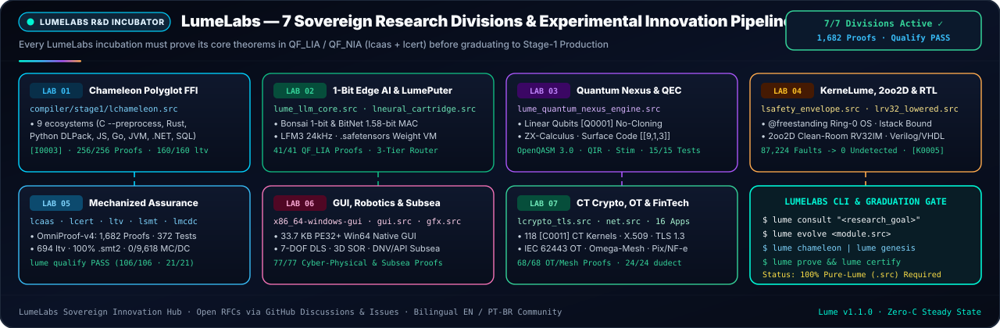

<h1>
  
  LumeLabs — Official R&amp;D Incubator &amp; Experimental Innovation Hub
</h1>

**Where High-Risk Systems, Polyglot FFI, 1-Bit Edge AI, Fault-Tolerant Quantum Computing, and Mechanized Proof Theory Graduate into 100% Pure-Lume Production (`stage2 == stage3`)**

<br clear="left"/>

<div align="center">

[](#the-7-lumelabs-research-divisions)
[](#the-lumelabs-graduation-protocol-rfc--proof--stage-1)
[](docs/PROJECT_STATE.md)
[](COMMUNITY.md)

[**Home (`README.md`)**](README.md) · [**Projects & Roadmap (`PROJECTS.md`)**](PROJECTS.md) · [**Community (`COMMUNITY.md`)**](COMMUNITY.md) · [**Wiki**](https://github.com/OmegaSoftDLL/lume/wiki) · [**GitHub Discussions**](https://github.com/OmegaSoftDLL/lume/discussions) · [**Manual (`EN`)**](docs/LUME_MANUAL_EN.md) · [**Manual (`PT-BR`)**](docs/LUME_MANUAL_PT_BR.md)

<br/>



</div>

---

## 1. Mission & Sovereign Charter


**LumeLabs** is the official research, incubation, and advanced systems engineering arm of the **Lume Programming Language (`v1.1.0`, Edition 2026)**.

Unlike traditional language incubators where experimental libraries rely on unverified C/C++/Python glue or unstable compiler plugins, every LumeLabs project adheres to three non-negotiable rules:

1. **100% Native Lume (`.src`) Implementation:** Zero Python scripts, zero Rust dependencies, and zero C seed expansion (`"Lume gera Lume 100%"`).
2. **Compile-Time Mathematical Proof (`QF_LIA` / `QF_NIA` / `QF_BV` / Separation Logic):** Every subsystem must state its safety invariants via `requires`, `ensures`, and universal `law` theorems verified by `lcaas` and certified by the standalone `lcert` kernel (`Lume Verified ✓`).
3. **Self-Hosted Fixpoint Preservation (`stage2 == stage3`):** Graduating a LumeLabs module into `compiler/stage1/` requires passing the bit-identical triple bootstrap, the **85/85 Claude Opus 5.5 + Red Team (R1, R2 & R3) Audit Gate** (`tests/harness/claude_audit_gate.src`), and the **15/15 Embedded Compiler Proof Batteries** (`lume self-prove`, `557` obligations, `154` unit tests).

> 🇧🇷 **Comunidade em Português (`pt-BR`):** Pesquisadores e desenvolvedores podem submeter propostas do LumeLabs, abrir discussões técnicas e consultar o manual nativo em português (`lume manual --pt` ou [`docs/LUME_MANUAL_PT_BR.md`](docs/LUME_MANUAL_PT_BR.md)).

<br clear="right"/>

---

## 2. The 7 LumeLabs Research Divisions

### Lab 01 Spotlight — Universal Chameleon Polyglot & Singularity Boundary $\Omega$ (`lchameleon.src`)


**Lab 01 (`compiler/stage1/lchameleon.src`)** embodies Lumi's adaptive nature: it synthesizes fail-closed **`[I0003]` `QF_LIA` refinement adapters** (`unverified[T] -> verified[T]` under `/ {ffi}`, `68/68` proven obligations, `12/12` unit tests) across **9 foreign ecosystems** (`c_abi`, `rust_cdylib`, `python_capi` DLPack zero-copy tensors, `node_napi_wasm`, `go_cshared`, `java_jni`, `dotnet_pinvoke`, `sql_relational`, and `openapi_rpc`), paired with the **2nd-Order Dynamical Transition Engine, Singularity Boundary $\Omega$ & Bayesian SPC/CUSUM/PAVA Analytics** (`lume singularity` / `lume ote`: counter-phase theorem $\tau_{\max}=T_m/4$, Operational Power Triangle $S, P, Q, \cos\Phi$, Nyquist guard, 9 physical-leverage-ordered normative prescriptions, `spc_beta_binomial_posterior_num`, `spc_cusum_upper_step_milli`, `ops_cpm_total_float_hours`, `analytics_k_anonymity_release_ok`, `analytics_pava_monotonic_pair_hi`).

<br clear="right"/>

| Division | Core Engine & Source | Verified Obligations & Key Capabilities | CLI Entrypoint |
| :--- | :--- | :--- | :--- |
| **Lab 01 · Chameleon Polyglot & Singularity $\Omega$** | [`compiler/stage1/lchameleon.src`](compiler/stage1/lchameleon.src) | **`68/68` proven obligations (`12/12` tests)** · Bridges 9 foreign ecosystems via fail-closed `[I0003]` `unverified[T] -> verified[T]` contracts + **2nd-Order Dynamical Transition Engine, Singularity Boundary $\Omega$ & Bayesian SPC / CUSUM / CPM / $k$-Anonymous PAVA** ($\tau_{\max}=T_m/4$, Power Triangle, 9 leverage prescriptions) | `lume chameleon [eco]` / `lume singularity` / `lume adapt <eco>` / `lume morph <file>` |
| **Lab 02 · Sovereign 1-Bit/Ternary Edge AI & Liquid Audio** | [`compiler/stage1/lume_llm_core.src`](compiler/stage1/lume_llm_core.src) | **`21/21` proven obligations** · Bonsai 1-bit & BitNet 1.58-bit ternary MAC (`{-1, 0, +1}`), 5-trit byte packing, Liquid AI `LFM3` $O(1)$ state-space recurrence, `LiquidCodec` 24 kHz audio frame bounds, `DSpark` speculative decoding, `Colibri` MoE SSD streaming guard (`8 GB` RAM cap) | `lume test compiler/stage1/lume_llm_core.src` |
| **Lab 03 · Quantum Nexus & Fault-Tolerant QEC** | [`compiler/stage1/lume_quantum_nexus_engine.src`](compiler/stage1/lume_quantum_nexus_engine.src) | **Linear Qubits (`[Q0001]` No-Cloning)** · `[Q0002]` Measurement Collapse, `[Q0003]` Uncomputation, `[Q0004]` Connectivity Routing, ZX-Calculus spider fusion, Rotated Surface Code `[[9,1,3]]` QEC, and 6 targets (`OpenQASM 3.0`, `QIR`, `Quil`, `IQM`, `Stim`, `QEC`) | `lume build <q.lume> --target openqasm3` |
| **Lab 04 · KerneLume Ring-0 Bare-Metal OS & Hardware Synthesis** | [`apps/lume_os/`](apps/lume_os/) · [`compiler/stage1/ltarget.src`](compiler/stage1/ltarget.src) | **`@freestanding` Zero-GC Ring-0 OS** · Bootable MBR -> 64-bit Long Mode `.kernel`, `[K0005]` W^X DMA protection, `[K0006]` interrupt stack bounds, `[V0002]` WCET cycle bounds, plus synthesizable `Verilog-2005`, `VHDL-2008`, and `openTPU` systolic array ISA | `lume build <k.lume> --target x86_64-kernel` |
| **Lab 05 · Mechanized Soundness & Proof Certificates** | [`compiler/stage1/lcaas.src`](compiler/stage1/lcaas.src) · [`compiler/stage1/lcert.src`](compiler/stage1/lcert.src) · [`formal/lean/LumeCore.lean`](formal/lean/LumeCore.lean) | **`557/557` compiler obligations (`154` tests)** · Fourier-Motzkin `QF_LIA` with cutting planes, degree-2 Positivstellensatz `QF_NIA`, `QF_BV` bitvector bounds, Separation Logic frame rules, `[C0009]` `@secret` constant-time taint proofs, and FIPS 180-4 SHA-256 `.cert` artifacts | `lume prove <file.src>` / `lume certify <file.src>` / `lume self-prove` |
| **Lab 06 · Native Desktop GUI, Cyber-Physical UFE & Subsea Physics** | [`compiler/stage1/ltarget.src`](compiler/stage1/ltarget.src) · [`compiler/stage1/gui.src`](compiler/stage1/gui.src) · [`compiler/stage1/gfx.src`](compiler/stage1/gfx.src) | **33,792-byte Win64 Native GUI (`PE32+`) & Unified Field / Subsea Engine (`77/77` proofs)** · Declarative `@ui-layout` (`1412694337` / `1412698308`, `ui_split_conservation_law`), 7-DOF DLS kinematics, 3D Laplace SOR, $5\sigma$ + Joseph EKF, IAPWS-IF97 + Carnot, 1 kHz `LatencyMonitor`, Subsea Catenary, VIV, Palmgren-Miner, DNV Heavy-Lift DAF, Bühlmann ZH-L16C, Well-Kill & ASME B31G | `lume build <app.src> --target x86_64-windows-gui` / `lume unified-field` |
| **Lab 07 · Applied Sovereign FinTech, IEC 62443 OT, Conduite & Omega-Mesh** | [`compiler/stage1/net.src`](compiler/stage1/net.src) · [`examples/apps/`](examples/apps/) | **`68/68` NetSentinel IEC 62443 / Conduite / Omega-Mesh proofs + `81/81` capstone proofs across 8 apps** · Purdue `L0..L4`/`L3.5` DMZ conduit guard, Conduite HA/GOOSE/storm, Omega-Mesh P2P/DHT/Raft/TOFU (`lume iec62443` / `lume conduite` / `lume omega-mesh`), `dfe_pix_bacen` (`11/11`), `pix_fraud_trace` (`9/9`), `brasil_public_id` (`9/9`), `zero_breach_forensics` (`8/8`), `sentry_uav_guard` (`9/9`), `verified_accounting` (`7/7`), `omniroute_guard` (`8/8`), `sovereign_llm_router` (`20/20`) | `lume net-sentinel` / `lume prove examples/apps/<app>/main.src` |

---

## 3. Running LumeLabs Experiments Locally

Every Lume `v1.1.0` installation ships with the complete LumeLabs engine suite built in:

```sh
# 1. Consult the Sovereign Compiler-as-Oracle & Hyperdimensional Memory
lume consult "design zero-copy rust cdylib tensor bridge with [I0003] bounds"

# 2. Run the Universal Chameleon Polyglot Interop Engine (Lab 01)
lume chameleon
lume chameleon rust
lume chameleon python
lume adapt rust
lume morph legacy_module.py

# 3. Prove & Certify LumeLabs Domain Engines (Labs 01, 02, 05, 07)
lume prove compiler/stage1/lchameleon.src
lume certify compiler/stage1/lchameleon.src
lume test compiler/stage1/lchameleon.src
lume test compiler/stage1/lume_llm_core.src

# 4. Run Autonomous Proof-Guided Program Evolution & Neural Kernel Synthesis
lume evolve examples/verified_showcase.src
lume neural-kernel
lume genesis "bounded ring buffer with QF_LIA head/tail invariants"

# 5. Execute the Full Embedded Compiler Self-Proof Suite (15 Batteries, 557 Obligations, 154 Tests)
lume unified-field
lume singularity
lume net-sentinel
lume self-prove
```

---

## 4. The LumeLabs Graduation Protocol (`RFC -> Proof -> Stage-1`)

Every experimental idea in LumeLabs progresses through four deterministic lifecycle stages tracked on our [**Project Board & Roadmap (`PROJECTS.md`)**](PROJECTS.md):

1. **Stage I — Proposal (`LumeLabs RFC`):**
   - Open a proposal using the [LumeLabs RFC Issue Template](.github/ISSUE_TEMPLATE/lumelabs_proposal.md) or in [GitHub Discussions (`LumeLabs R&D`)](https://github.com/OmegaSoftDLL/lume/discussions).
   - Define the target problem, mathematical invariants (`requires`/`ensures`/`law`), and why Lume's formulation is strictly superior to prior art.
2. **Stage II — Prototype (`examples/apps/` or `compiler/stage1/l*.src`):**
   - Implement 100% in pure Lume (`.src`, pure LF `\n`, formatted via `lume fmt`).
   - Achieve `100%` proven status under `lume prove` and `lume certify` (`0` unproven obligations, `0` failed unit tests).
3. **Stage III — Adversarial Red-Team & Differential Fuzzing:**
   - Add negative conformance tests verifying that invalid inputs or contract violations fail closed with a deterministic diagnostic code (such as `[I0003]`, `[V0001]`, `[C0009]`, or `[E0200]`).
   - Pass the 4-way differential fuzzer (`lumec` ELF64 vs `LUME_GC_STRESS=1` vs Stage-0 `lume0` vs `lcaas`) in `tests/harness/claude_audit_gate.src`.
4. **Stage IV — Stage-1 Graduation & Manifest Lock:**
   - Integrate into `compiler/stage1/`, verify `stage2 == stage3` bit-identical bootstrap, update bilingual manuals (`lmanual.src` -> `LUME_MANUAL_EN.md` + `LUME_MANUAL_PT_BR.md`), and lock into `MANIFEST.sha256`.
