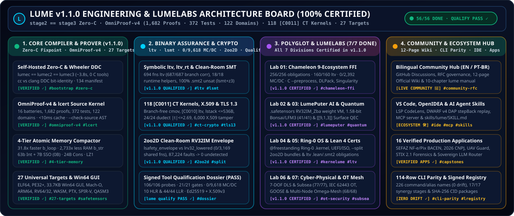

# Lume Sovereign Project Board & Engineering Roadmap (`PROJECTS.md`)
### **Quadro Oficial de Projetos, Milestones e Horizonte LumeLabs (`EN` / `PT-BR`)**

 

Welcome to the official **Lume Engineering Project Board & Roadmap**. Every compiler pass, theorem prover extension, hardware target, and domain engine in Lume is tracked transparently through verifiable milestones, machine-checkable proof obligations (`./lume self-prove`), and **LumeLabs** R&D tracks.

Bem-vindo ao **Quadro Oficial de Projetos e Engenharia da Linguagem Lume**. Cada fase do compilador auto-hospedado (`stage2 == stage3`), do provador formal `QF_LIA`, dos 27 alvos de compilação e dos motores soberanos é governada por baterias formais verificáveis em CI.

  

---

## 🧭 1. Live GitHub Project Links / Links Oficiais no GitHub

| Portal | Description (`EN` / `PT-BR`) | Direct Link |
|---|---|---|
| **📌 GitHub Milestones** | Track `v1.0.0` (Foundation), `v1.1.0` (Certified Release), and `v1.2.0` (LumeLabs Horizon) | [github.com/OmegaSoftDLL/lume/milestones](https://github.com/OmegaSoftDLL/lume/milestones) |
| **📋 Roadmap Issues** | Filter by `#lumelabs`, `#chameleon-polyglot`, `#formal-verification`, `#27-targets`, `#memory-compactor` | [github.com/OmegaSoftDLL/lume/issues](https://github.com/OmegaSoftDLL/lume/issues) |
| **💬 Community Discussions** | Official bilingual (`EN` / `PT-BR`) forum, Announcements, LumeLabs RFCs & Show and Tell | [github.com/OmegaSoftDLL/lume/discussions](https://github.com/OmegaSoftDLL/lume/discussions) |
| **🔬 LumeLabs R&D Incubator** | The 7 Sovereign Research Divisions (`Lab 01` to `Lab 07`) & Experimental Graduation Pipeline | [`LUMELABS.md`](LUMELABS.md) · [`docs/LUMELABS.md`](docs/LUMELABS.md) |
| **🤝 Community & Governance** | Code of Conduct, Contribution Standards, Constitutional Laws & RFC Workflow | [`COMMUNITY.md`](COMMUNITY.md) · [`docs/COMMUNITY.md`](docs/COMMUNITY.md) |
| **📚 Official Lume Wiki** | 10 comprehensive bilingual reference pages (Quickstart, Architecture, Prover, Memory, Chameleon, Targets) | [github.com/OmegaSoftDLL/lume/wiki](https://github.com/OmegaSoftDLL/lume/wiki) |

---

## 🏛️ 2. Milestone Architecture & Delivery Matrix

### ✅ Milestone 1: `v1.0.0` — Sovereign Zero-C Self-Hosted Foundation *(Shipped & Closed)*
- **Link:** [Milestone #1 on GitHub](https://github.com/OmegaSoftDLL/lume/milestone/1)
- **Tracker Issue:** [#26 — `[v1.0.0 Shipped] Self-Hosted Zero-C Steady State (stage2 == stage3) & 27 Universal Targets`](https://github.com/OmegaSoftDLL/lume/issues/26)
- **Key Deliverables:**
  - **100% Self-Hosted Compiler Pipeline (`compiler/stage1/`):** Lexer (`01_lexer.src`), Parser (`02_parser.src`), Resolver & Type/Effect/Ownership Checker (`03_resolver.src`), Optimizer & SRA (`04_opt.src`), Native SysV AMD64 Codegen (`05_codegen.src`), Runtime Helpers (`06_runtime.src`), and Driver (`07_driver.src`).
  - **Zero-C Assembler & Linker (`lasm.src`) + Module Bundler (`lmod.src`):** Direct emission of native executables without `gcc`, `clang`, `as`, or `ld`, achieving bit-identical `stage2 == stage3` fixpoint in **~3.8 seconds**.
  - **27 Orthogonal Compilation Targets (`ltarget.src`):** `x86_64-linux-elf`, `aarch64-linux-elf`, `riscv64-linux-elf`, `x86_64-windows-pe`, `x86_64-windows-gui`, `x86_64-windows-gui-protected`, `aarch64-macos-macho`, `x86_64-macos-macho`, `aarch64-android-elf`, `aarch64-ios-macho`, `x86_64-uefi-pe`, `wasm32-wasi`, `wasm32-web-dom`, `nvptx64-nvidia-cuda`, `spirv64-vulkan-compute`, `arm-none-cortexm`, `avr-none-elf`, `xtensa-esp32-elf`, `verilog-rtl`, `vhdl-rtl`, `qasm3-quantum`, `dna-quaternary`, and one-command `apk`/`ipa`/`iso`/`uefi` packagers.

---

### 🏆 Milestone 2: `v1.1.0` — Atomic Memory Compactor, 85/85 Audit, Win64 GUI & 9-Ecosystem Chameleon FFI *(Certified Active Release)*
- **Link:** [Milestone #2 on GitHub](https://github.com/OmegaSoftDLL/lume/milestone/2)
- **Tracker Issues:**
  - [#27 — `[v1.1.0 Certified] 4-Tier Atomic Memory Compactor (31.8x Reduction) & 85/85 Audit Gate`](https://github.com/OmegaSoftDLL/lume/issues/27)
  - [#28 — `[v1.1.0 Certified] Universal Chameleon Polyglot Interop (9 Ecosystems) & Clean Win64 PE32+ GUI (Lumi Icon)`](https://github.com/OmegaSoftDLL/lume/issues/28)
- **Key Deliverables:**
  - **Universal Chameleon Polyglot Interop & Singularity Transition Engine (`compiler/stage1/lchameleon.src`):**
    - Bridges **9 foreign ecosystems** (`c_abi`, `rust_cdylib`, `python_capi` with zero-copy DLPack tensors, `node_napi_wasm`, `go_cshared`, `java_jni`, `dotnet_pinvoke`, `sql_relational`, `openapi_rpc`).
    - Enforces fail-closed `[I0003]` boundary contracts (`unverified[T] -> verified[T]` under `/ {ffi}`) and embeds the **2nd-Order Dynamical Transition Engine & Singularity Boundary $\Omega$** (`lume singularity` / `lume ote`: counter-phase theorem $\tau_{\max}=T_m/4$, Operational Power Triangle $S, P, Q, \cos\Phi$, Nyquist aliasing guard, cascade $3\times$ bandwidth decoupling, quantitative $\zeta$ & $K_p$ retuning, and 9 physical-leverage-ordered prescriptions) with **`63/63` proven `QF_LIA` obligations** and **`12/12` unit tests**.
    - Full CLI (`lume chameleon`, `lume camaleao`, `lume polyglot`, `lume ffi-bridge`, `lume singularity`, `lume ote`, `lume adapt <eco>`, `lume morph <file>`), REPL (`:chameleon`, `:camaleao`, `:ufe`, `:singularity`, `:iec62443`), and LSP hover/completion support.
  - **Sovereign Cyber-Physical Unified Field Engine (`std.gfx`) & NetSentinel IEC 62443 OT Guard (`std.net`):**
    - **Unified Field Engine (`lume unified-field` / `lume ufe` — `35/35` proofs, `12/12` tests):** 7-DOF DLS singularity-free kinematics, 3D Harmonic Laplace Red-Black SOR solver & maximum principle, GNRON swirl attenuation, capsule self-collision, IEEE-754 finite register guard, $5\sigma$ Mahalanobis + Joseph EKF, valve stiction + RUL prognostics, multi-robot swarm separation, IAPWS-IF97 steam regions + Carnot bound, and 1 kHz `LatencyMonitor` with 100-cycle hysteresis.
    - **NetSentinel IEC 62443 (`lume net-sentinel` / `lume iec62443` — `38/38` proofs, `12/12` tests):** Purdue `L0..L4` & DMZ `L3.5` conduit enforcement, OT default-drop firewall audit, structural read-only DCS guard (`ot_readonly_dcs_guard`), tri-state telemetry quality, and finite `1e12` sentinel clamping.
  - **4-Tier Atomic Memory Compactor (`31.8×` Peak RAM Reduction):**
    - Stage 0 `.rodata` content-addressed deduplication, Level 1 64-bit NaN-boxed register words, Level 2 16-byte micro-cells & 8-byte string slices, and Level 3 `LZ1` cold-arena freeze/thaw (`421.4 MB -> 13.2 MB` peak RSS).
  - **Clean Generic Win64 Native PE32+ GUI & Official Lumi Mascot Icon (`compiler/stage1/ltarget.src`):**
    - 33,792-byte native `PE32+` Windows GUI (`Subsystem 2`) with embedded `16x16` 32-bit BGRA `RT_ICON` (`Type=3, ID=1`) + `RT_GROUP_ICON` (`Type=14, ID=1`) of **Lumi — The Sovereign Bioluminescent Chameleon**, `hMenu=0`, `Segoe UI -12` font, wide toolbar buttons, and 4 resizable/scrollable child panes.
  - **85/85 Claude Opus 5.5 + Sovereign Red Team Rounds 1, 2 & 3 Remediation (`tests/harness/claude_audit_gate.src`):**
    - Sound negative modulo in `QF_LIA`, wrapping `+%`/`-%`/`*%` opacity, 64-bit coefficient overflow guards, fail-closed contract parser (`[V0001]`), Perceus alias safety, `/ pure` capability isolation (`[E0200]`), `@secret` constant-time taint (`[C0009]`), and the 100%-Lume **4-Way Differential Fuzzer** (`lumec` ELF64 vs `LUME_GC_STRESS=1` vs Stage-0 `lume0` vs `lcaas`).

---

### 🔬 Milestone 3: `v1.2.0` — LumeLabs Horizon: Multi-Node Sovereign AI, Post-Quantum & Formal OS Verification *(Active R&D)*
- **Link:** [Milestone #3 on GitHub](https://github.com/OmegaSoftDLL/lume/milestone/3)
- **Active Tracker Issues:**
  - [#29 — `[LumeLabs v1.2.0] Lab 01 & 02: Zero-Copy GPU DLPack Tensor Bridge & Distributed 1.58-Bit Ternary AI Mesh`](https://github.com/OmegaSoftDLL/lume/issues/29)
  - [#30 — `[LumeLabs v1.2.0] Lab 03, 04 & 05: Fault-Tolerant Quantum Surface Code, KerneLume SMP/IOMMU & Lean 4 Metatheory`](https://github.com/OmegaSoftDLL/lume/issues/30)
- **Research Tracks (See [`LUMELABS.md`](LUMELABS.md) for full details):**
  1. **Lab 01 — Polyglot Zero-Copy Arrow & Multi-GPU DLPack Bridges:** Extending `lchameleon.src` with Apache Arrow columnar zero-copy descriptors and multi-stream CUDA/Vulkan synchronization proofs.
  2. **Lab 02 — Distributed 1.58-Bit Ternary AI & LFM3 Real-Time Voice Mesh:** Scaling `lume_llm_core.src` (`Bonsai` 1-bit / `BitNet b1.58` + `LFM3` 24 kHz `LiquidCodec` + `Colibri` MoE SSD guard) across multi-node edge clusters.
  3. **Lab 03 — Fault-Tolerant Quantum Surface Codes (`d = 5, 7`) & Hardware Pulse Compilation:** Scaling `lume_quantum_nexus_engine.src` (`Silq` `qfree`, `QuiZX` spider fusion, `Stim` tableau, and `[[d^2, 1, d]]` surface code syndrome decoding).
  4. **Lab 04 — `KerneLume` Bare-Metal SMP Multicore & IOMMU Ring-0 OS Drivers:** Expanding `@freestanding` hardware capabilities (`[K0005]` DMA W^X and `[K0006]` stack bounds) to NVMe, VirtIO-Net, and APIC/IOMMU isolation.
  5. **Lab 05 — Mechanized Lean 4 Metatheory (`proofs/lean4/`):** Connecting `lcert.src` Ed25519 proof certificates directly to Lean 4 proof terms for end-to-end mechanized soundness.

---

## 📊 3. Master Verification & Gate Matrix (`./lume self-prove`)

Every card moved to **Shipped & Certified** on the Lume Project Board must pass the 15 embedded verification batteries in `./lume self-prove` (`LumeCompiler-Embedded-OmniProof-v3`) and the native CI gates:

| Gate / Battery | Source Artifact | Verified Obligations / Tests | Status |
|---|---|---|---|
| **1. Self-Hosted Bootstrap Fixpoint** | `scripts/bootstrap.src` & `scripts/zero_c.src` | `stage2 == stage3` (`0` byte diff, Zero-C) | **PASS ✓** |
| **2. Claude Opus & Red Team R1/R2/R3 Gate** | `tests/harness/claude_audit_gate.src` | `21` Audit + `64` Red Team + 4-Way Fuzzer | **PASS ✓** |
| **3. Universal Chameleon & Singularity $\Omega$** | `compiler/stage1/lchameleon.src` | `63/63` `QF_LIA`/`WCET` proofs · `12/12` tests | **PASS ✓** |
| **4. Sovereign 1-Bit/Ternary LLM Core** | `compiler/stage1/lume_llm_core.src` | `21/21` `QF_LIA` proofs · `7/7` tests | **PASS ✓** |
| **5. Sovereign Quantum Nexus Engine** | `compiler/stage1/lume_quantum_nexus_engine.src` | `30/30` `QF_LIA` proofs · `6/6` tests | **PASS ✓** |
| **6. Continuum Nexus (7 Engines)** | `compiler/stage1/lume_continuum_nexus_engine.src` | `28/28` `QF_LIA` proofs · `7/7` tests | **PASS ✓** |
| **7. OpenTPU Systolic AI Accelerator** | `compiler/stage1/lume_opentpu_engine.src` | `29/29` `QF_LIA` proofs · `7/7` tests | **PASS ✓** |
| **8. NCM Next-Concept Modeling** | `compiler/stage1/lume_ncm_engine.src` | `26/26` `QF_LIA` proofs · `7/7` tests | **PASS ✓** |
| **9. EGM Elephant-Goldfish SDD Engine** | `compiler/stage1/lume_egm_engine.src` | `23/23` `QF_LIA` proofs · `6/6` tests | **PASS ✓** |
| **10. Pingora Edge Proxy & TLS 1.3** | `compiler/stage1/lume_pingora_proxy_engine.src` | `25/25` `QF_LIA` proofs · `6/6` tests | **PASS ✓** |
| **11. Reversa SDD & Binary Decompiler** | `compiler/stage1/lume_reversa_engine.src` | `15/15` `QF_LIA` proofs · `5/5` tests | **PASS ✓** |
| **12. Industrial SCADA, IEC 61850 & IEC 62443** | `compiler/stage1/net.src` | `38/38` `QF_LIA` proofs · `12/12` tests | **PASS ✓** |
| **13. 2D/3D Graphics, Cyber-Physical UFE & GUI** | `compiler/stage1/gfx.src`, `gui.src`, `los.src` | `50/50` `QF_LIA` proofs · `29/29` tests | **PASS ✓** |
| **14. Crypto, Blockchain & Constant-Time `[C0009]`** | `compiler/stage1/lume_crypto_blockchain_engine.src` | `19/19` `QF_LIA` proofs · `6/6` tests | **PASS ✓** |
| **15. 27 Targets, Win64 GUI & Toolchain Manifest** | `compiler/stage1/ltarget.src` & `MANIFEST.sha256` | `482` total proofs · `150` unit tests · `99` SHA-256 files | **PASS ✓** |
