<h1>
  
  Lume — Formally Verified Systems, AI &amp; Quantum Programming Language
</h1>

**Compile-Time Mathematical Verification (`OmniProof-v4`: `QF_LIA` / `QF_NIA` / `lcert` / `ltv` / `lsmt`) · 100% Self-Hosted Zero-C Compiler (`stage2 == stage3`) · `118` `[C0011]` Constant-Time Crypto Kernels · `2oo2D` Clean-Room Safety Envelope · 9-Ecosystem Chameleon FFI · 27 Target Architectures**

<br clear="left"/>

<div align="center">

[](https://github.com/OmegaSoftDLL/lume/actions/workflows/ci.yml)
[](https://github.com/OmegaSoftDLL/lume/releases/tag/v1.1.0)
[](docs/PROJECT_STATE.md)
[](#formal-verification-binary-assurance--safety-certification)
[](docs/certification/QUALIFICATION_DOSSIER.md)
[](#constant-time-cryptography-x509v3-pki--tls-13)
[](#universal-chameleon-polyglot-interoperability-9-ecosystems)
[](#27-universal-targets--system-packagers)
[](LUMELABS.md)
[](COMMUNITY.md)
[](https://codespaces.new/OmegaSoftDLL/Lume?quickstart=1)
[](#license)

[**Overview**](#overview--what-lume-is--how-it-is-built) · [**Installation**](#installation--toolchain-setup) · [**Quickstart**](#quickstart) · [**Compiler & Assurance Pipeline**](#how-lume-works--compiler--mutual-assurance-pipeline) · [**Memory Architecture (`31.8×`)**](#memory-architecture--4-tier-atomic-compactor) · [**Qualification & Safety (`PASS`)**](docs/certification/QUALIFICATION_DOSSIER.md) · [**Audit Report (`PT-BR`)**](docs/RELATORIO_AUDITORIA_E_CERTIFICACAO_CLAUDE_PT_BR.md) · [**Chameleon Polyglot (`9` Ecosystems)**](#universal-chameleon-polyglot-interoperability-9-ecosystems) · [**AI, Cyber-Physical & Quantum**](#ai-neural-execution-cyber-physical--quantum-engines) · [**27 Targets**](#27-universal-targets--system-packagers) · [**Repository Structure**](#repository-structure) · [**Verification Gates**](#verification--quality-gates-100-lume-generates-lume) · [**Manual (`EN` / `PT-BR`)**](#built-in-bilingual-manual--developer-tooling)

<br/>



</div>

---

## Overview — What Lume Is & How It Is Built


**Lume (`v1.1.0`, Edition 2026)** is a statically typed, formally verified **systems, artificial intelligence, cyber-physical, and quantum programming language** created by **Ricardo Bueno ([`@OmegaSoftDLL`](https://github.com/OmegaSoftDLL))**. Lume is designed from first principles to be written fluently by both human engineers and autonomous AI systems while enforcing machine-checked mathematical correctness from source contracts down to emitted native machine code.

Unlike conventional toolchains that rely on external C/C++ compiler backends, third-party assemblers, or unverified runtime libraries, **Lume's entire production toolchain is written 100% in Lume itself**:

1. **Auditable Seed & Diverse Double-Compilation (`bootstrap/lume0/`):** Bootstrap begins from a minimal, frozen ~4.8k-LoC C11 interpreter and ELF64 emitter locked by `bootstrap/lume0/SEED_FREEZE.sha256`. Using **David A. Wheeler's Diverse Double-Compilation (DDC)**, compiling the self-hosted compiler from independent C compilers (`cc` and `clang`) converges to the exact same SHA-256 native compiler binary (`0` byte difference).
2. **Zero-C Self-Hosted Fixpoint (`lumec1 == lumec2 == lumec3`):** In steady state, Lume compiles, assembles, links, formats, tests, proves, and packages itself in **`~3.8 s`** with all external C compilers and system assemblers/linkers blocked (`lume zero-c`), verified across **`134` SHA-256-locked manifest files** (`MANIFEST.sha256`) and **`114` table-driven CLI commands (`226` command & alias names, `0` parity drift)**.
3. **Clean-Room Mutual Verification:** No single component is trusted in isolation. Compiler proofs (`lcaas.src`) are re-checked by a standalone zero-compiler-import proof kernel (`lcert.src`); emitted x86-64, AArch64, and RISC-V machine code is verified against AST semantics by symbolic translation validators (`ltv.src`, `ltv_multiarch.src`) and runtime-helper verifiers (`ltv_rt.src`); `.smt2` proof obligations are independently discharged by both a clean-room native solver (`lsmt.src`) and external `z3`; structural coverage is confirmed on native binaries by a Masking MC/DC engine (`lmcdc.src`, **`0/9,618` uncovered conditions**); and critical kernels execute in **`2oo2D` dual-channel lockstep** (`lsafety_envelope.src`) against a clean-room RV32IM compiler (`lrv32_lowered.src`) sharing **`0/3,169` functions** with `lumec`.

> 🇧🇷 **Resumo em Português (`pt-BR`):** A **Lume (`v1.1.0`, Edição 2026)** é uma linguagem de programação estaticamente tipada e formalmente verificada para **sistemas críticos, inteligência artificial, controle ciberfísico e computação quântica**, 100% auto-hospedada em código nativo (**Zero-C**, ponto fixo bit a bit `stage2 == stage3` em `~3,8 s` e verificada por *Diverse Double-Compilation*). Reúne provador matemático embarcado **`OmniProof-v4`** (**`1.682` obrigações formais provadas em `16` baterias**, **`0` refutadas ou pendentes em runtime**, **`372` testes unitários**, **`122` domínios soberanos**), validação simbólica de código de máquina (`ltv` em **`694` funções** + `ltv_rt` nos **`18/18` helpers de runtime** + checador `.smt2` *clean-room* `lsmt` & `z3`), **`0/9.618` condições MC/DC descobertas**, **`118` kernels criptográficos *constant-time* `[C0011]`** (TLS 1.3, X.509v3 Ed25519 e entropia NIST SP 800-90B), envelope **`2oo2D` *clean-room* RV32IM**, compactador atômico de memória (**`31,8×` mais rápido** e **`2.733×` menos RAM**), interoperabilidade poliglota **Camaleão para 9 ecossistemas (`[I0003]`)**, dossiê de qualificação assinado (**`lume qualify` `PASS`: `106/106` sondas e `21/21` gates**) e compilação direta para **27 arquiteturas**.

<br clear="right"/>

### Architectural Pillars at a Glance

| Pillar | Core Implementation (`compiler/stage1/`) | Verified Technical Guarantee |
| :--- | :--- | :--- |
| **1. Self-Hosted Zero-C Compiler & Assembler** | `lume/01_lexer.src` .. `07_driver.src`, `lasm.src`, `lmod.src`, `lfmt.src`, `ltest.src`, `lume_driver.src`, `lcli.src` | Bit-identical triple-bootstrap fixpoint (`stage2 == stage3`, `0 diff`); native ELF64/PE32+/Mach-O/VEX/EVEX/DWARF v4 assembler byte-verified against GNU `as` across **`39,968` instructions**; **`114`-row CLI parity (`0` mismatches)** |
| **2. Multi-Theory Theorem Prover & Proof Kernel** | `06_typecheck.src`, `06b_phase3.src`, `lcaas.src`, `lcert.src`, `lproof_cache.src` | `QF_LIA` (Fourier-Motzkin, cutting planes, Farkas dual certificates), `QF_NIA` (Horner/Bernstein envelopes, native quadratic square-completion), `QF_BV` bit-shifts, relational octagons, DAG/loop ranking, `@bound` WCET (`[V0002]`), Separation Logic, `< 10 ms` SHA-256 proof cache, and independent `lcert --check-source` AST binding (`[K0005]`, `[K0006]`) |
| **3. Binary Assurance, MC/DC & `2oo2D` Lockstep** | `ltv.src`, `ltv_rt.src`, `lsmt.src`, `ltv_multiarch.src`, `lmcdc.src`, `lstack.src`, `lsafety_envelope.src`, `lrv32_lowered.src`, `lqualify.src` | **`694` functions** translation-validated (`687/687` 1-to-1 AST-to-object branch correlation), **`18/18` runtime helpers** verified (`268` paths / `462` obligations), **`100%` `.smt2` `unsat`** in `lsmt` & `z3`, static `@no_alloc` stack bounds (`lstack`), **`0/9,618` uncovered MC/DC**, clean-room RV32IM Channel B (`87,224` injected faults → `0` false negatives), and signed **`lume qualify` `PASS`** (`106/106` probes, `21/21` gates) |
| **4. Ownership, Perceus Reuse & 4-Tier Memory** | `own_flow.src`, `runtime_core.lume`, `arena.src`, `capsule.src` | Affine `own` / `&T` / `&mut T` borrow & alias safety, compile-time Perceus cell reuse, 63-bit unboxed integers & 7-byte inline UTF-8 strings (`0 B` heap), `24 B` `Cons`, `32 B` shared-shape records, 43-class segregated Mark & Lazy-Sweep GC, and demand-paged `LZ1` cold-arena compaction (**`31.8×` faster**, **`2,733×` lower RAM**) |
| **5. Constant-Time Cryptography, X.509v3 & TLS 1.3** | `lcrypto_tls.src`, `lx509.src`, `lprotect.src`, `protect.src` | **`118` `@secret @no_alloc` `[C0011]` constant-time kernels** lowered branch-free (`cmov`) and machine-verified (`[C0010]` `ltv` + `lstack` max `536 B` + `24`-target `dudect` Welch `\|t\| <= 2.690 < 4.5`), SHA-256/512, HMAC, HKDF, ChaCha20-Poly1305, X25519, Ed25519, TLS 1.3, DER/PEM X.509v3 (`6,000/6,000` tampered chains refused), and NIST SP 800-90B entropy health checks |
| **6. Polyglot FFI, Differentiable AI, Cyber-Physical & 27 Targets** | `lchameleon.src`, `tensor.src`, `nn.src`, `lneural_cartridge.src`, `lume_llm_core.src`, `gfx.src`, `net.src`, `lume_quantum_nexus_engine.src`, `ltarget.src` | **9-ecosystem `[I0003]` Chameleon FFI** (with built-in C header preprocessor & Linux `io_uring` syscalls `425..427`), shape-checked tensors + reverse/forward autodiff + `.safetensors` / `LumePuter` weight-compiled neural VMs, 7-DOF robotics / Subsea / Singularity $\Omega$ / IEC 62443 OT / Omega-Mesh P2P, linear-qubit Quantum Nexus, and **27 compilation targets** |

---

## How Lume Works — Compiler & Mutual Assurance Pipeline

Every Lume source program (`.src`) passes through a deterministic, mutually-auditing compilation and verification chain (continuously exercised end-to-end across **`17/17` stages** and **`36/36` cross-tamper checks** by `lume synergy-gate`):

```text
  Source (.src) + Contracts (requires / ensures / invariant / law / @bound / @no_alloc / @secret)
        │
        ▼
  [1] Frontend & Hygienic Comptime  ──► 01_lexer.src · 02_parser.src · 03_comptime.src · 04_parser_decls.src
        │   O(N) slicen scanner, hardened string interpolation, fail-closed contract parser [V0001]
        ▼
  [2] Type, Ownership, Effect & Taint Analysis  ──► 06_typecheck.src · own_flow.src · name_flow.src · 06b_phase3.src
        │   Hindley-Milner inference [T0300], affine moves [O0001..O0030], / pure isolation [E0200],
        │   @no_alloc real-time [E0210], linear channels & lock ranks [E0305, E0306], @secret taint [C0009],
        │   branch-free @secret @no_alloc constant-time kernel enforcement [C0011]
        ▼
  [3] Static Theorem Prover & Independent Proof Kernel  ──► lcaas.src ◄──► lcert.src (--check-source) + lproof_cache.src
        │   QF_LIA + Farkas duals, QF_NIA Horner/square-completion, QF_BV shifts, Octagons, Separation Logic;
        │   every obligation bound to source SHA-256 and AST [K0005, K0006]
        ▼
  [4] Native Code Generation & Direct Binary Assembly  ──► 05_codegen.src + runtime_core.lume ──► lasm.src / ltarget.src
        │   Perceus reuse, SRA, DWARF v4 (-g), --critical check retention, AVX2 VEX / AVX-512 EVEX SIMD,
        │   27 target architectures (ELF64, PE32+, Win64 GUI, Mach-O 64, AArch64, RV64/RV32, WASM, PTX, SPIR-V, RTL, QASM3)
        ▼
  [5] Post-Codegen Binary Assurance & Safety Envelope
        ├── lume tv        (ltv.src / ltv_multiarch.src) : Symbolic machine-code equivalence & [C0010] CT check
        ├── lume tv-rt     (ltv_rt.src)                  : Symbolic proof of all 18 emitted integer runtime helpers
        ├── lume smt-check (lsmt.src + z3)               : Clean-room QF_UFNIA .smt2 certificate verification
        ├── lume stack     (lstack.src)                  : Exact worst-case stack byte bound on emitted assembly
        ├── lume mcdc      (lmcdc.src)                   : Native-binary Masking MC/DC witness execution + lcert pruning
        └── lume safety-envelope (lsafety_envelope.src)  : 2oo2D lockstep vs clean-room RV32IM Channel B + --split bundle
```

---

## Installation & Toolchain Setup

### 1. Linux, macOS & WSL (One-Line Installer)

Install the prebuilt, SHA-256-verified toolchain into `~/.lume` and add `~/.lume/bin` to your shell `PATH`:

```sh
curl -fsSL https://github.com/OmegaSoftDLL/lume/releases/latest/download/install.sh | sh

export PATH="$HOME/.lume/bin:$PATH"
grep -qxF 'export PATH="$HOME/.lume/bin:$PATH"' ~/.bashrc 2>/dev/null || echo 'export PATH="$HOME/.lume/bin:$PATH"' >> ~/.bashrc
[ -f ~/.zshrc ] && (grep -qxF 'export PATH="$HOME/.lume/bin:$PATH"' ~/.zshrc || echo 'export PATH="$HOME/.lume/bin:$PATH"' >> ~/.zshrc)

lume --version
lume self verify
lume self-prove
```

### 2. Homebrew (macOS Apple Silicon, macOS Intel & Linux)

```sh
brew install OmegaSoftDLL/lume/lume
lume --version
```

### 3. Windows x64 (PowerShell)

```powershell
# Option A: One-line PowerShell installer
irm https://github.com/OmegaSoftDLL/lume/releases/latest/download/install.ps1 | iex

# Option B: Direct archive extraction + persistent User PATH setup
Invoke-WebRequest -Uri "https://github.com/OmegaSoftDLL/lume/releases/download/v1.1.0/lume-v1.1.0-windows-x86_64.tar.gz" -OutFile "lume-win64.tar.gz"
mkdir "$HOME\.lume" -Force | Out-Null
tar -xzf lume-win64.tar.gz --strip-components=1 -C "$HOME\.lume"

$lumeBin = "$HOME\.lume\bin"
$env:PATH = "$lumeBin;$env:PATH"
$userPath = [Environment]::GetEnvironmentVariable("Path", "User")
if ($userPath -notlike "*$lumeBin*") {
    [Environment]::SetEnvironmentVariable("Path", "$lumeBin;$userPath", "User")
}

lume --version
lume self verify
```

### 4. OCI Container Image (GitHub Container Registry)

```sh
docker pull ghcr.io/omegasoftdll/lume:v1.1.0
docker run --rm ghcr.io/omegasoftdll/lume:v1.1.0 --version
```

### 5. Prebuilt Release Archives (`v1.1.0`)

| Platform / Architecture | Archive |
| :--- | :--- |
| **Linux x86-64 (`ELF64`)** | [`lume-v1.1.0-linux-x86_64.tar.gz`](https://github.com/OmegaSoftDLL/lume/releases/download/v1.1.0/lume-v1.1.0-linux-x86_64.tar.gz) |
| **Linux ARM64 (`aarch64`)** | [`lume-v1.1.0-linux-aarch64.tar.gz`](https://github.com/OmegaSoftDLL/lume/releases/download/v1.1.0/lume-v1.1.0-linux-aarch64.tar.gz) |
| **Linux RISC-V 64 (`riscv64`)** | [`lume-v1.1.0-linux-riscv64.tar.gz`](https://github.com/OmegaSoftDLL/lume/releases/download/v1.1.0/lume-v1.1.0-linux-riscv64.tar.gz) |
| **macOS Apple Silicon (`aarch64`)** | [`lume-v1.1.0-macos-aarch64.tar.gz`](https://github.com/OmegaSoftDLL/lume/releases/download/v1.1.0/lume-v1.1.0-macos-aarch64.tar.gz) |
| **macOS Intel (`x86_64`)** | [`lume-v1.1.0-macos-x86_64.tar.gz`](https://github.com/OmegaSoftDLL/lume/releases/download/v1.1.0/lume-v1.1.0-macos-x86_64.tar.gz) |
| **Windows x64 (`PE32+`)** | [`lume-v1.1.0-windows-x86_64.tar.gz`](https://github.com/OmegaSoftDLL/lume/releases/download/v1.1.0/lume-v1.1.0-windows-x86_64.tar.gz) |
| **Cryptographic Checksums** | [`SHA256SUMS`](https://github.com/OmegaSoftDLL/lume/releases/download/v1.1.0/SHA256SUMS) |

### 6. AI Coding Agent Skill (`skills/lume`) & IDE Extensions (`editors/`)

Lume ships with an official **AI Agent Skill ([`skills/lume/SKILL.md`](skills/lume/SKILL.md))** for **Antigravity (AGY)**, **Claude Code**, **Cursor**, **Codex**, and **Windsurf**, alongside official editor plugins in [`editors/vscode-lume`](editors/vscode-lume) and [`editors/openidea-lume`](editors/openidea-lume):

```sh
# Install via skills.sh CLI
npx skills add OmegaSoftDLL/lume@lume -g -y

# Or copy directly on Linux / macOS / WSL
mkdir -p ~/.agents/skills ~/.gemini/config/skills ~/.claude/skills
cp -r skills/lume ~/.agents/skills/lume
cp -r skills/lume ~/.gemini/config/skills/lume
cp -r skills/lume ~/.claude/skills/lume
```

```powershell
# Or copy directly on Windows PowerShell
New-Item -ItemType Directory -Path "$HOME\.agents\skills", "$HOME\.gemini\config\skills", "$HOME\.claude\skills" -Force | Out-Null
Copy-Item -Path ".\skills\lume" -Destination "$HOME\.agents\skills\lume" -Recurse -Force
Copy-Item -Path ".\skills\lume" -Destination "$HOME\.gemini\config\skills\lume" -Recurse -Force
Copy-Item -Path ".\skills\lume" -Destination "$HOME\.claude\skills\lume" -Recurse -Force
```

---

## Quickstart

### 1. Functional & Verified Application Code (`hello.src`)

```lume
const BONUS: int = 10

fn scale_and_bonus(x: int, factor: int) -> int
  requires x >= 0 and factor >= 1
  ensures result >= x + BONUS
= (x * factor) + BONUS

law scale_monotone(x: int) =
  if x >= 0 then scale_and_bonus(x, 2) >= x + BONUS else 1 == 1

fn classify_list(xs) =
  let head_val = match xs
    Nil        => 0
    Cons(h, _) => h
  in head_val |> scale_and_bonus(2)

fn test_classify() =
  let (a, b) = (15, 25) in
  let st = {count: a, total: b} in
  let st2 = { st with count: st.count + 5 } in
  classify_list(Cons(st2.count, Nil)) == 50

print f"Verified result: {classify_list(Cons(20, Nil))}"
```

```sh
lume run hello.src                                       # -> Verified result: 50
lume test hello.src                                      # -> 1 passed, 0 failed
lume prove hello.src                                     # -> {"ok":true, ... "status":"proven"}
lume certify hello.src > hello.cert.json                 # -> emit SHA-256-bound proof certificate
lume verify-cert --check-source hello.src hello.cert.json # -> independent proof kernel + AST check
lume build hello.src -o hello                            # -> standalone native binary
```

### 2. Hard Real-Time (`@no_alloc`) & Constant-Time (`@secret @no_alloc`) Kernels (`kernel.src`)

```lume
# Zero-allocation hard real-time actuator clamp ([E0210] verified, bounded stack & WCET)
@no_alloc
@bound(32)
fn clamp_dose(dose: int, lo: int, hi: int) -> int
  requires dose >= 0 and dose <= 10000 and lo >= 0 and lo <= hi and hi <= 5000
  ensures result >= lo and result <= hi
= if dose < lo then lo else if dose > hi then hi else dose

# Branch-free constant-time cryptographic mux ([C0011] source check + [C0010] machine-code check)
@secret
@no_alloc
fn ct_mux_u32(mask: int, a: int, b: int) -> int =
  let ma = bit_and(a, 4294967295) in
  let mb = bit_and(b, 4294967295) in
  ct_select(ct_eq(bit_and(mask, 1), 1), ma, mb)

print clamp_dose(700, 100, 500)
```

```sh
lume prove kernel.src                                    # Static QF_LIA, @bound [V0002], @no_alloc [E0210] & [C0011]
lume stack kernel.src --json                             # Worst-case stack bytes on emitted x86-64 assembly
lume tv kernel.src --exec                                # Symbolic x86-64 equivalence + transitive [C0010] CT check
lume mcdc kernel.src --exec                              # Decision + Masking MC/DC witness execution on native binary
lume safety-envelope kernel.src --fn clamp_dose --args 700,100,500   # 2oo2D lockstep (x86-64 vs clean-room RV32IM)
lume build --critical -g kernel.src -o kernel            # Retain proven runtime checks + emit DWARF v4 debug info
```

---

## Core Language Design & Ergonomics

| Language Capability | Syntax & Semantics | Compiler, Runtime & Prover Enforcement |
| :--- | :--- | :--- |
| **Refinement Contracts & Laws** | `requires P`, `ensures Q`, `invariant I`, `law L(...) = ...` | Discharged at compile time by `QF_LIA` / `QF_NIA` / `QF_BV` / Separation Logic; fail-closed contract parser (`[V0001]`) |
| **Affine Ownership & Perceus Reuse** | `own x`, `&x`, `&mut x`, `rc[T]`, `arc[T]`, `weak[T]`, `arena` | Compile-time move/borrow/alias checking (`[O0001]`..`[O0030]`) with in-place Perceus constructor reuse (`pat_scrutinee_safe`) |
| **Algebraic Effects & Capabilities** | `fn f() -> int / pure`, `fn g() / {io, net, fs, ffi}` | Pure functions cannot invoke ambient capabilities or bypass isolation via handlers (`[E0200]`) |
| **Hard Real-Time & WCET Budgets** | `@no_alloc fn`, `@bound(N)`, `@interrupt` | Rejects heap allocation, unbounded recursion, and 63-bit integer spill (`[E0210]`, `[V0002]`); stack-bounded by `lume stack` |
| **Constant-Time Secret Types** | `@secret fn`, `@secret @no_alloc fn`, `ct_select`, `ct_eq` | Forbids secret-dependent branches, divisions, memory indices, and compression (`[C0009]`, `[C0011]`); machine-verified (`[C0010]`) |
| **Linear Concurrency & Lock Ranks** | `chan_send_linear`, ranked mutex acquisition | Prevents post-send linear channel aliasing (`[E0305]`) and out-of-order lock deadlocks (`[E0306]`) |
| **Checked vs. Wrapping Arithmetic** | Checked `+`, `-`, `*`, `/`, `%` vs. wrapping `+%`, `-%`, `*%` | Hardware overflow traps (`exit 3`) on checked arithmetic; explicit 64-bit modular semantics on `+%`, `-%`, `*%` |
| **Exact Financial Decimals & Tables** | `decimal`, `money`, `table[T]`, `query`, B+Tree WAL | Base-10 scaled arithmetic with zero IEEE-754 rounding drift and ACID write-ahead logging (`decimal.src`, `table.src`, `db.src`) |
| **Hardened String Interpolation** | `f"sum={x + y}"`, `"{x:04x}"` | Rejects injection/JS blocks in interpolation holes and scans plain literal chunks in $O(1)$ without per-char heap churn |
| **Pipes, Records & SRA** | `x \|> f(10)`, `{ st with k: v }`, `let (a, b) = pair` | Left-associative pipes, functional record updates, destructuring, and Scalar Replacement of Aggregates (`0 B` heap) |
| **Hardware SIMD & Bare-Metal Systems** | `simd_add4_i64`, `@freestanding`, `@repr(c)`, `@packed`, `@mmio` | Native `AVX2` VEX / `AVX-512` EVEX encoding in `lasm.src` and zero-GC Ring-0 MBR/Long-Mode `.kernel` image generation |
| **Intent Synthesis (`.intent`)** | `@intent Name`, hole `= _` under `requires` / `ensures` | Synthesizes provably correct implementations from formal postconditions with `V0005` SHA-256 cache tamper detection |

---

## Memory Architecture & 4-Tier Atomic Compactor

<div align="center">


📄 **[Memory Architecture & Benchmark Dossier (EN)](docs/39-memory-saga-and-atomic-compactor-dossier.md)** · 🇧🇷 **[Dossiê da Arquitetura de Memória (`PT-BR`)](docs/LUME_MEMORY_SAGA_DOSSIER_PT_BR.md)** · ⚙️ **[Runtime & Collector Specification](docs/38-memory-management.md)**

</div>

Lume's native runtime ([`compiler/stage1/runtime_core.lume`](compiler/stage1/runtime_core.lume), shared identically between `lumec` and the Stage-0 assembly oracle) combines **compile-time Perceus ownership reuse** ([`compiler/stage1/own_flow.src`](compiler/stage1/own_flow.src)), a **43-size-class segregated non-moving Mark & Lazy-Sweep Collector** (`mmap` 64 KiB chunks with `MADV_DONTNEED` physical page return), and a **4-tier value representation**:

1. **Tier 0 — Content-Addressed `.rodata` Literals & Zero-Arity Singletons:** Deduplicated string literals, static constructor/record descriptors, and shared `Nil`/`None` singletons (`0 B` heap allocation).
2. **Tier 1 — 64-Bit Tagged Register Words (`0–1` Cycle Pack/Unpack):**
   - `...iiii1`: **63-bit signed integers** unboxed directly in registers (`0 B` heap; full 64-bit edge values spill transparently to a `16 B` atomic cell, and 64-bit signed overflow traps cleanly via hardware `jo __rt_ovf`).
   - `...ss|lll|010`: **Short UTF-8 strings up to 7 bytes** (`at`, `chr`, short keys, tokens) stored inline inside the 64-bit register word (`0 B` heap), eliminating `74.9%–94.9%` of dynamic short-string allocations.
3. **Tier 2 — Compact ADT Cells & Interned-Shape Records:** `Cons(head, tail)` occupies **`24 B`** (`-70%` vs. boxed layouts); 3-field records occupy **`32 B`** (`-80%`) using static shape descriptors for $O(1)$ pointer-equality field lookup.
4. **Tier 3 — Cold-Arena Demand-Paged `LZ1` Compactor (`lume pack` / `lume unpack`, `arena_freeze`):** Compresses cold arenas and `.lcaps`/`.lumb` capsules at **`~355 MB/s` pack / `~975 MB/s` unpack** with a 64-bit integrity checksum, `PROT_NONE` + `SIGSEGV` transparent lazy page restoration on touch, and fail-closed compile-time refusal on `@secret` data (`[C0009]`) and `@bound` WCET paths (`[V0002]`).

### Production Memory & Throughput Benchmarks (Intel Core Ultra 5 135U, WSL2 x86-64)

| Workload | Unoptimized Baseline | Segregated GC + Ownership | **4-Tier Atomic Memory Runtime** | Speedup & Allocation Delta | RAM Reduction |
| :--- | :---: | :---: | :---: | :---: | :---: |
| **`b_loop` (`100M` iterations)** | `4,800 MB` | `2,796 ms` · `68 MB` (`200M`) | **`88 ms` · `0.39 MB` (`1` alloc)** | **`31.8×` · `-99.9999%` allocs** | **`174×` (`-99.4%`)** |
| **Full C11 Seed Bootstrap** | `194.8 s` · `12.7 GB` | `200.0 s` · `2.5 GB` | **`22.0 s` · `537 MB`** | **`9.0×` faster bootstrap** | **`23.6×` (`-95.8%`)** |
| **Seed $\rightarrow$ `lumec.src`** | `102.0 s` · `12.5 GB` | `5.5 s` · `472 MB` | **`5.5 s` · `472 MB`** | **`18.5×` faster** | **`26.5×` (`-96.2%`)** |
| **Self-Compile (`stage2 == stage3`)** | `1,820 ms` · `1,165 MB` | `1,908 ms` · `228 MB` | **`445 ms` · `115 MB` (`1.01 MB` ELF)** | **`4.3×` · ELF `-34%`** | **`10.1×` (`-90.1%`)** |
| **`b_rec` (`20M` 3-field records)** | `6,000 MB` | `3,270 ms` · `67 MB` (`240M`) | **`429 ms` · `66 MB` (`20M` allocs)** | **`7.6×` · `12×` fewer allocs** | **64 MiB GC cap** |
| **`b_match` (`20M` ADT matches)** | Unbounded | `1,617 ms` · `72 MB` (`80M`) | **`235 ms` · `68 MB` (`20M` allocs)** | **`6.9×` · `4×` fewer allocs** | **64 MiB GC cap** |
| **`b_list` (`30M` `Cons` cells)** | Unbounded | `2,747 ms` · `239 MB` (`180M`) | **`480 ms` · `67 MB` (`30M` allocs)** | **`5.7×` · `6×` fewer allocs** | **`3.6×` (`-72%`)** |
| **`b_str` (String processing)** | `5,090 ms` · `6.0 GB` | `679 ms` · `74 MB` (`42.6M`) | **`131 ms` · `2.2 MB` (`17` allocs)** | **`38.8×` vs. baseline** | **`2,733×` (`-99.96%`)** |
| **`b_fib` (`fib(38)`)** | `1,190 ms` | `1,042 ms` | **`273 ms`** | **`4.4×` vs. baseline** | **`0 B` heap** |
| **410-Test Conformance Suite** | `> 600 s` · `12.7 GB` | `529 s` · `2.49 GB` (`404`) | **`136 s` · `537 MB` (`410/410`)** | **`3.9×` (`0` failures)** | **`23.6×` (`-95.8%`)** |

---

## Formal Verification, Binary Assurance & Safety Certification

Lume provides an end-to-end developer qualification and binary verification suite aligned with high-assurance engineering workflows (**DO-178C / DO-330**, **IEC 61508**, **ISO 26262**, and **IEC 62304**):

- **Embedded `OmniProof-v4` Suite (`lume self-prove`):** Live verification of **`1,682` formal mathematical obligations across `16` proof batteries** (`0` runtime-checked or refuted), **`372` unit tests**, **`70` `lstd.src` functions translation-validated (`426` proof cases)**, and **`122` sovereign domains**.
- **Symbolic Machine-Code Translation Validation (`ltv.src`, `ltv_rt.src`, `ltv_multiarch.src`, `lsmt.src`):**
  - Validates **`694` compiled functions** directly from emitted x86-64, AArch64, and RISC-V assembly against source AST semantics (`0` rejected, `7,846` native boundary vectors, **`687/687` 1-to-1 AST-to-object branch correlation**, `600/600` codegen mutants killed).
  - Symbolically verifies all **`18/18` integer runtime helpers** (`lume tv-rt`: `268` paths / `462` obligations) so arithmetic helpers are proven theorems rather than trusted axioms.
  - Emits `.smt2` `QF_UFNIA` proof obligations checked `unsat` with **`100%` agreement** across both Lume's clean-room native solver (`lume smt-check`, rejecting `3,820` mutants) and external `z3`.
- **Zero Uncovered MC/DC & Worst-Case Stack Bounds (`lmcdc.src`, `lstack.src`):**
  - Achieves **`0/9,618` uncovered Masking MC/DC conditions** executed on real native binaries with `lcert`-proven dead-branch pruning across all 4 certified core modules (`compiler/stage1/lstd.src` `0/980`, `examples/safety_envelope/critical_kernels.src` `0/112`, `compiler/stage1/lchameleon.src` `0/2,392`, and `compiler/stage1/lsentience.src` `0/6,134`).
  - Computes exact static worst-case stack byte bounds (`lume stack`) over emitted assembly for `@no_alloc` call DAGs, failing closed (`exit 3`) on any unbounded frame or cycle.
- **`2oo2D` Clean-Room Dual-Channel Lockstep Envelope (`lsafety_envelope.src`, `lrv32_lowered.src`):**
  - Channel A executes native host code (`x86-64`, `AArch64`, or `RV64`); Channel B compiles `.src` directly to bare-metal `RV32IM` through an independent clean-room compiler sharing **`0/3,169` functions** with `lumec` (`87,224` injected bit-flips, RAM/register/ROM upsets, and compiler mutants → **`0` undetected faults**).
  - Exports standalone multi-board split bundles with SHA-256 manifests and framed voting (`lume safety-envelope --split` / `--split-verify` / `--split-run`, documented in [`docs/41-safety-envelope-split-bundle.md`](docs/41-safety-envelope-split-bundle.md)).
- **Signed Tool Qualification Dossier (`lume qualify` — `PASS`):**
  - Executes **`106/106` probes** and **`21/21` end-to-end gates** tracing **`10` High-Level Requirements (HLR) and `44/44` Low-Level Requirements (LLR)** (`VERIFIED`), emitting [`docs/certification/TOR_TOOL_OPERATIONAL_REQUIREMENTS.md`](docs/certification/TOR_TOOL_OPERATIONAL_REQUIREMENTS.md), [`docs/certification/TQP_TOOL_QUALIFICATION_PLAN.md`](docs/certification/TQP_TOOL_QUALIFICATION_PLAN.md), [`docs/certification/RTM_TRACEABILITY_MATRIX.md`](docs/certification/RTM_TRACEABILITY_MATRIX.md), and [`docs/certification/QUALIFICATION_DOSSIER.md`](docs/certification/QUALIFICATION_DOSSIER.md) signed with Ed25519 and X.509v3 (`docs/certification/QUALIFICATION_SIGNING_CERT.der`, re-verified by `lume qualify --verify`).

---

## Constant-Time Cryptography, X.509v3 PKI & TLS 1.3

[`compiler/stage1/lcrypto_tls.src`](compiler/stage1/lcrypto_tls.src) and [`compiler/stage1/lx509.src`](compiler/stage1/lx509.src) implement a pure-Lume, formally bounded cryptographic and transport security stack:

- **`118` Verified Constant-Time Kernels (`@secret @no_alloc` `[C0011]`):** Lowered branch-free (`cmov`), verified free of secret-dependent branches or memory accesses at the machine-code level across all transitive `call` targets (`lume tv` `[C0010]`, `1,068/1,068` CT mutants killed), stack-bounded by `lume stack` (`max 536 B`), and empirically validated across **`24/24` `dudect` Welch $t$-test targets (`|t| <= 2.690 < 4.5`)**.
- **Primitives & RFC 8446 TLS 1.3:** FIPS 180-4 SHA-256 & SHA-512, HMAC, HKDF, RFC 8439 ChaCha20-Poly1305 AEAD, RFC 7748 X25519 ECDH, RFC 8032 Ed25519 signatures, and authenticated TLS 1.3 client/server key schedule, transcript binding, and AEAD record protection.
- **Strict X.509v3 Path Validation & OS Entropy Health (`lume x509`, `lume entropy`):** Deterministic DER/PEM Ed25519 X.509v3 certificate chain validator (`BasicConstraints`, `KeyUsage`, validity window, cryptographic chain signatures; **`6,000/6,000` tampered certificate chains rejected**) and NIST SP 800-90B repetition-count / adaptive-proportion health checks over OS CSPRNG entropy.

---

## Universal Chameleon Polyglot Interoperability (9 Ecosystems)


Implemented in [`compiler/stage1/lchameleon.src`](compiler/stage1/lchameleon.src) (`256/256` certified obligations, `160/160` `ltv`-validated, `0/2,392` uncovered MC/DC, `19/19` unit tests), Lume's **Chameleon Polyglot Engine** generates fail-closed FFI bridges and transpiles legacy modules across **9 ecosystems**. Every foreign value enters Lume as an untrusted `unverified[T]` handle inside the `/ {ffi}` effect and must satisfy a compile-time **`[I0003]` `QF_LIA` refinement contract** (plus FFI callback arena epoch guards) before promotion to `verified[T]`.

<br clear="right"/>

<div align="center">


</div>

| Ecosystem ID | Target Runtime & ABI | `[I0003]` Formal Boundary Contract & Zero-Copy Mechanism | CLI Command |
| :--- | :--- | :--- | :--- |
| **`c_abi`** | **C / C++ (`SysV AMD64` / `Win64` / `AAPCS64`)** | Built-in C header preprocessor (`--preprocess`), `@repr(c)` layout, `ptr != 0`, alignment & `[0..cap]` bounds | `lume adapt c --preprocess <h>` |
| **`rust_cdylib`** | **Rust (`cdylib` / `#[repr(C)]` / `extern "C"`)** | Affine `own` / `&T` Perceus lifetime parity and `panic = "abort"` FFI boundary isolation | `lume adapt rust <lib.rs>` |
| **`python_capi`** | **Python 3.12+ (`PyObject*` / `DLPack`)** | Reference-count balance + **DLPack zero-copy `NDArray` tensor bridge** (`shape_dim >= 1`) | `lume adapt python <mod.py>` |
| **`node_napi_wasm`** | **Node.js / TypeScript (`N-API v9` & `WASM32`)** | Linear memory page-bound verification (`offset + len <= wasm_pages * 65536`, `[I0275]`) | `lume adapt js <index.d.ts>` |
| **`go_cshared`** | **Go (`-buildmode=c-shared` / `cgo`)** | `runtime.Pinner` enforcement forbidding unpinned Go heap pointers across FFI | `lume adapt go <pkg.go>` |
| **`java_jni`** | **Java / Kotlin (`JNI` & `JDK 22+ Panama FFM`)** | `PushLocalFrame` / `PopLocalFrame` capacity balance and `MemorySegment` bounds | `lume adapt java <Api.java>` |
| **`dotnet_pinvoke`** | **C# / .NET 8+ (`P/Invoke` & `NativeAOT`)** | `GCHandle.Alloc(Pinned)` blittable struct layout and marshaling verification | `lume adapt dotnet <Api.cs>` |
| **`sql_relational`** | **SQL (`PostgreSQL` / `SQLite` / `DuckDB`)** | DDL/DML schema lifting to typed `table[T]` with exact `decimal` scale & ACID WAL invariants | `lume adapt sql <schema.sql>` |
| **`openapi_rpc`** | **OpenAPI 3.1 / JSON-Schema / gRPC** | Authenticated TLS 1.3 transport + bounded payload contracts (`0 < body <= max_bytes`) | `lume adapt openapi <api.yaml>` |

```sh
lume chameleon                                # Inspect all 9 verified ecosystems & [I0003] contract status
lume adapt c --preprocess include/api.h       # Preprocess C macros/typedefs and emit fail-closed [I0003] Lume bindings
lume adapt python model_bridge.py             # Inspect Python C-API + DLPack zero-copy tensor adapter
lume morph legacy_service.py                  # Transpile legacy C/Python/JS/Rust/Go/SQL into verified Lume (.src)
```

---

## AI, Neural Execution, Cyber-Physical & Quantum Engines

Lume includes self-hosted, mathematically verified domain engines across `compiler/stage1/` and `examples/apps/`:

| Domain | Modules & CLI Entrypoints | Capabilities & Verified Proofs |
| :--- | :--- | :--- |
| **Differentiable AI, Weight-Compiled `LumePuter` & Local LLM Core** | `tensor.src`, `nn.src`, `lneural_cartridge.src`, `lchameleon.src` (`lume lumeputer`), `lume_opentpu_engine.src` (`lume opentpu`), `lume_ncm_engine.src` (`lume ncm`), `lume_llm_core.src` | Compile-time shape-checked tensors, forward/reverse autodiff (`grad`, `jvp`, `vjp`), `@schedule(...)` `kernel fn` lowering to CUDA PTX 8.0 & Vulkan SPIR-V 1.6, `.safetensors` neural cartridges (`--target safetensors`) & `LumePuter` weight-compiled `RV32IM_Zba` + Gated-DeltaNet execution (`--target lumeputer-rv32im-weights`), `Posit-Quire` exact dot products, `openTPU` systolic MXU (`23/23` proofs), `MS-RVQ` Next-Concept Modeling (`19/19` proofs), and 1-bit Bonsai / 1.58-bit ternary MAC + Liquid `LFM3` 24 kHz audio budgeting + 3-tier hybrid LLM routing (`41/41` proofs with `examples/apps/sovereign_llm_router`) |
| **Cyber-Physical Control (`UFE`), 7-DOF Robotics & Subsea Engineering** | `gfx.src` (`lume unified-field` / `lume ufe` / `lume subsea`), `gui.src` (`lume ui-layout`) | 7-DOF singularity-free Damped Least-Squares kinematics, 3D Harmonic Laplace Red-Black SOR solver, $5\sigma$ Mahalanobis + Joseph-form EKF, actuator stiction & RUL estimation, IAPWS-IF97 steam thermodynamics & Carnot bounds, 1 kHz deterministic load shedding, DNV/API subsea catenary & bending stress, VIV & Palmgren-Miner fatigue, heavy-lift DAF floor, Bühlmann ZH-L16C hyperbaric decompression, Wait & Weight well-kill, ASME B31G pipeline burst guard (**`77/77` proofs, `15/15` tests**), and conservation-proven `@ui-layout` |
| **Dynamical Singularity Boundary ($\Omega$) & Statistical Process Control** | `lchameleon.src` (`lume singularity` / `lume ote`) | Dual-regime underdamped/overdamped 2nd-order step identification ($\zeta \in (0, 100]$), Operational Power Triangle ($S, P, Q, \cos\Phi$), counter-phase Singularity Boundary theorem $\tau_{\max} = T_m/4$, Nyquist aliasing guard, cascade $3\times$ bandwidth decoupling, Bayesian Beta-Binomial conjugate SPC, Page's tabular CUSUM, CPM float, and $k$-anonymous monotonic PAVA |
| **Industrial OT Security (`IEC 62443`), Mesh Networking & Edge Proxy** | `net.src` (`lume net-sentinel` / `lume iec62443` / `lume conduite` / `lume omega-mesh`), `lume_pingora_proxy_engine.src` (`lume pingora`), `lume_continuum_nexus_engine.src` (`lume continuum`) | Purdue `L0..L4` & `L3.5` DMZ conduit isolation, default-drop OT firewall auditing, read-only DCS guard, IEC 61850 GOOSE `stNum`/`sqNum` transition verification, HA failover parity, Omega-Mesh P2P framing, Kademlia DHT healing, Raft quorum/backtrack & TOFU pinning (**`68/68` proofs, `27/27` tests**), TinyUFO + Ketama P2C TLS 1.3 edge proxy (`14/14` proofs), and CRDT/ACP context engine (`27/27` proofs) |
| **Quantum Computing, Binary Recovery & Ledger Verification** | `lume_quantum_nexus_engine.src` (`lume quantum-nexus`), `lume_crypto_blockchain_engine.src` (`lume crypto-engine`), `lume_reversa_engine.src` (`lume reversa`), `lume_egm_engine.src` (`lume egm`) | Linear `Qubit` no-cloning type checker, automatic $U^\dagger$ ancilla uncomputation, ZX-calculus spider fusion, $O(n^2)$ Clifford stabilizer simulator, `[[9, 1, 3]]` surface-code QEC decoder, parameter-shift VQE/QAOA (`15/15` tests), HD wallets & AMM/CEI ledger proofs (`10/10` tests), ELF/PE/Mach-O/WASM-to-`LumeMIR` binary lifter (`13/13` proofs), and 5-stage specification anti-drift auditor (`15/15` proofs) |
| **Verified Production Capstones (`examples/apps/`)** | `pix_fraud_trace`, `dfe_pix_bacen`, `brasil_public_id`, `verified_accounting`, `sentry_uav_guard`, `omniroute_guard`, `zero_breach_forensics`, `p0_rtc_kernel`, `p0_tenant_ledger`, `lume_os` | Real-world verified applications covering BACEN Pix `CobV`/MED fraud recovery, SEFAZ NF-e 4.00 & EC 87/2015 DIFAL, July 2026 Alphanumeric CNPJ Modulo-11, double-entry accounting, Ring-0 UAV geofencing, confidential LLM circuit breaking, STIX 2.1 endpoint spyware triage, multi-tenant ledgers, and bare-metal OS kernels |

---

## 27 Universal Targets & System Packagers

Lume compiles `.src` programs directly across **27 target triples** (`ISA × Container × OS/ABI`) plus neural weight cartridges and one-command mobile/bootable system images via `lumec`, `lasm`, `larm64`, `lriscv`, and `ltarget`:

```sh
lume targets                                              # List all supported target triples
lume build --target x86_64-linux-elf app.src -o app       # Native Linux x86-64 ELF64
lume build --target aarch64-linux-elf app.src -o app      # Native Linux ARM64 ELF64
lume build --target riscv64-linux-elf app.src -o app      # Native Linux RISC-V RV64IM ELF64
lume build --target riscv32-none-elf kernel.src -o k.rv32 # Bare-metal RISC-V RV32IM kernel (ltv_multiarch verified)
lume build --target x86_64-windows-pe app.src -o app.exe  # Native Windows x64 PE32+ console executable
lume build --target x86_64-windows-gui app.src -o gui.exe # Clean Generic Win64 Native GUI (PE32+ Subsystem 2)
lume build --target aarch64-macos-macho app.src -o app    # Native Apple Silicon Mach-O 64 (16 KiB page-aligned)
lume build --target x86_64-macos-macho app.src -o app     # Native macOS Intel Mach-O 64
lume build --target wasm32-wasi app.src -o app.wasm       # WebAssembly WASI (with [I0275] linear memory sandbox)
lume build --target safetensors --entry f k.src -o f.safetensors # Verified neural weight cartridge
lume build --target nvptx64-nvidia-cuda k.src -o k.ptx    # NVIDIA CUDA PTX 8.0 compute kernel
lume build --target spirv64-vulkan-compute k.src -o k.spv # Vulkan SPIR-V 1.6 compute shader
lume build --target verilog-rtl k.src -o k.v              # IEEE 1364-2005 synthesizable Verilog RTL
lume build --target vhdl-rtl k.src -o k.vhd               # IEEE 1076-2008 synthesizable VHDL RTL
lume build --target qasm3-quantum q.src -o q.qasm         # OpenQASM 3.0 quantum circuit
lume build --target dna-quaternary d.src -o d.dna         # Homopolymer-free quaternary DNA archive
lume package apk app.src -o app.apk                       # Android APK package
lume package ipa app.src -o app.ipa                       # iOS IPA package
lume package iso kernel.src -o lume_os.iso                # Bootable BIOS / El-Torito OS image
lume package uefi kernel.src -o BOOTX64.EFI               # UEFI x86-64 PE32+ boot application
```

---

## Built-In Bilingual Manual & Developer Tooling

Lume embeds a complete 10-chapter programmer's manual in **English (`en`)** and **Brazilian Portuguese (`pt-BR`)**, along with native JSON-RPC **LSP**, **DAP** (with DWARF v4 & `stepBack` replay), **MCP**, and **REPL** servers:

```sh
lume manual                        # Table of contents (English)
lume manual --pt                   # Indice completo em Portugues (pt-BR)
lume manual syntax                 # Syntax & language ergonomics
lume manual contracts              # Formal verification (QF_LIA / QF_NIA / @no_alloc / @secret)
lume manual stdlib                 # Standard library, Chameleon FFI & domain engines
lume manual targets                # 27 compilation targets & system packagers
lume manual commands               # Complete CLI reference
lume manual all                    # Print full 10-chapter manual
lume manual --export MANUAL.md     # Export Markdown manual to disk

lume repl                          # Interactive REPL (:chameleon, :no-alloc, :dwarf, :lockstep, :qualify)
lume lsp --stdio                   # Language Server Protocol over stdio
lume dap --stdio                   # Debug Adapter Protocol over stdio
lume mcp app.src                   # Model Context Protocol server for AI agents
lume fmt --check app.src           # Canonical deterministic formatter
lume doc --json app.src            # Structured documentation & contract extractor
```

Pre-exported manuals in the repository:
- **English Manual:** [`docs/LUME_MANUAL_EN.md`](docs/LUME_MANUAL_EN.md)
- **Portuguese Manual (`pt-BR`):** [`docs/LUME_MANUAL_PT_BR.md`](docs/LUME_MANUAL_PT_BR.md)

---

## Repository Structure

```text
.
├── lume                                      # Thin POSIX bootstrap launcher -> execs native build/bin/lume_driver
├── VERSION                                   # Canonical release version (1.1.0)
├── MANIFEST.sha256                           # Cryptographic SHA-256 inventory verified by `lume self verify` (134 files)
├── Formula/lume.rb                           # Official Homebrew formula (macOS Apple Silicon/Intel & Linux)
├── .github/workflows/                        # CI (17 jobs), CodeQL, Linguist grammar check & multi-platform Release (4 jobs)
├── bootstrap/lume0/                          # Frozen C11 bootstrap seed (~4.8k LoC, SEED_FREEZE.sha256) & Stage-0 conformance
├── compiler/stage1/
│   ├── lume/                                 # Modular self-hosted compiler passes -> amalgamated to compiler/stage1/lumec.src
│   │   ├── 01_lexer.src                      #   O(N) slicen scanner & lexical diagnostics ([L0002], [L0003])
│   │   ├── 02_parser.src                     #   Pratt/layout expression parser & hardened string interpolation
│   │   ├── 03_comptime.src                   #   Deterministic compile-time evaluation & hygienic macro expansion
│   │   ├── 04_parser_decls.src               #   Top-level declarations, attributes ([P0002]) & contract parser ([V0001])
│   │   ├── 05_codegen.src                    #   x86-64 native codegen, Perceus RC, SRA, DWARF v4, --critical, VEX/EVEX SIMD
│   │   ├── 06_typecheck.src                  #   Hindley-Milner type inference ([T0300])
│   │   ├── 06b_phase3.src                    #   Ownership, effects, @no_alloc [E0210], @secret [C0009]/[C0011] & QF_LIA/QF_NIA prover
│   │   └── 07_driver.src                     #   Compiler pipeline entry point & diagnostic formatting
│   ├── runtime_core.lume                     # Single-source x86-64 runtime, 43-class mark-sweep GC & 4-tier tagged values
│   ├── own_flow.src / name_flow.src          # Affine ownership/borrow dataflow & lexical resolution passes
│   ├── lasm.src / larm64.src / lriscv.src    # Native x86-64 (ELF/PE/Mach-O/VEX/EVEX/DWARF), AArch64 & RISC-V assemblers/backends
│   ├── lkir.src / ltarget.src                # Kernel IR, 27 universal targets, LumeMIR SSA & APK/IPA/ISO/UEFI packagers
│   ├── lcaas.src / lproof_cache.src          # Compiler-as-a-Service JSON oracle, multi-theory prover & SHA-256 proof cache
│   ├── lcert.src                             # Zero-compiler-import proof certificate kernel (`--check-source` [K0005], [K0006])
│   ├── ltv.src / ltv_rt.src / ltv_multiarch.src # Symbolic x86-64, runtime-helper (18/18) & AArch64/RISC-V translation validators
│   ├── lsmt.src / lstack.src / lmcdc.src     # Clean-room SMT-LIB2 checker, @no_alloc stack analyzer & native Masking MC/DC engine
│   ├── lsafety_envelope.src / lrv32_lowered.src # 2oo2D lockstep voter, clean-room RV32IM Channel B compiler & --split bundles
│   ├── lcrypto_tls.src / lx509.src           # 118 [C0011] constant-time crypto kernels, TLS 1.3, Ed25519 X.509v3 & SP 800-90B
│   ├── lqualify.src / levidence.src          # Signed tool qualification harness (TOR, TQP, RTM, dossier) & renewable evidence
│   ├── lume_driver.src / lcli.src            # Native 114-row table-driven CLI driver, `OmniProof-v4` & package/evolve control plane
│   ├── lmod.src / lfmt.src / ltest.src / ldoc.src # Native module bundler, canonical formatter, test runner & doc extractor
│   ├── linteractive.src / lmanual.src        # Native LSP, DAP, REPL/Jupyter kernel & built-in 10-chapter EN/PT-BR manual
│   ├── lchameleon.src                        # 9-ecosystem [I0003] polyglot FFI, Singularity Omega, SPC & LumePuter weight VM
│   ├── lneural_cartridge.src / lume_llm_core.src # Verified `.safetensors` neural cartridges & 1-bit/ternary/LFM3 LLM core
│   ├── lprotect.src / protect.src            # Binary symbol obfuscation, constant-time tag helpers & `.lsym` symbolizer
│   ├── lregistry.src / lmesh.src / levolve.src / lsentience.src # Verified CID registry, semantic mesh, governance & domain hub
│   ├── lume_*_engine.src                     # Self-hosted Quantum, Crypto/Ledger, Reversa, Pingora, EGM, NCM, OpenTPU & Continuum engines
│   └── lstd, fs, bytes, map, db, decimal, table, query, arena, capsule, concurrency, actor, los, net, gfx, gui, tensor, nn
├── stdlib/                                   # Surface `.lume` standard library modules (`std.lume`, `crypto.lume`)
├── scripts/                                  # Native Lume build/install/CI tools (`amalgamate.src`, `bootstrap.src`, `lume_make.src`, `zero_c.src`, `install.src`, `docs_ci.src`, `linguist_grammar.src`)
├── tests/
│   ├── harness/                              # 24 native Lume verification gates (`synergy_gate.src`, `claude_audit_gate.src`, `tv_gate.src`, `tv_rt_gate.src`, `smt_cert_gate.src`, `safety_envelope_gate.src`, `crypto_tls_gate.src`, `multi_arch_gate.src`, `realtime_gate.src`, `concurrency_gate.src`, `cert_source_gate.src`, `dwarf_cache_gate.src`, `safetensors_gate.src`, `lcaas_scale_gate.src`, `prover_fuzz_gate.src`, `soak_battle_gate.src`, `ownership_gate.src`, `runtime_sync_gate.src`, `gc_gate.src`, `lasm_gate.src`, `c_adapter_gate.src`)
│   ├── cli/                                  # CLI parity, incremental build, interactive LSP/DAP/REPL, arena & evolve gates (`driver_gate.src` .. `make_gate.src`)
│   ├── conformance/ & fixtures/              # Language, compiler, negative diagnostic & cross-target conformance suites
│   └── capstones/, memory/, registry/, economic_benchmark/, acceptance_matrix/, llm_gen_eval/
├── examples/
│   ├── 01_hello.lume .. 09_stdlib.lume       # Guided tour of surface `.lume` syntax
│   ├── safety_envelope/ & synergy/           # Certified `2oo2D` safety kernels (`critical_kernels.src`) & 17-stage `critical_pipeline.src`
│   ├── intent/ & interop/                    # `.intent` synthesis specs & polyglot FFI examples
│   └── apps/                                 # 16 verified end-to-end applications (`pix_fraud_trace`, `dfe_pix_bacen`, `brasil_public_id`, `verified_accounting`, `sentry_uav_guard`, `omniroute_guard`, `sovereign_llm_router`, `zero_breach_forensics`, `p0_rtc_kernel`, `p0_tenant_ledger`, `lume_os`, `mnist`, `agent`, `inventory`, `job_server`, `supply_chain_demo`)
├── docs/
│   ├── certification/                        # Ed25519 + X.509v3 signed Qualification Dossier (`PASS`), TOR, TQP, RTM & evidence JSON
│   ├── LUME_MANUAL_EN.md & LUME_MANUAL_PT_BR.md # Exported 10-chapter bilingual programmer's manuals
│   └── Technical specifications, memory architecture dossier (`docs/39-*.md`), split-bundle spec (`docs/41-*.md`) & audit reports
├── skills/lume/                              # Official distributable AI Agent Skill (`SKILL.md`, `references/`, `verified_showcase.src`)
├── editors/                                  # VS Code extension (`vscode-lume/lsp_bridge.src`) & OpenIDEA plugin (`openidea-lume`)
├── contrib/                                  # GitHub Linguist samples (`contrib/linguist/`) & TextMate grammar (`Lume.tmLanguage.json`)
├── evolve/                                   # Ed25519 maintainer keys, budgets, goals & signed evolution proposals
├── grammar/lume.ebnf                         # Complete formal EBNF grammar
├── acceptance/matrix.json                    # Machine-verified capability acceptance matrix (`24/24 PASS`)
└── wiki/                                     # Mirror of official GitHub Wiki documentation
```

---

## Verification & Quality Gates (`100% Lume Generates Lume`)

Every compiler fixpoint check, formal proof battery, binary translation validator, MC/DC analyzer, constant-time audit, fault-injection campaign, and CLI parity gate runs **100% natively through `./lume`** with zero Python or external test frameworks:

```sh
# 1. Self-Hosted Bootstrap Fixpoint, Zero-C Steady State & Manifest Integrity
./lume amalgamate                                         # Assemble compiler/stage1/lume/*.src -> compiler/stage1/lumec.src
./lume bootstrap                                          # Verify triple self-build fixpoint (lumec1 == lumec2 == lumec3, 0 diff)
./lume zero-c                                             # Verify full self-compilation with cc/clang/as/ld blocked
./lume self verify                                        # Verify SHA-256 integrity of all 134 installed manifest files
./lume cli-parity                                         # Verify 0 drift across 114 CLI rows, --help, manuals, README & SKILL.md

# 2. Embedded OmniProof-v4, Cross-Module Synergy & Acceptance Gates
./lume self-prove                                         # 16 batteries: 1,682 formal proofs (0 runtime/refuted), 372 tests, 122 domains
./lume synergy-gate                                       # 17-stage cross-module critical pipeline + 36/36 tamper rejections
./lume realtime-gate && ./lume concurrency-gate && ./lume crypto-gate
./lume multi-arch-gate && ./lume safetensors-gate && ./lume dwarf-cache-gate && ./lume cert-source-gate

# 3. Machine-Code Translation Validation, Clean-Room SMT, Stack Bounds & MC/DC
./lume tv examples/safety_envelope/critical_kernels.src --exec
./lume tv-rt examples/safety_envelope/critical_kernels.src
./lume smt-check --dir build/certification/proofs
./lume stack examples/safety_envelope/critical_kernels.src --json
./lume mcdc examples/safety_envelope/critical_kernels.src --exec
./lume tv-gate && ./lume tv-rt-gate && ./lume smt-cert-gate && ./lume lcaas-scale-gate

# 4. 2oo2D Clean-Room Safety Envelope, X.509v3 PKI & NIST SP 800-90B Entropy
./lume safety-envelope --gate                             # 87,224-fault injection campaign across x86-64 & clean-room RV32IM Channel B
./lume safety-envelope examples/safety_envelope/critical_kernels.src --fn safe_actuator_cmd --split build/split
./lume safety-envelope --split-verify build/split/manifest.json
./lume x509 show docs/certification/QUALIFICATION_SIGNING_CERT.der
./lume entropy --bytes 32 --json

# 5. Signed Tool Qualification Dossier, Adversarial Fuzzing & Domain Test Suites
./lume qualify --verify                                   # Verify SHA-256 hash chain, Ed25519 signature & X.509v3 cert of the dossier
./lume qualify                                            # Re-run full 106-probe, 21-gate, 4-module MC/DC qualification campaign
./lume prover-fuzz                                        # Adversarial false-theorem fuzzer across lumec, lcaas & lcert
./lume soak                                               # Multi-process soak campaign with hash-chained telemetry ledger
./lume test compiler/stage1/lchameleon.src compiler/stage1/gfx.src compiler/stage1/net.src compiler/stage1/ltarget.src compiler/stage1/lume_quantum_nexus_engine.src
./lume build tests/harness/claude_audit_gate.src -o build/bin/claude_audit_gate && printf '@root %s\n' "$(pwd)" | build/bin/claude_audit_gate
```

📄 **Qualification Dossier & Technical Audit Reports:**
- **Signed Tool Qualification Dossier (`PASS`, EN):** [`docs/certification/QUALIFICATION_DOSSIER.md`](docs/certification/QUALIFICATION_DOSSIER.md)
- **Independent Audit & Qualification Report (`pt-BR`):** [`docs/RELATORIO_AUDITORIA_E_CERTIFICACAO_CLAUDE_PT_BR.md`](docs/RELATORIO_AUDITORIA_E_CERTIFICACAO_CLAUDE_PT_BR.md)
- **Security Remediation & Red-Team Report (EN / `pt-BR`):** [`docs/LUME_REMEDIATION_AND_REDTEAM_REPORT.md`](docs/LUME_REMEDIATION_AND_REDTEAM_REPORT.md) · [`docs/LUME_REMEDIATION_AND_REDTEAM_REPORT_PT_BR.md`](docs/LUME_REMEDIATION_AND_REDTEAM_REPORT_PT_BR.md)
- **Language Technical Paper (EN / `pt-BR`):** [`docs/LUME_TECHNICAL_PAPER.md`](docs/LUME_TECHNICAL_PAPER.md) · [`docs/LUME_TECHNICAL_PAPER_PT_BR.md`](docs/LUME_TECHNICAL_PAPER_PT_BR.md)

---

## LumeLabs, Community & Official Lumi Mascot Gallery

<div align="center">


[**LumeLabs R&D Incubator (`LUMELABS.md`)**](LUMELABS.md) · [**Project Board & Roadmap (`PROJECTS.md`)**](PROJECTS.md) · [**Sovereign Community (`COMMUNITY.md`)**](COMMUNITY.md) · [**Official Wiki**](https://github.com/OmegaSoftDLL/lume/wiki) · [**GitHub Discussions (`EN` / `PT-BR`)**](https://github.com/OmegaSoftDLL/lume/discussions)

</div>

| **Lumi Mascot Illustration** (`lume-mascot.jpg`) | **Chameleon Lambda Emblem** (`lume-chameleon-emblem.jpg`) | **App & IDE Icon** (`lume-icon.jpg` / `lume.ico`) | **Harmonized Vector Badge** (`lume-mascot-badge.svg`) |
| :---: | :---: | :---: | :---: |
|  |  |  |  |

---

## Contributors & Engineering Co-Pilots

| Contributor | Role & Focus |
| :--- | :--- |
| **[Ricardo Bueno (`@OmegaSoftDLL`)](https://github.com/OmegaSoftDLL)** | Creator, Language Architect & Principal Systems Engineer |
| **Claude (AI-Assisted Engineering & Formal Verification Co-Pilot)** | Self-Hosted Compiler, Formal Verification (`QF_LIA` / `QF_NIA` / Separation Logic), Binary Assurance & Certification Tooling |
| **Kimi (AI-Assisted Engineering & Conformance Co-Pilot)** | Incremental Module Cache, Memory Arenas & Conformance Engineering |
| **AGY — Antigravity (AI-Assisted Engineering & Autonomous Verification Co-Pilot)** | Runtime Memory Compactor, Multi-Platform Release Engineering & Autonomous Verification |

> *Note: AI coding assistants listed above were used as pair-programming tools under human architectural direction and do not imply organizational endorsement by their respective vendors.*

---

## License

Licensed under the [Apache License, Version 2.0 (`Apache-2.0`)](LICENSE-APACHE). See [COPYRIGHT](COPYRIGHT) for details.
