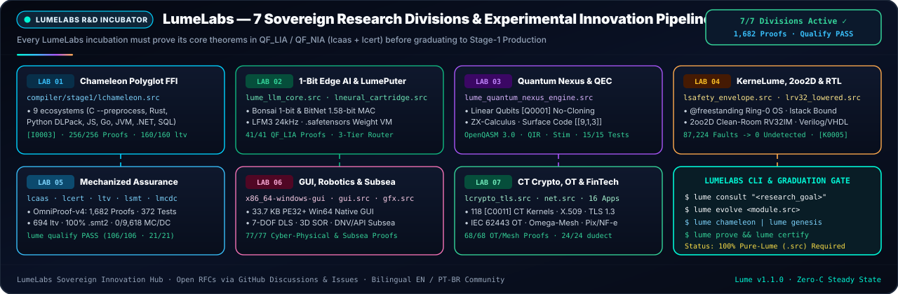

<h1>
  
  LumeLabs — Official R&amp;D Incubator &amp; Experimental Innovation Hub
</h1>

**Where Polyglot FFI, 1.58-Bit Edge AI, Fault-Tolerant Quantum Computing, Bare-Metal Ring-0 Systems, and Mechanized Proof Theory Graduate into 100% Pure-Lume Production (`lumec1 == lumec2 == lumec3`)**

<br clear="left"/>

<div align="center">

[](#2-the-7-lumelabs-research-divisions)
[](PROJECTS.md)
[](certification/QUALIFICATION_DOSSIER.md)
[](PROJECT_STATE.md)
[](COMMUNITY.md)

[**Home (`index.md`)**](index.md) · [**Projects & Roadmap (`PROJECTS.md`)**](PROJECTS.md) · [**Live Board `#5`**](https://github.com/users/OmegaSoftDLL/projects/5) · [**Qualification Dossier (`PASS`)**](certification/QUALIFICATION_DOSSIER.md) · [**Community (`COMMUNITY.md`)**](COMMUNITY.md) · [**Wiki**](https://github.com/OmegaSoftDLL/lume/wiki) · [**GitHub Discussions**](https://github.com/OmegaSoftDLL/lume/discussions) · [**Manual (`EN`)**](LUME_MANUAL_EN.md) · [**Manual (`PT-BR`)**](LUME_MANUAL_PT_BR.md)

<br/>



</div>

---

## 1. Mission & Engineering Charter


**LumeLabs** is the official research, incubation, and advanced systems engineering division of the **Lume Programming Language (`v1.1.0`, Edition 2026)**.

Unlike conventional language incubators where experimental subsystems rely on unverified C/C++/Python glue or external compiler plugins, every LumeLabs engine adheres to four non-negotiable engineering invariants:

1. **100% Native Lume (`.src`) Implementation:** Zero Python build scripts, zero Rust/C++ helper crates, and zero C seed expansion (`bootstrap/lume0/SEED_FREEZE.sha256` remains permanently frozen).
2. **Compile-Time Mathematical Proof (`QF_LIA` / `QF_NIA` / `QF_BV` / Separation Logic):** Every subsystem declares machine-checked invariants via `requires`, `ensures`, `invariant`, `@bound`, `@no_alloc`, `@secret`, and universal `law` theorems verified by `lcaas.src` and independently re-checked against source ASTs by `lcert.src --check-source`.
3. **Post-Codegen Binary Assurance:** Critical kernels undergo symbolic machine-code translation validation (`ltv.src`, `ltv_rt.src`), clean-room `.smt2` checking (`lsmt.src` & `z3`), static worst-case stack bounding (`lstack.src`), native-binary Masking MC/DC (`lmcdc.src`), and `2oo2D` clean-room `RV32IM` lockstep voting (`lsafety_envelope.src`).
4. **Self-Hosted Fixpoint & `OmniProof-v4` Preservation:** Graduating into `compiler/stage1/` requires preserving the bit-identical triple bootstrap (`lumec1 == lumec2 == lumec3`), **`16/16` `OmniProof-v4` batteries** (`1,682` formal obligations, `0` runtime/refuted, `372` unit tests, `134` SHA-256 manifest files), `./lume synergy-gate` (`17/17` links + `36/36` cross-tamper checks), and `./lume qualify --verify` (`PASS`).

> 🇧🇷 **Pesquisa e Comunidade em Português (`pt-BR`):** Pesquisadores e engenheiros podem submeter propostas de P&D ao LumeLabs, acompanhar os issues abertos do horizonte **`v1.2.0`** ([#29](https://github.com/OmegaSoftDLL/lume/issues/29), [#30](https://github.com/OmegaSoftDLL/lume/issues/30), [#32](https://github.com/OmegaSoftDLL/lume/issues/32)), abrir discussões técnicas e consultar o manual nativo em português (`lume manual --pt` ou [`LUME_MANUAL_PT_BR.md`](LUME_MANUAL_PT_BR.md)).

<br clear="right"/>

---

## 2. The 7 LumeLabs Research Divisions

### Lab 01 Spotlight — Universal Chameleon Polyglot, Singularity Boundary $\Omega$ & `LumePuter` (`lchameleon.src`)


**Lab 01 ([`compiler/stage1/lchameleon.src`](https://github.com/OmegaSoftDLL/lume/blob/main/compiler/stage1/lchameleon.src))** embodies Lumi's adaptive nature: it synthesizes fail-closed **`[I0003]` `QF_LIA` refinement adapters** (`unverified[T] -> verified[T]` under `/ {ffi}`, **`256/256` certified obligations**, **`160/160` `ltv`-validated**, **`0/2,392` uncovered MC/DC**, `21/21` `self-prove` unit tests) across **9 foreign ecosystems** (`c_abi` with built-in C `--preprocess`, `rust_cdylib`, `python_capi` DLPack zero-copy tensors, `node_napi_wasm`, `go_cshared`, `java_jni`, `dotnet_pinvoke`, `sql_relational`, and `openapi_rpc`), paired with the **2nd-Order Dynamical Transition Engine & Singularity Boundary $\Omega$** (`lume singularity` / `lume ote`: counter-phase theorem $\tau_{\max}=T_m/4$, Operational Power Triangle $S, P, Q, \cos\Phi$, Nyquist guard, Bayesian Beta-Binomial SPC, Page's tabular CUSUM, CPM float, $k$-anonymous monotonic PAVA) and the **`LumePuter` `RV32IM_Zba` + Gated-DeltaNet weight-compiled neural VM** (`lume lumeputer`).

<br clear="right"/>

| Division | Core Engine & Source (`compiler/stage1/`) | Certified `v1.1.0` Baseline & Active `v1.2.0` Horizon | CLI Entrypoints |
| :--- | :--- | :--- | :--- |
| **Lab 01 · Chameleon Polyglot, Singularity $\Omega$ & `LumePuter`** | [`lchameleon.src`](https://github.com/OmegaSoftDLL/lume/blob/main/compiler/stage1/lchameleon.src) · [`lneural_cartridge.src`](https://github.com/OmegaSoftDLL/lume/blob/main/compiler/stage1/lneural_cartridge.src) | **`256/256` obligations (`160/160` `ltv`, `0/2,392` MC/DC, `21` tests)** · 9-ecosystem `[I0003]` FFI, C `--preprocess`, Python DLPack, Singularity $\Omega$, Bayesian SPC/PAVA, `.safetensors` & `LumePuter` weight VM · *`v1.2.0` ([#29](https://github.com/OmegaSoftDLL/lume/issues/29)): Apache Arrow IPC & multi-GPU stream bridges* | `lume chameleon` · `lume adapt c --preprocess <h>` · `lume singularity` · `lume lumeputer` |
| **Lab 02 · 1.58-Bit Ternary Edge AI, OpenTPU & Liquid Audio** | [`lume_llm_core.src`](https://github.com/OmegaSoftDLL/lume/blob/main/compiler/stage1/lume_llm_core.src) · [`lume_opentpu_engine.src`](https://github.com/OmegaSoftDLL/lume/blob/main/compiler/stage1/lume_opentpu_engine.src) · [`lume_ncm_engine.src`](https://github.com/OmegaSoftDLL/lume/blob/main/compiler/stage1/lume_ncm_engine.src) · [`lsentience.src`](https://github.com/OmegaSoftDLL/lume/blob/main/compiler/stage1/lsentience.src) | **`243` OpenTPU + `176` NCM + `21` LLM Core obligations (`0/6,134` `lsentience` MC/DC)** · Bonsai 1-bit & BitNet 1.58-bit ternary MAC, `LiquidCodec` 24 kHz audio frames, `Colibri` MoE SSD RAM guard, MS-RVQ & systolic MXU · *`v1.2.0` ([#29](https://github.com/OmegaSoftDLL/lume/issues/29)): Multi-node ternary & full-duplex voice mesh* | `lume opentpu` · `lume ncm` · `lume synapse` · `lume test compiler/stage1/lume_llm_core.src` |
| **Lab 03 · Quantum Nexus & Topological QEC** | [`lume_quantum_nexus_engine.src`](https://github.com/OmegaSoftDLL/lume/blob/main/compiler/stage1/lume_quantum_nexus_engine.src) | **`99/99` obligations (`20/20` tests)** · Linear Qubits (`[Q0001..Q0004]`), automatic $U^\dagger$ ancilla uncomputation, ZX spider fusion, Clifford stabilizer tableau, rotated `[[9,1,3]]` QEC & 6 quantum targets (`OpenQASM 3.0`, `QIR`, `Quil`, `IQM`, `Stim`, `QEC`) · *`v1.2.0` ([#30](https://github.com/OmegaSoftDLL/lume/issues/30)): `d >= 5` surface-code decoding & lattice surgery* | `lume quantum-nexus` · `lume build --target qasm3-quantum <q.src>` |
| **Lab 04 · `KerneLume` Bare-Metal Ring-0 OS & Silicon HIL** | [`ltarget.src`](https://github.com/OmegaSoftDLL/lume/blob/main/compiler/stage1/ltarget.src) · [`lkir.src`](https://github.com/OmegaSoftDLL/lume/blob/main/compiler/stage1/lkir.src) · [`lsafety_envelope.src`](https://github.com/OmegaSoftDLL/lume/blob/main/compiler/stage1/lsafety_envelope.src) · [`examples/apps/lume_os/`](https://github.com/OmegaSoftDLL/lume/blob/main/examples/apps/lume_os) | **`@freestanding` Zero-GC Ring-0 `.kernel` & `2oo2D` Clean-Room `RV32IM` Envelope** · `[K0005]` W^X DMA, `[K0006]` interrupt stack bounds, `Verilog-2005`/`VHDL-2008`, `87,224`-fault lockstep & `--split` bundles · *`v1.2.0` ([#30](https://github.com/OmegaSoftDLL/lume/issues/30), [#32](https://github.com/OmegaSoftDLL/lume/issues/32)): SMP/IOMMU drivers & dual-MCU Cortex-M/RISC-V HIL* | `lume package iso <k.src> -o os.iso` · `lume safety-envelope --gate` |
| **Lab 05 · Binary Assurance, Qualification & Lean 4 Soundness** | [`06b_phase3.src`](https://github.com/OmegaSoftDLL/lume/blob/main/compiler/stage1/lume/06b_phase3.src) · [`lcaas.src`](https://github.com/OmegaSoftDLL/lume/blob/main/compiler/stage1/lcaas.src) · [`lcert.src`](https://github.com/OmegaSoftDLL/lume/blob/main/compiler/stage1/lcert.src) · [`ltv.src`](https://github.com/OmegaSoftDLL/lume/blob/main/compiler/stage1/ltv.src) · [`lsmt.src`](https://github.com/OmegaSoftDLL/lume/blob/main/compiler/stage1/lsmt.src) · [`lmcdc.src`](https://github.com/OmegaSoftDLL/lume/blob/main/compiler/stage1/lmcdc.src) · [`lqualify.src`](https://github.com/OmegaSoftDLL/lume/blob/main/compiler/stage1/lqualify.src) | **`OmniProof-v4` (`1,682` proofs, `372` tests), `694` `ltv` fns, `18/18` `ltv_rt` helpers, `100%` `lsmt`/`z3` `unsat`, `0/9,618` MC/DC & Signed `PASS` Dossier (`106/106` probes)** · *`v1.2.0` ([#30](https://github.com/OmegaSoftDLL/lume/issues/30), [#32](https://github.com/OmegaSoftDLL/lume/issues/32)): Automated Lean 4 witness export & PKCS#11/HSM CA custody* | `lume self-prove` · `lume tv` · `lume smt-check` · `lume mcdc` · `lume qualify --verify` |
| **Lab 06 · Native Desktop GUI, Cyber-Physical UFE, Subsea & `levolve`** | [`gfx.src`](https://github.com/OmegaSoftDLL/lume/blob/main/compiler/stage1/gfx.src) · [`gui.src`](https://github.com/OmegaSoftDLL/lume/blob/main/compiler/stage1/gui.src) · [`levolve.src`](https://github.com/OmegaSoftDLL/lume/blob/main/compiler/stage1/levolve.src) · [`lume_egm_engine.src`](https://github.com/OmegaSoftDLL/lume/blob/main/compiler/stage1/lume_egm_engine.src) | **`77/77` UFE & Subsea proofs + `128/128` EGM proofs + Win64 `PE32+` GUI** · 7-DOF DLS kinematics, 3D Laplace SOR, Joseph EKF, IAPWS-IF97, DNV/API catenary, VIV, Bühlmann ZH-L16C, ASME B31G, `@ui-layout`, and Ed25519-governed proof-guided evolution | `lume unified-field` · `lume egm` · `lume build --target x86_64-windows-gui <app.src>` |
| **Lab 07 · Constant-Time Crypto, IEC 62443 OT, Reversa & FinTech** | [`lcrypto_tls.src`](https://github.com/OmegaSoftDLL/lume/blob/main/compiler/stage1/lcrypto_tls.src) · [`lx509.src`](https://github.com/OmegaSoftDLL/lume/blob/main/compiler/stage1/lx509.src) · [`net.src`](https://github.com/OmegaSoftDLL/lume/blob/main/compiler/stage1/net.src) · [`lume_reversa_engine.src`](https://github.com/OmegaSoftDLL/lume/blob/main/compiler/stage1/lume_reversa_engine.src) · [`lume_pingora_proxy_engine.src`](https://github.com/OmegaSoftDLL/lume/blob/main/compiler/stage1/lume_pingora_proxy_engine.src) · [`lume_continuum_nexus_engine.src`](https://github.com/OmegaSoftDLL/lume/blob/main/compiler/stage1/lume_continuum_nexus_engine.src) | **`118` `[C0011]` CT crypto kernels (`dudect` `|t| <= 2.690`), `6,000/6,000` X.509v3 tamper rejections, `68` NetSentinel OT/Mesh + `93` Reversa + `106` Pingora + `294` Continuum proofs** + verified `Pix` / `SEFAZ` / `STIX` capstones | `lume crypto-gate` · `lume x509` · `lume net-sentinel` · `lume reversa` · `lume pingora` · `lume continuum` |

---

## 3. Running LumeLabs Engines & Assurance Suites Locally

Every Lume `v1.1.0` installation ships with the complete LumeLabs engine and binary verification suite built in:

```sh
# 1. Universal Chameleon Polyglot FFI, C Preprocessor & LumePuter (Lab 01)
lume chameleon
lume adapt c --preprocess include/api.h
lume adapt python
lume morph legacy_module.py
lume singularity
lume lumeputer

# 2. Domain Engines: Cyber-Physical UFE, IEC 62443 OT, Quantum, OpenTPU, NCM, Pingora & Reversa
lume unified-field
lume net-sentinel
lume quantum-nexus
lume opentpu
lume ncm
lume pingora
lume reversa
lume continuum

# 3. Binary Translation Validation, Clean-Room SMT, MC/DC, CT Crypto & 2oo2D Lockstep (Labs 04, 05, 07)
lume tv examples/safety_envelope/critical_kernels.src --exec
lume tv-rt examples/safety_envelope/critical_kernels.src
lume stack examples/safety_envelope/critical_kernels.src --json
lume mcdc examples/safety_envelope/critical_kernels.src --exec
lume safety-envelope examples/safety_envelope/critical_kernels.src --fn safe_actuator_cmd --args 120,0,500
lume x509 show docs/certification/QUALIFICATION_SIGNING_CERT.der
lume entropy --bytes 32 --json

# 4. Full OmniProof-v4 (16 Batteries, 1,682 Obligations, 372 Tests), Synergy & Signed Qualification
lume self-prove --json
lume synergy-gate
lume qualify --verify
```

---

## 4. The LumeLabs Graduation Protocol (`RFC -> Formal Proof -> Binary Assurance -> Manifest Lock`)

Every research initiative in LumeLabs advances through four deterministic engineering gates tracked on [**GitHub Project `#5`**](https://github.com/users/OmegaSoftDLL/projects/5) and [**`PROJECTS.md`**](PROJECTS.md):

1. **Step 1 — Formal RFC Specification:**
   - Open a proposal via the [LumeLabs RFC Issue Template](https://github.com/OmegaSoftDLL/lume/blob/main/.github/ISSUE_TEMPLATE/lumelabs_proposal.md) or in [GitHub Discussions (`LumeLabs R&D & RFCs`)](https://github.com/OmegaSoftDLL/lume/discussions).
   - Define the mathematical state invariants (`requires`, `ensures`, `invariant`, `law`, `@bound`, `@no_alloc`, `@secret`) and failure diagnostic codes before implementation.
2. **Step 2 — 100% Pure-Lume Verified Prototype (`examples/apps/` or `compiler/stage1/`):**
   - Implement exclusively in native Lume (`.src`, pure LF `\n`, canonical `lume fmt --check`).
   - Discharge `100%` of static proof obligations via `lume prove`, `lume certify`, and `lume verify-cert --check-source` (`0` runtime-checked or refuted obligations).
3. **Step 3 — Binary Assurance, MC/DC & Multi-Oracle Differential Fuzzing:**
   - Validate emitted machine code with `lume tv`, `lume smt-check`, `lume stack` (for `@no_alloc` paths), and `lume mcdc --exec` (`0` uncovered conditions on certified modules), plus `[C0010]`/`[C0011]` + `dudect` on any `@secret` routine.
   - Pass negative fail-closed conformance tests and the 4-oracle differential fuzzer (`lumec` ELF64 vs `LUME_GC_STRESS=1` vs `bootstrap/lume0` vs `lcaas`) in [`tests/harness/claude_audit_gate.src`](https://github.com/OmegaSoftDLL/lume/blob/main/tests/harness/claude_audit_gate.src).
4. **Step 4 — Self-Hosted Integration, CLI Parity & Cryptographic Manifest Lock:**
   - Verify bit-identical `lumec1 == lumec2 == lumec3` (`./lume bootstrap` & `./lume zero-c`), `./lume synergy-gate`, `./lume cli-parity` (`0` drift across bilingual manuals `LUME_MANUAL_EN.md` + `LUME_MANUAL_PT_BR.md`), `./lume qualify --verify`, and lock SHA-256 digests into [`MANIFEST.sha256`](https://github.com/OmegaSoftDLL/lume/blob/main/MANIFEST.sha256) (`134` verified files).
