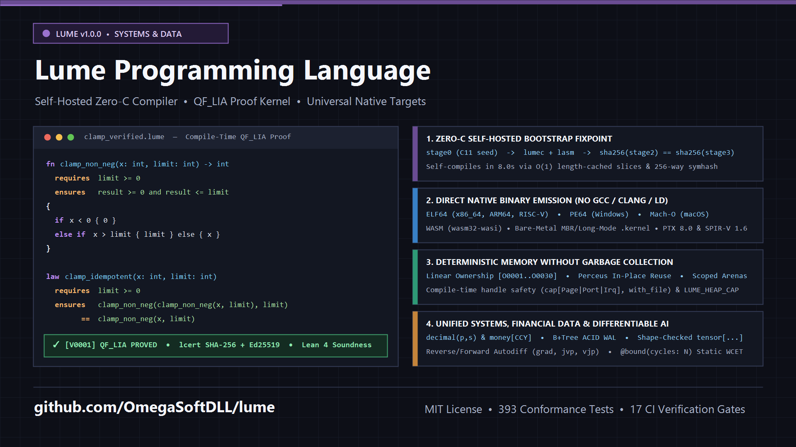

# Engineering a Self-Hosted Programming Language with Built-In `QF_LIA` Verification and a Zero-C Native Backend

*Design notes on Lume (`v1.0.0`), achieving a bit-identical `stage2 == stage3` bootstrap fixpoint, and integrating linear integer arithmetic proofs directly into the typechecker.*



Modern software infrastructure forces an uncomfortable split across the engineering stack.

When you need predictable memory layout, small standalone binaries, and direct hardware access—kernels, industrial telemetry protocols, storage engines—you reach for C, C++, or Rust. When you need exact decimal arithmetic for financial ledgers, automatic differentiation over tensor pipelines, or rapid iteration with automated code synthesis, you end up in Python or TypeScript, trading away static guarantees and paying for a heavy runtime.

Adding formal verification to production code usually makes this split worse. Most verification workflows depend on external SMT solvers invoked out-of-process. A minor solver version bump or a changed timeout heuristic on a CI runner is often enough to turn a passing build into a flaky failure.

**Lume** (`https://github.com/OmegaSoftDLL/lume`) is an open-source systems and data programming language built from scratch to test a specific engineering hypothesis: *can a single, small, self-hosted compiler emit native machine binaries across architectures without an external C toolchain, verify functional contracts deterministically at compile time, and support bare-metal systems, financial data, and differentiable programming under one type system?*

With `v1.0.0` now tagged on GitHub, this article documents the core architectural decisions, the compiler bottlenecks we hit along the way, and how the toolchain works under the hood.

---

## 1. Bootstrap Architecture and the `stage2 == stage3` Fixpoint

Most contemporary languages rely on LLVM, GCC, or the host OS linker (`ld`, `link.exe`) to lower intermediate representations into executables. That accelerates early development, but it couples the compiler to hundreds of megabytes of external C++ dependencies and obscures the trusted computing base.

Lume uses a three-stage bootstrap designed to reach a **Zero-C steady state**:

1. **Stage 0 (`lume0`):** A minimal reference interpreter written in portable C11 with zero third-party dependencies. Its sole job is to evaluate the compiler source tree from cold start.
2. **Stage 1 (`lumec` + `lasm`):** The self-hosted compiler (`lumec`) and native assembler/linker (`lasm`), both written in Lume (`compiler/stage1/`). Rather than shelling out to `binutils` or `clang`, `lasm` directly encodes executable formats byte-for-byte: `ELF64` (`x86_64-linux`, `aarch64-linux`, `riscv64-linux`), `PE64` (`x86_64-windows` with a native `kernel32.dll` Import Address Table), `Mach-O` (`aarch64-macos`), `WASM` (`wasm32-wasi`), and bootable `.kernel` images (16-bit MBR real-mode bootstrap transitioning into 64-bit long mode).
3. **Self-Hosted Fixpoint (`stage2 == stage3`):** The Stage-1 compiler compiles its own source tree to produce `lumec2`. Then `lumec2` compiles the exact same source tree to produce `lumec3`. Every CI run verifies that `sha256(lumec2) == sha256(lumec3)` with zero byte diffs.

Reaching a bit-identical fixpoint without LLVM exposed classic compiler problems that higher-level backends usually hide:

- **32-bit PC-relative displacement sign extension (`lasm.src`):** Once the amalgamated compiler assembly (`lumec.s`) grew past 128 KB of code distance between branch targets, forward and backward `jmp`/`call` relocations required signed 32-bit little-endian emission (`emit_i32_le`) and a 256-way hash-bucketed symbol table (`symhash`), which cut native assembly time by roughly 5x.
- **Register preservation across bump-allocator growth (`05_codegen.src`):** In the runtime string/list concatenation path (`addv`), triggering a heap growth call (`alloc_grow`) while holding active pointers in caller-saved registers clobbered `%rdi` and `%rsi`. Explicitly bracketing the slow path with stack saves (`pushq %rdi` / `popq %rdi` in `av_ls` and `pushq %rsi` / `popq %rsi` in `av_rs`) eliminated subtle heap corruption during self-compilation without touching callee-saved `%r15`.
- **From $O(N^2)$ string scanning to $O(1)$ length-cached slices and 64-bit tagged register words:** Early versions of the lexer and parser built tokens via character-by-character concatenation. Caching byte length at offset `8(%rax)` of every heap string allocation (`mkstr`, `cnts`, `slice`, `slicen`), bounding transitive helper discovery (`kuses_hop` at depth `d <= 1`), and introducing the **4-Tier Atomic Memory Compactor** (63-bit tagged register integers `...iiii1` + `0..7`-byte inline SSO strings `...ss|lll|010`, `24 B` `Cons` cells, and `.rodata` descriptors) dropped `lumec2 -> lumec3` self-compilation time from ~240 seconds (`12.7 GB` RAM) to **`445 ms` (`115 MB` peak RSS)**, and full seed-to-fixpoint bootstrap from ~360 seconds to **`22 seconds` (`537 MB` peak RSS)**.

---

## 2. Compile-Time Contracts and Proof Certificates (`QF_LIA` + Separation Logic)

Instead of treating `requires` and `ensures` annotations as runtime assertions, Lume embeds a quantifier-free linear integer arithmetic (**`QF_LIA`**) and separation-logic decision procedure directly inside the semantic analysis pass (`06b_phase3.src`), paired with a standalone proof-checking kernel (`lcert.src`, ~394 lines of code).

Here is a minimal example that compiles and proves both a function contract and an algebraic law:

```lume
fn clamp_non_neg(x: int, limit: int) -> int
  requires limit >= 0
  ensures result >= 0 and result <= limit
{
  if x < 0 {
    0
  } else {
    if x > limit { limit } else { x }
  }
}

law clamp_idempotent(x: int, limit: int)
  requires limit >= 0
  ensures clamp_non_neg(clamp_non_neg(x, limit), limit) == clamp_non_neg(x, limit)
```

During `lume check` or `lume verify`, the compiler performs Hindley-Milner type inference (with `Forall` let-polymorphism) and then constructs verification conditions by negating `ensures` under the conjunction of `requires` and path-sensitive branch guards:

- If a counterexample exists, compilation fails closed with diagnostic `[V0001]` and prints the concrete variable assignment that violates the postcondition.
- If the negation is unsatisfiable, `lcert` emits a deterministic proof certificate hashed with FIPS 180-4 `SHA-256` and signed with `Ed25519`. Downstream consumers can verify a compiled module's proof bundle (`lume evidence verify`) in milliseconds without re-running proof search.

To anchor the soundness of the core calculus, the operational semantics and type safety proofs of Lume-Core are mechanized in **Lean 4** (`formal/lean/LumeCore.lean`).

---

## 3. Memory Model: Ownership, a Collected Heap, the 4-Tier Atomic Compactor, and Scoped Arenas

Lume separates two questions. Who may use a value, and when, is decided at compile time. Reclaiming memory is the runtime's job: the single-source hosted runtime (`compiler/stage1/runtime_core.lume`) has a segregated 43-size-class non-moving mark-and-lazy-sweep collector whose pause is proportional to the live heap and which returns physical pages to the OS via `madvise(MADV_DONTNEED)`, so annotations are never required for a program to run in bounded memory (`docs/38-memory-management.md`, `docs/39-memory-saga-and-atomic-compactor-dossier.md`).

On top of that collector, Lume adds four mechanisms:

1. **Linear Ownership and Borrow Checking (`[O0001]`–`[O0030]`, `own_flow.src`):** A move invalidates every binding that can observe the value (aliases, containers, parts, closures), and a borrow lasts until its last use. A `resource type` value held by a `let` is linear: using it after it is consumed, or leaving it unconsumed on any control-flow path, is rejected at compile time (`[O0001]`, `[O0004]`). Conflicts with a live borrow are `[O0013]`, and a capability such as `cap[Page]` cannot be mapped twice.
2. **The 4-Tier Atomic Memory Compactor:**
   - **Stage 0 (`.rodata` Static Unification):** String literals, constructor descriptors, record shape tables, and zero-arity constructors (`Nil`, `None`, `True`, `False`) live permanently in `.rodata` (`0 B` heap).
   - **Level 1 (64-Bit Tagged Register Word):** A 63-bit signed integer (`...iiii1`) and a `0..7`-byte inline SSO string (`...ss|lll|010`, beating Rust's 24-byte + heap `String`) live directly inside a single 64-bit CPU register word (`0 B` heap), while full 64-bit `int` semantics (`[-2^63, 2^63-1]`) are preserved via a 16-byte overflow cell `[3][value]` for the 64th bit. Inline register arithmetic (`add`/`sub`/`imul` + `jo`) executes a 100M-iteration integer loop in **`88 ms`** (`31.8x` faster, `0.39 MB` RSS).
   - **Level 2 (Compact Cells):** `Cons(h, t)` shrinks from `80 B` to **`24 B`** (`8 B` descriptor + 2 words), and a 3-field record shrinks from `160 B` to **`32 B`** (`8 B` shape + 3 words).
   - **Level 3 (Cold Arena Demand-Paged `LZ1` Compactor):** Cold arenas and `.lcaps`/`.lumb` bundles compress with an inline x86-64 `LZ1` codec (`mem_pack` at `~355 MB/s`, `mem_unpack` at `~975 MB/s`, `lume pack`/`lume unpack`), release physical pages via `MADV_DONTNEED` (`arena_freeze`), and thaw lazily per 4 KB page via `PROT_NONE` + `SIGSEGV` on first touch (`arena_thaw`), while `@secret` (`[C0009]`) and `@bound` (`[V0002]`) functions forbid compression fail-closed.
3. **Perceus-Style Functional Reuse (`__perceus_reuse_1/2`) & Scalar Replacement (`lsra_expr`):** When pattern matching destructures an `own` value that every call site provably passes as unique (`pu_*`), the compiler reuses the existing cell in place; non-escaping local records are scalar-replaced onto `%rbp` stack slots; and self-tail-calls lower to direct jumps (`.Ltail_<fn>`).
4. **Lexically Scoped Arenas (`std.arena`) and Hard Heap Caps (`LUME_HEAP_CAP`):** Batch workloads can allocate inside scoped arenas (`arena_new`, `arena_alloc`, `arena_reset`, `arena_destroy`). To preserve referential transparency, the effect checker rejects arena mutations inside `/ pure` functions (`[E0200]`), and `--memory` reports exact child peak RSS (`os_self_maxrss_kb`).

---

## 4. Financial Data, Differentiable Tensors, and Bare-Metal Systems in One Language

A recurring source of bugs in production engineering is translating logic across language boundaries—prototyping a model in Python, rewriting the storage layer in SQL/Go, and re-implementing the packet parser in C. Lume provides first-class semantics for all three domains:

- **Exact Financial & Relational Primitives (`decimal(p,s)`, `money[CCY]`, `table[T]`):** Fixed-point decimal arithmetic and currency-parameterized types prevent accidental float rounding or cross-currency addition (`money[USD] + money[EUR]` is a type error). Persistent tables (`db.src`) are backed by a multi-way recursive B+Tree (`BMLeaf`/`BMInner`) with crash-safe write-ahead logging (WAL).
- **Shape-Checked Tensors & Native GPU Lowering (`tensor[DType, ...]`, `[T0300]`):** Reverse- and forward-mode automatic differentiation (`grad`, `value_and_grad`, `jvp`, `vjp`) operate natively on Lume functions. Compute kernels annotated with `@schedule(...) kernel fn` lower directly to SSA **CUDA PTX 8.0** and **Vulkan SPIR-V 1.6**, alongside native `.safetensors` and `.onnx` binary wire parsers (`nn.src`).
- **Freestanding Kernels & Worst-Case Execution Time (`@freestanding`, `@interrupt`, `@bound(cycles: N)`):** Systems code uses `@repr(c)`, `@packed`, and `@mmio` volatile register mappings. Interrupt handlers annotated with `@bound(cycles: N)` undergo static cycle-budget verification (`[V0002]`) and forbid heap allocation.

---

## 5. Compiler-as-an-Oracle (CaaS) for Automated Synthesis

Because Lume tracks explicit algebraic effects (`! {IO, Net, Fs}`) and formal contracts (`requires`/`ensures`), the compiler itself serves as a formal oracle for both human developers and automated synthesis loops.

Through its built-in JSON/MCP server (`lume mcp`, `lume certify --json`, `lume agent cegis`, `lume heal`), a developer or coding agent can write a function signature with a formal postcondition and leave a typed hole (`??`) in the body. Using Counterexample-Guided Inductive Synthesis (CEGIS), the compiler synthesizes candidate expressions, checks them against the `QF_LIA` prover, and only emits code that is mathematically proven to satisfy the specification.

---

## 6. Exploring `v1.0.0`

Lume `v1.0.0` is available under the MIT License with prebuilt release archives for **Linux (`x86_64`, `aarch64`, `riscv64`)**, **Windows (`x86_64`)**, and **macOS (`aarch64` Apple Silicon & `x86_64`)**, backed by a 410-test Stage-0 conformance suite, 317 red-team assertions, 159 semantic batch checks, 75,512 differential value-representation test cases, AddressSanitizer/UBSan verification, and 44 continuous integration steps.

- **GitHub Repository:** https://github.com/OmegaSoftDLL/lume
- **Release `v1.0.0` Binaries & `SHA256SUMS`:** https://github.com/OmegaSoftDLL/lume/releases/tag/v1.0.0
- **Compiler Source Tree (`lumec` + `lasm` + `lcert`):** `compiler/stage1/`
- **Lean 4 Mechanization:** `formal/lean/LumeCore.lean`
