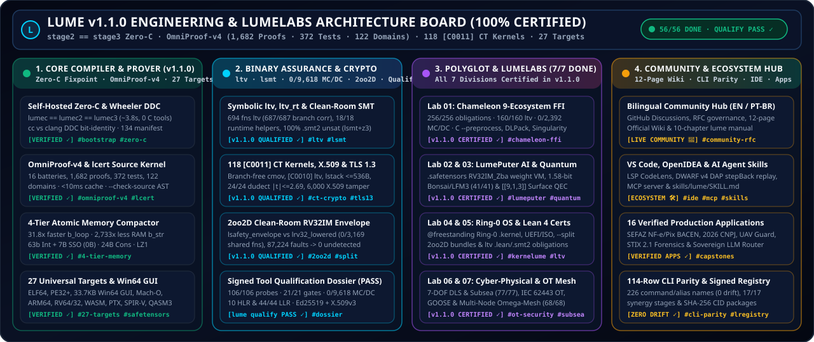

# Lume Sovereign Project Board & Engineering Roadmap (`PROJECTS.md`)
### **Official Engineering Roadmap, Milestones, `OmniProof-v4` Batteries & LumeLabs Horizon (`EN` / `PT-BR`)**

 

[**Home (`index.md`)**](index.md) · [**Live GitHub Project `#5`**](https://github.com/users/OmegaSoftDLL/projects/5) · [**Milestones**](https://github.com/OmegaSoftDLL/lume/milestones) · [**Qualification Dossier (`PASS`)**](certification/QUALIFICATION_DOSSIER.md) · [**Audit Report (`PT-BR`)**](RELATORIO_AUDITORIA_E_CERTIFICACAO_CLAUDE_PT_BR.md) · [**LumeLabs (`LUMELABS.md`)**](LUMELABS.md) · [**Community (`COMMUNITY.md`)**](COMMUNITY.md) · [**Wiki**](https://github.com/OmegaSoftDLL/lume/wiki)

Welcome to the official **Lume Engineering Project Board & Roadmap (`v1.1.0`, Edition 2026)**. Every compiler module, multi-theory theorem prover extension, post-codegen binary verifier, constant-time cryptographic kernel, hardware target, and **LumeLabs** research division is tracked transparently through live GitHub Milestones, Issues, machine-checked `OmniProof-v4` proof batteries (`./lume self-prove`), and the signed Tool Qualification Dossier (`./lume qualify --verify`).

> 🇧🇷 **Governança Bilíngue (`pt-BR`):** Bem-vindo ao **Quadro Oficial de Engenharia e Roadmap da Linguagem Lume (`v1.1.0`)**. Cada módulo do compilador 100% auto-hospedado (**Zero-C**, ponto fixo `lumec1 == lumec2 == lumec3`), do provador formal `OmniProof-v4` (**`1.682` obrigações formais em `16` baterias**, **`372` testes unitários**, **`122` domínios**, **`134` arquivos SHA-256**), da validação simbólica de binários (`ltv`, `ltv_rt`, `lsmt`, **`0/9.618` condições MC/DC descobertas**), dos **`118` kernels criptográficos *constant-time* `[C0011]`** e do horizonte de P&D **LumeLabs (`v1.2.0`)** é auditável em tempo real no [GitHub Project `#5`](https://github.com/users/OmegaSoftDLL/projects/5).

  

---

## 1. Official GitHub Portals / Portais Oficiais no GitHub

| Portal | Scope (`EN` / `PT-BR`) | Direct Link |
| :--- | :--- | :--- |
| **📊 GitHub Project `#5`** | Live Kanban board (`Done` / `In Progress` / `Todo`) across `v1.0.0`, `v1.1.0` & `v1.2.0` | [github.com/users/OmegaSoftDLL/projects/5](https://github.com/users/OmegaSoftDLL/projects/5) |
| **📌 GitHub Milestones** | Milestone `#1` (`v1.0.0` Closed), `#2` (`v1.1.0` Certified), and `#3` (`v1.2.0` Horizon) | [github.com/OmegaSoftDLL/lume/milestones](https://github.com/OmegaSoftDLL/lume/milestones) |
| **📋 Engineering Issues** | Tracked by `formal-verification`, `chameleon-polyglot`, `memory-compactor`, `27-targets`, `lumelabs` | [github.com/OmegaSoftDLL/lume/issues](https://github.com/OmegaSoftDLL/lume/issues) |
| **🛡️ Qualification Dossier** | Ed25519 + X.509v3 signed `PASS` dossier (`106/106` probes, `21/21` gates, `10` HLR, `44/44` LLR) | [`QUALIFICATION_DOSSIER.md`](certification/QUALIFICATION_DOSSIER.md) |
| **🔬 LumeLabs R&D Hub** | The 7 Research Divisions (`Lab 01`..`Lab 07`) & Production Graduation Protocol | [`LUMELABS.md`](LUMELABS.md) |
| **🤝 Community & Charter** | Bilingual (`EN` / `PT-BR`) working groups, RFC workflow, and brand guidelines | [`COMMUNITY.md`](COMMUNITY.md) |
| **💬 GitHub Discussions** | Announcements, LumeLabs RFCs, `QF_LIA` / `lcert` clinic, and `Comunidade Brasil` | [github.com/OmegaSoftDLL/lume/discussions](https://github.com/OmegaSoftDLL/lume/discussions) |
| **📚 Official Lume Wiki** | 11 comprehensive bilingual reference pages (Architecture, Prover, Assurance, Memory, Targets) | [github.com/OmegaSoftDLL/lume/wiki](https://github.com/OmegaSoftDLL/lume/wiki) |

---

## 2. Milestone Architecture & Issue Delivery Matrix

### ✅ Milestone #1: `v1.0.0 — Self-Hosted Zero-C Compiler Foundation, Static Prover & 27 Targets` *(Closed)*
- **GitHub Milestone:** [Milestone #1](https://github.com/OmegaSoftDLL/lume/milestone/1)
- **Engineering Record:** [#26 — `[v1.0.0 Shipped] Self-Hosted Zero-C Compiler Foundation (lumec == lumec2 == lumec3) & 27 Universal Targets`](https://github.com/OmegaSoftDLL/lume/issues/26)
- **Delivered Architecture:**
  - **Auditable Bootstrap & Diverse Double-Compilation:** Frozen ~4.8k-LoC C11 bootstrap seed ([`bootstrap/lume0/SEED_FREEZE.sha256`](https://github.com/OmegaSoftDLL/lume/blob/main/bootstrap/lume0/SEED_FREEZE.sha256)) verified under **David A. Wheeler's Diverse Double-Compilation (DDC)** (`cc` vs `clang` converging to the exact same compiler SHA-256).
  - **100% Self-Hosted Compiler Pipeline (`compiler/stage1/lume/`):** `01_lexer.src` (`[L0002]`, `[L0003]`), `02_parser.src`, `03_comptime.src`, `04_parser_decls.src` (`[P0002]`, `[V0001]`), `05_codegen.src`, `06_typecheck.src` (`[T0300]` Hindley-Milner), `06b_phase3.src`, and `07_driver.src`, amalgamated into [`compiler/stage1/lumec.src`](https://github.com/OmegaSoftDLL/lume/blob/main/compiler/stage1/lumec.src) with bit-identical triple self-build (`lumec1 == lumec2 == lumec3` in `~3.8 s`, `scripts/bootstrap.src` & `scripts/zero_c.src`).
  - **Native Assembler, Prover & 27 Targets:** Direct ELF64/PE32+/Mach-O/VEX/EVEX/DWARF v4 emission (`lasm.src`, `larm64.src`, `lriscv.src` verified against GNU `as` across `39,968` instructions), module bundler (`lmod.src`), multi-theory prover (`lcaas.src`), zero-compiler-import certificate kernel (`lcert.src`), and 27 target triples + `apk`/`ipa`/`iso`/`uefi` packagers (`ltarget.src`, `lkir.src`).

---

### 🏆 Milestone #2: `v1.1.0 — Certified Assurance, OmniProof-v4, 118 CT Crypto Kernels, 2oo2D Envelope & Chameleon FFI` *(Active Certified Release)*
- **GitHub Milestone:** [Milestone #2](https://github.com/OmegaSoftDLL/lume/milestone/2)
- **Certified Tracker Issues (`CLOSED / COMPLETED`):**
  - [#21 — `10 Strategic Audit Improvements (CI differential fuzzing, seed gate, --strict prover, AArch64/RISC-V backends, HM/generics/Result & canonical specification)`](https://github.com/OmegaSoftDLL/lume/issues/21)
  - [#27 — `[v1.1.0 Certified] 4-Tier Atomic Memory Compactor (31.8x Speedup, 2,733x RAM Reduction) & Multi-Oracle Differential Verification`](https://github.com/OmegaSoftDLL/lume/issues/27)
  - [#28 — `[v1.1.0 Certified] Universal Chameleon 9-Ecosystem Polyglot FFI ([I0003]), LumePuter Weight VM & Win64 Native GUI`](https://github.com/OmegaSoftDLL/lume/issues/28)
  - [#31 — `[v1.1.0 Certified] Binary Assurance (ltv / lsmt / 0/9,618 MC/DC), 118 [C0011] CT Crypto Kernels, 2oo2D Clean-Room Envelope & Signed Qualification Dossier (PASS)`](https://github.com/OmegaSoftDLL/lume/issues/31)
- **Certified Engineering Highlights:**
  - **Post-Codegen Binary Assurance & Qualification (`ltv.src`, `ltv_rt.src`, `lsmt.src`, `lmcdc.src`, `lstack.src`, `lqualify.src`):** Symbolic machine-code equivalence across **`694` functions** (`687/687` 1-to-1 AST-to-object branch correlation, `600/600` codegen mutants killed), **`18/18` runtime helpers** proven (`268` paths / `462` obligations), **`100%` `.smt2` `unsat`** in clean-room `lsmt` (`3,820` mutants rejected) & `z3`, static `@no_alloc` stack bounds (`lstack`), **`0/9,618` uncovered Masking MC/DC conditions**, and Ed25519 + X.509v3-signed **[Qualification Dossier (`PASS`)](certification/QUALIFICATION_DOSSIER.md)** (`106/106` probes, `21/21` gates, `10` HLR, `44/44` LLR).
  - **`118` `[C0011]` Constant-Time Crypto Kernels, X.509v3 PKI & TLS 1.3 (`lcrypto_tls.src`, `lx509.src`):** Branch-free (`cmov`) `@secret @no_alloc` kernels machine-verified across transitive `call` targets (`ltv` `[C0010]`, `1,068/1,068` CT mutants killed), stack-bounded (`<= 536 B`), empirically validated across **`24/24` `dudect` Welch $t$-test targets (`|t| <= 2.690 < 4.5`)**, DER/PEM Ed25519 X.509v3 path validation (`6,000/6,000` tampered chains refused), NIST SP 800-90B entropy health checks, and RFC 8446 TLS 1.3.
  - **`2oo2D` Clean-Room Safety Envelope (`lsafety_envelope.src`, `lrv32_lowered.src`):** Native host Channel A (`x86-64` / `AArch64` / `RV64`) in lockstep with an independent clean-room bare-metal `RV32IM` compiler sharing **`0/3,169` functions** with `lumec` (`87,224` injected faults -> `0` undetected) plus standalone multi-board `--split` bundles ([`41-safety-envelope-split-bundle.md`](41-safety-envelope-split-bundle.md)).
  - **4-Tier Atomic Memory Runtime (`runtime_core.lume`, `own_flow.src`, `arena.src`, `capsule.src`):** 63-bit unboxed tagged integers & 7-byte inline UTF-8 strings (`0 B` heap), `24 B` `Cons`, `32 B` shared-shape records, 43-class segregated Mark & Lazy-Sweep GC, and demand-paged `LZ1` cold-arena compaction (**`31.8x` faster** on `b_loop`, **`2,733x` lower RAM** on `b_str`; [`39-memory-saga-and-atomic-compactor-dossier.md`](39-memory-saga-and-atomic-compactor-dossier.md)).
  - **Universal Chameleon 9-Ecosystem FFI, `LumePuter` & Win64 Native GUI (`lchameleon.src`, `ltarget.src`):** **`256/256` certified obligations** (`160/160` `ltv`, `0/2,392` uncovered MC/DC), built-in C header preprocessor (`--preprocess`), Python DLPack zero-copy tensors, Singularity $\Omega$, Bayesian SPC/CUSUM/PAVA, `LumePuter` `RV32IM_Zba` weight VM, `.safetensors` cartridges, and 33,792-byte native `x86_64-windows-gui` (`PE32+`) executables with embedded Lumi icon.

---

### 🔬 Milestone #3: `v1.2.0 — LumeLabs Horizon: Silicon Target Qualification, HSM Custody, Distributed Ternary AI & Lean 4` *(Open R&D Horizon)*
- **GitHub Milestone:** [Milestone #3](https://github.com/OmegaSoftDLL/lume/milestone/3)
- **Active Open Roadmap Issues:**
  - [#29 — `[LumeLabs v1.2.0] Lab 01 & 02: Apache Arrow / Multi-GPU DLPack Tensor Bridges & Distributed 1.58-Bit Ternary Voice Mesh`](https://github.com/OmegaSoftDLL/lume/issues/29)
  - [#30 — `[LumeLabs v1.2.0] Lab 03, 04 & 05: Higher-Distance Surface Codes (d >= 5), KerneLume SMP/IOMMU Drivers & Mechanized Lean 4 Proof Export`](https://github.com/OmegaSoftDLL/lume/issues/30)
  - [#32 — `[LumeLabs v1.2.0] Silicon-in-the-Loop Qualification (Cortex-M / Dual-MCU 2oo2D), HSM Root Signing Custody & Independent Lab Assessment`](https://github.com/OmegaSoftDLL/lume/issues/32)
- **Planned `v1.2.0` Engineering Horizons (See [`LUMELABS.md`](LUMELABS.md)):**
  1. **Silicon-in-the-Loop (`2oo2D` HIL) & HSM Custody (`#32`):** Physical Cortex-M + bare-metal RISC-V dual-MCU UART/SPI lockstep execution of `lume safety-envelope --split`, on-silicon `DWT->CYCCNT`/`mcycle` WCET & `dudect` validation, PKCS#11/YubiHSM X.509v3 root signing custody, and air-gapped external lab audit kits.
  2. **Apache Arrow & Multi-GPU DLPack Tensor Mesh (`#29`, `Lab 01`):** Zero-copy Arrow C Data / IPC columnar adapters and linear CUDA/Vulkan stream-event synchronization contracts.
  3. **Distributed 1.58-Bit Ternary & Full-Duplex `LFM3` Voice Mesh (`#29`, `Lab 02`):** Multi-node packed 5-trit ternary weight sharding and bounded-jitter (`<= 20 ms`) 24 kHz voice `<tool_call>` orchestration over Omega-Mesh.
  4. **Higher-Distance Surface Codes, Multicore `KerneLume` & Mechanized Lean 4 (`#30`, `Labs 03-05`):** Real-time `@no_alloc` `[[d^2, 1, d]]` (`d = 5, 7`) syndrome decoding, multicore APIC/SMP + IOMMU DMA isolation + NVMe/VirtIO Ring-0 drivers, and automated `lcert`/`lsmt` witness export checked under `lake build` in Lean 4.

---

## 3. Embedded `OmniProof-v4` Battery Matrix (`./lume self-prove --json`)

Every release and pull request executes `./lume self-prove` (`LumeCompiler-Embedded-OmniProof-v4`), certifying **`1,682` formal obligations (`0` runtime-checked or refuted)** and **`372` unit tests** across **16 embedded batteries** with zero external scripts:

| # | `OmniProof-v4` Battery ID | Primary Source Module | Formal Obligations (`Proven` + `@bound` Budget) | Runtime / Refuted | Unit Tests | Status |
| :---: | :--- | :--- | :---: | :---: | :---: | :---: |
| **1** | `std_net` | [`compiler/stage1/net.src`](https://github.com/OmegaSoftDLL/lume/blob/main/compiler/stage1/net.src) | **`68`** (`43` + `25`) | `0` | `16` | **PASS ✓** |
| **2** | `std_gfx` | [`compiler/stage1/gfx.src`](https://github.com/OmegaSoftDLL/lume/blob/main/compiler/stage1/gfx.src) | **`77`** (`41` + `36`) | `0` | `11` | **PASS ✓** |
| **3** | `crypto_blockchain_defi` | [`compiler/stage1/lume_crypto_blockchain_engine.src`](https://github.com/OmegaSoftDLL/lume/blob/main/compiler/stage1/lume_crypto_blockchain_engine.src) | **`15`** (`15` + `0`) | `0` | `11` | **PASS ✓** |
| **4** | `reversa_sdd_engine` | [`compiler/stage1/lume_reversa_engine.src`](https://github.com/OmegaSoftDLL/lume/blob/main/compiler/stage1/lume_reversa_engine.src) | **`93`** (`51` + `42`) | `0` | `17` | **PASS ✓** |
| **5** | `pingora_edge_proxy` | [`compiler/stage1/lume_pingora_proxy_engine.src`](https://github.com/OmegaSoftDLL/lume/blob/main/compiler/stage1/lume_pingora_proxy_engine.src) | **`106`** (`67` + `39`) | `0` | `23` | **PASS ✓** |
| **6** | `egm_spec_driven_engine` | [`compiler/stage1/lume_egm_engine.src`](https://github.com/OmegaSoftDLL/lume/blob/main/compiler/stage1/lume_egm_engine.src) | **`128`** (`72` + `56`) | `0` | `21` | **PASS ✓** |
| **7** | `ncm_next_concept_engine` | [`compiler/stage1/lume_ncm_engine.src`](https://github.com/OmegaSoftDLL/lume/blob/main/compiler/stage1/lume_ncm_engine.src) | **`176`** (`101` + `75`) | `0` | `27` | **PASS ✓** |
| **8** | `opentpu_systolic_isa_engine` | [`compiler/stage1/lume_opentpu_engine.src`](https://github.com/OmegaSoftDLL/lume/blob/main/compiler/stage1/lume_opentpu_engine.src) | **`243`** (`139` + `104`) | `0` | `31` | **PASS ✓** |
| **9** | `continuum_nexus_engine` | [`compiler/stage1/lume_continuum_nexus_engine.src`](https://github.com/OmegaSoftDLL/lume/blob/main/compiler/stage1/lume_continuum_nexus_engine.src) | **`294`** (`169` + `125`) | `0` | `36` | **PASS ✓** |
| **10** | `quantum_nexus_engine` | [`compiler/stage1/lume_quantum_nexus_engine.src`](https://github.com/OmegaSoftDLL/lume/blob/main/compiler/stage1/lume_quantum_nexus_engine.src) | **`99`** (`55` + `44`) | `0` | `20` | **PASS ✓** |
| **11** | `chameleon_polyglot_engine` | [`compiler/stage1/lchameleon.src`](https://github.com/OmegaSoftDLL/lume/blob/main/compiler/stage1/lchameleon.src) | **`256`** (`160` + `96`) | `0` | `21` | **PASS ✓** |
| **12** | `lume_standard_library` | [`compiler/stage1/lstd.src`](https://github.com/OmegaSoftDLL/lume/blob/main/compiler/stage1/lstd.src) | **`117`** (`70` + `47`, `70` `ltv`) | `0` | `7` | **PASS ✓** |
| **13** | `safety_critical_kernels` | [`examples/safety_envelope/critical_kernels.src`](https://github.com/OmegaSoftDLL/lume/blob/main/examples/safety_envelope/critical_kernels.src) | **`10`** (`5` + `5`) | `0` | `0` (`2oo2D`) | **PASS ✓** |
| **14** | `lsentience_synapse` | [`compiler/stage1/lsentience.src`](https://github.com/OmegaSoftDLL/lume/blob/main/compiler/stage1/lsentience.src) | `122` sovereign domains (`0/6,134` MC/DC) | `0` | `127` | **PASS ✓** |
| **15** | `lmanual_and_sha256` | [`compiler/stage1/lmanual.src`](https://github.com/OmegaSoftDLL/lume/blob/main/compiler/stage1/lmanual.src) & [`MANIFEST.sha256`](https://github.com/OmegaSoftDLL/lume/blob/main/MANIFEST.sha256) | `134` SHA-256 manifest files & `EN`/`PT-BR` parity | `0` | `4` | **PASS ✓** |
| **16** | `kernelume_sovereign_os` | [`examples/apps/lume_os/`](https://github.com/OmegaSoftDLL/lume/blob/main/examples/apps/lume_os) & `06b_phase3.src` | `[K0005]` W^X DMA & `[K0006]` stack laws (`[C0009]`/SRA) | `0` | Kernel laws | **PASS ✓** |
| — | **Total (`OmniProof-v4`)** | **`16/16` Certified Batteries** | **`1,682` Formal Obligations** | **`0`** | **`372` Tests** | **PASS ✓** |

---

## 4. End-to-End Binary Assurance & Qualification Gates

Alongside `lume self-prove`, every certified release must pass Lume's native mutual-assurance and qualification gates:

| Assurance Gate | CLI Command | Verified Engineering Guarantee | Status |
| :--- | :--- | :--- | :---: |
| **Self-Hosted Fixpoint & Zero-C** | `./lume bootstrap && ./lume zero-c` | Bit-identical `lumec1 == lumec2 == lumec3` (`0` diff) with `cc`/`clang`/`as`/`ld` blocked + Wheeler DDC | **PASS ✓** |
| **CLI & Manual Parity** | `./lume cli-parity` | `0` drift across `114` table-driven CLI rows (`226` names), `--help`, manuals, `README.md` & `SKILL.md` | **PASS ✓** |
| **Cross-Module Synergy Gate** | `./lume synergy-gate` | `17/17` real-artifact pipeline links (`prove` -> `certify` -> `tv` -> `mcdc` -> `2oo2D` -> `qualify`) + `36/36` tamper checks | **PASS ✓** |
| **Machine-Code Translation Validation** | `./lume tv-gate && ./lume tv-rt-gate` | `694` functions (`687/687` branch correlation, `600/600` mutants killed) + `18/18` runtime helpers proven | **PASS ✓** |
| **Clean-Room SMT-LIB2 Gate** | `./lume smt-cert-gate` | `100%` `.smt2` `unsat` parity across clean-room `lsmt.src` (`3,820` mutants rejected) & external `z3` | **PASS ✓** |
| **Native Masking MC/DC & Stack** | `./lume mcdc ... --exec && ./lume stack ...` | `0/9,618` uncovered Masking MC/DC conditions across 4 certified modules + exact `@no_alloc` stack bounds | **PASS ✓** |
| **Constant-Time Crypto & TLS 1.3** | `./lume crypto-gate` | `118` `[C0011]` CT kernels (`1,068/1,068` CT mutants killed, `24/24` `dudect` `|t| <= 2.690 < 4.5`, `6,000/6,000` X.509v3 tampered chains refused) | **PASS ✓** |
| **`2oo2D` Clean-Room Safety Envelope** | `./lume safety-envelope --gate` | `0/3,169` shared functions between `lumec` & clean-room `RV32IM` Channel B; `87,224` faults -> `0` undetected | **PASS ✓** |
| **Signed Qualification Dossier** | `./lume qualify --verify` | `106/106` probes, `21/21` gates, `10` HLR & `44/44` LLR signed with Ed25519 + X.509v3 (`PASS`) | **PASS ✓** |
