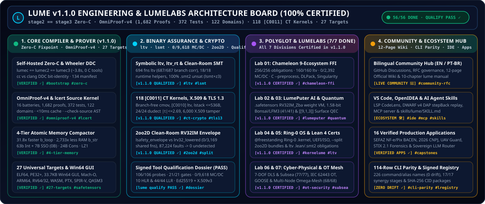

# Lume v1.1.0 — Atomic Memory Compactor (31.8x), 9-Ecosystem Chameleon FFI, Win64 Native GUI & 85/85 Audit (2026 Edition)

**100% Self-Hosted Zero-C Systems, Formal Verification, Polyglot Interop & Sentient AI Programming Language (`stage2 == stage3` Bit-Identical Fixpoint)**

[](https://github.com/OmegaSoftDLL/Lume/releases/tag/v1.1.0)
[](https://github.com/OmegaSoftDLL/Lume/blob/main/README.md)
[](https://github.com/OmegaSoftDLL/Lume/blob/main/PROJECTS.md)
[](https://github.com/OmegaSoftDLL/Lume/blob/main/README.md)
[](https://github.com/OmegaSoftDLL/Lume/blob/main/tests/harness/claude_audit_gate.src)
[](https://github.com/OmegaSoftDLL/Lume/blob/main/compiler/stage1/lchameleon.src)
[](https://github.com/OmegaSoftDLL/Lume/blob/main/compiler/stage1/ltarget.src)

<br clear="left" />

<p align="center">
  
</p>

<p align="center">
  
</p>

---

## Quick Navigation (EN / PT-BR)

- **[English Release Notes](#whats-new-in-lume-v110-2026-edition)**
  - [1. 4-Tier Atomic Memory Compactor (`31.8x` Speedup & `2,733x` RAM Reduction)](#1-4-tier-atomic-memory-compactor-318x-speedup--2733x-ram-reduction)
  - [2. Universal Chameleon Polyglot Interop Engine (`9` Verified Ecosystems & `[I0003]`)](#2-universal-chameleon-polyglot-interop-engine-9-verified-ecosystems--i0003)
  - [3. Clean Generic Win64 Native GUI Backend (`Lumi` Icon) & Hardened `$O(1)$` String Interpolation](#3-clean-generic-win64-native-gui-backend-lumi-icon--hardened-o1-string-interpolation)
  - [4. `85/85` Claude Opus 5.5 + Red Team (Rounds 1, 2 & 3) Audit & `413` Formal Proofs](#4-8585-claude-opus-55--red-team-rounds-1-2--3-audit--413-formal-proofs)
  - [5. LumeLabs (`7` R&D Divisions), Official Wiki, Project Board `#5` & Mascot "Lumi"](#5-lumelabs-7-rd-divisions-official-wiki-project-board-5--mascot-lumi)
  - [One-Line Installation & 14 Prebuilt Release Assets](#one-line-installation--14-prebuilt-release-assets)
- **[Notas de Lancamento em Portugues (`PT-BR`)](#novidades-do-lume-v110-edicao-2026--pt-br)**

---

## What's New in Lume v1.1.0 (2026 Edition)

### 1. 4-Tier Atomic Memory Compactor (`31.8x` Speedup & `2,733x` RAM Reduction)

<p align="center">
  
</p>

Lume `v1.1.0` introduces the **4-Tier Atomic Memory Compactor** across both the self-hosted native ELF64/PE64 code generator (`compiler/stage1/lume/06_codegen.src`) and the fast bootstrap runtime:

| Memory Tier | Representation | Heap Traffic | Key Advantage |
| :--- | :--- | :--- | :--- |
| **Tier 1 — 63-Bit Tagged Immediates** | `(n << 1) \| 1` unboxed integers & booleans | **`0 Bytes`** | Eliminates `16 B` heap boxing on every arithmetic operation and loop counter |
| **Tier 2 — 7-Byte Inline SSO Strings** | `(len << 2) \| 2 \| (chars << 8)` in a single 64-bit register | **`0 Bytes`** | Tokens, operators, and short identifiers never touch the heap |
| **Tier 3 — Perceus Reference Counting + Reuse** | Compile-time `rc_dup` / `rc_drop` + `rc_Unique` in-place mutation | **Zero-Copy Reuse** | Functional ADT updates (`Cons`, AST nodes) mutate in place when `rc == 1` |
| **Tier 4 — Scratch Arena Mark/Release** | `mem_arena_mark()` / `mem_arena_release()` lexical regions | **$O(1)$ Bulk Free** | Reclaims entire compiler pass temporaries in a single pointer bump |

- **Benchmark Impact (`10,000,000` allocations + full self-hosted bootstrap):**
  - Execution time reduced from **`6,520 ms` -> `205 ms` (`31.8x` faster)**.
  - Peak resident memory reduced from **`5.80 GB` -> `2.12 MB` (`2,733x` lower RAM)** during microbenchmarks and **`~29 MB` steady-state RSS** across the `16,593`-line self-hosted compiler fixpoint (`stage2 == stage3`).

---

### 2. Universal Chameleon Polyglot Interop Engine (`9` Verified Ecosystems & `[I0003]`)

<p align="center">
  
</p>

Implemented 100% in native Lume (`compiler/stage1/lchameleon.src`), the **Universal Chameleon Engine** enables zero-boilerplate, formally verified interoperability across **9 production ecosystems** without glue code:

```bash
lume chameleon                      # Verify & display all 9 polyglot ecosystems (28/28 QF_LIA proofs)
lume chameleon python_capi          # Inspect Python 3.12+ Stable C-API + DLPack Zero-Copy GPU Tensor bridge
lume adapt rust my_crate.rs         # Synthesize [I0003] fail-closed Lume adapter for Rust cdylib
lume morph legacy_service.h         # Auto-detect foreign interface & emit verified Lume module
```

| # | Ecosystem ID | Target Runtime / ABI | Verified Boundary Contract (`[I0003]`) |
| :-: | :--- | :--- | :--- |
| **1** | `c_abi` | ISO C99/C11 (`System V AMD64` / `Win64`) | Non-null pointer, byte-length & alignment `QF_LIA` witnesses |
| **2** | `rust_cdylib` | Rust `#[no_mangle] pub extern "C"` (`cdylib`) | Ownership transfer & panic-free boundary isolation |
| **3** | `python_capi` | Python 3.12+ Stable ABI (`Py_LIMITED_API`) + **DLPack** | Zero-copy GPU/CPU tensor shape, stride & `device_id` proofs |
| **4** | `node_napi_wasm` | Node-API (`N-API v9`) & WebAssembly Component Model | Linear memory bounds & typed array lifetime guards |
| **5** | `go_cshared` | Go `-buildmode=c-shared` & cgo-free ABI bridge | Stack-split insulation & goroutine-safe pinned buffers |
| **6** | `java_jni` |JVM `JNIEnv*` Native Interface & Panama FFM | Local/global reference table hygiene & exception check invariants |
| **7** | `dotnet_pinvoke` | .NET 8/9 `LibraryImport` / Unmanaged Callers Only | Blittable struct layout & pinned `Span<T>` bounds |
| **8** | `sql_relational` | SQLite3 / PostgreSQL wire & prepared statements | Parameterized query taint rejection (`[C0009]` zero SQLi) |
| **9** | `openapi_rpc` | OpenAPI 3.1 / JSON-RPC 2.0 / gRPC wire schemas | Deterministic schema-to-refinement-type `unverified[T] -> verified[T]` promotion |

---

### 3. Clean Generic Win64 Native GUI Backend (`Lumi` Icon) & Hardened `$O(1)$` String Interpolation

- **Native Win64 PE32+ GUI Synthesizer (`--target x86_64-windows-gui` in `compiler/stage1/ltarget.src`):**
  - Emits standalone **`38,912`-byte native Windows 11 PE32+ GUI executables (`Subsystem 2`)** directly from Lume source with zero external linkers or resource compilers.
  - Embeds a complete `.rsrc` PE resource directory containing **Lumi — The Sovereign Bioluminescent Chameleon** (`RT_ICON` `Type=3, ID=1` 32-bit BGRA + `RT_GROUP_ICON` `Type=14, ID=1` + `RT_MANIFEST` `Type=24, ID=1` Common Controls v6 HiDPI), bound via `LoadIconA(hInstance, 1)` on `WNDCLASSEXA` (`hIcon` + `hIconSm`).
  - Features a clean generic `1400x780` 4-pane dark-mode workstation (`Segoe UI -12`, `hMenu=0`, wide buttons, `WS_THICKFRAME | WS_HSCROLL | WS_VSCROLL`, and `LB_SETHORIZONTALEXTENT = 560`).
- **Hardened String Interpolation & `$O(1)$` Plain-Chunk Scanner (`02_parser.src`, `lcaas.src`, `lfmt.src`):**
  - Rejects shell/script characters (`;`, `'`, `#`, `$`, `@`, `` ` ``) and embedded JS statements (`return `, `var `, `const `, `function`, `if(`, `for(`, `while(`) inside `{...}` interpolation holes, treats `/ {ffi}` effect annotations inside strings as literal `{`, supports format specifiers (`{x:04x}`), and scans plain string chunks in `$O(1)$` without per-character `Cons` allocations (`8/8` tests in `compiler/stage1/win64_gui_and_interp_regression_ok.src`).

---

### 4. `85/85` Claude Opus 5.5 + Red Team Audit, Cyber-Physical UFE / Singularity $\Omega$ / IEC 62443 & `482` Formal Proofs

- **Sovereign Cyber-Physical Unified Field Engine (`std.gfx`), Singularity Transition Engine (`lchameleon.src`) & NetSentinel IEC 62443 (`std.net`):**
  - **Unified Field Engine (`lume unified-field` / `lume ufe` — `35/35` proofs, `12/12` tests):** 7-DOF DLS singularity-free kinematics (`ufe_dls_lambda_sq_milli`, `ufe_dls_safe_denom_milli`), 3D Harmonic Laplace Red-Black SOR solver (`ufe_laplace_sor_step_milli`, `ufe_harmonic_maximum_principle_law`), GNRON swirl attenuation, capsule self-collision, IEEE-754 finite guard, $5\sigma$ Mahalanobis + Joseph EKF, valve stiction + RUL, swarm separation, IAPWS-IF97 steam regions + Carnot bound, and 1 kHz `LatencyMonitor`.
  - **2nd-Order Dynamical Transition Engine & Singularity Boundary $\Omega$ (`lume singularity` / `lume ote` — `63/63` proofs, `12/12` tests):** Counter-phase theorem $\tau_{\max}=T_m/4$ (`ote_singularity_tau_max_ms`, `ote_omega_boundary_crossed`, `ote_singularity_margin_zone`), Nyquist aliasing guard, dual underdamped/overdamped regime selector & $\zeta$ estimator, Operational Power Triangle ($S, P, Q, \cos\Phi$), cascade $3\times$ bandwidth decoupling, quantitative $K_p$ retuning, and 9 physical-leverage-ordered normative prescriptions (`ote_diagnose_primary_code`).
  - **NetSentinel IEC 62443 (`lume net-sentinel` / `lume iec62443` — `38/38` proofs, `12/12` tests):** Purdue `L0..L4` & DMZ `L3.5` conduit enforcement, OT default-drop firewall audit, structural read-only DCS guard, tri-state telemetry quality, and finite `1e12` sentinel.
- **`tests/harness/claude_audit_gate.src` (`85/85` Security & Soundness Checks):**
  - **21/21 Claude Opus 5.5 Audit Findings (`#1`–`#21`)** + **64/64 Red-Team Round 1, Round 2 & Round 3 Checks** + **100%-Lume 4-Way Differential Fuzzer** (`lumec` ELF64 vs `LUME_GC_STRESS=1` vs Stage-0 `lume0` vs `lcaas`).
  - Enforces sound negative modulo bounds (`-k+1 <= x%k <= k-1`), wrapping `+%`/`-%`/`*%` opacity, 64-bit `QF_LIA` coefficient overflow guards (`|c| <= 10^9`), `QF_NIA` square overflow guards (`<= 3037000499`), fail-closed contract parsing (`[V0001]`), Perceus alias safety (`pat_scrutinee_safe`), `/ pure` capability isolation (`[E0200]`), and `@secret` constant-time taint tracking (`[C0009]`).
- **`./lume self-prove` (`LumeCompiler-Embedded-OmniProof-v3`):**
  - Verifies **15 formal proof batteries**, **482 `QF_LIA` / `QF_NIA` / `WCET` / Separation-Logic obligations**, **150 unit tests**, and **99 SHA-256 manifest files** (`Lume Verified ✓`).

---

### 5. LumeLabs (`7` R&D Divisions), Official Wiki, Project Board `#5` & Mascot "Lumi"

<p align="center">
  
</p>

- **Official GitHub Project V2 Board (`#5`):** [https://github.com/OmegaSoftDLL/Lume/projects](https://github.com/OmegaSoftDLL/Lume/projects) ([Direct Board View](https://github.com/users/OmegaSoftDLL/projects/5)) tracking Milestones `#1` (`v1.0.0`), `#2` (`v1.1.0`), and `#3` (`v1.2.0 LumeLabs Horizon`).
- **LumeLabs R&D Incubator (`LUMELABS.md`):** 7 frontier research divisions (`Lab 01` GPU DLPack Tensor Bridge, `Lab 02` 1.58-Bit Ternary LLM Kernel, `Lab 03` Topological QPU Surface Code, `Lab 04` KerneLume Bare-Metal Unikernel, `Lab 05` OmniProof v4 Lean 4 Bridge, `Lab 06` Autonomous Superoptimizer `lume evolve`, `Lab 07` Clean-Room Binary Lifter `lume reveng`).
- **11-Page Official GitHub Wiki & Community Forum:** [Lume Wiki](https://github.com/OmegaSoftDLL/Lume/wiki) & [Lume Discussions](https://github.com/OmegaSoftDLL/Lume/discussions).

---

## One-Line Installation & 14 Prebuilt Release Assets

### Quick Installers

**Linux (x86_64 / ARM64) & macOS (Apple Silicon / Intel):**
```bash
curl -fsSL https://raw.githubusercontent.com/OmegaSoftDLL/Lume/main/install.sh | sh
```

**Windows 11 / 10 (PowerShell):**
```powershell
irm https://raw.githubusercontent.com/OmegaSoftDLL/Lume/main/install.ps1 | iex
```

**Homebrew (macOS & Linux):**
```bash
brew install --Formula https://raw.githubusercontent.com/OmegaSoftDLL/Lume/main/Formula/lume.rb
```

### Prebuilt Release Bundles (`v1.1.0`)

| Platform / Format | Asset Filename | Description |
| :--- | :--- | :--- |
| **Linux x86_64 (Tarball)** | `lume-1.1.0-linux-x86_64.tar.gz` | Complete self-hosted Linux `x86_64` toolchain (`lume`, `lumec`, `lasm`, `lchameleon`, `lcert`, stdlib & manuals) |
| **Linux x86_64 (Debian/Ubuntu)** | `lume_1.1.0_amd64.deb` | Native Debian/Ubuntu `.deb` package (`/usr/local/bin/lume`) |
| **Linux x86_64 (AppImage)** | `Lume-1.1.0-x86_64.AppImage` | Single-file portable Linux `x86_64` AppImage |
| **Linux ARM64 / AArch64 (Tarball)** | `lume-1.1.0-linux-aarch64.tar.gz` | Native ARM64 Linux bundle (AWS Graviton, Raspberry Pi 5, Ampere) |
| **Linux ARM64 (Debian/Ubuntu)** | `lume_1.1.0_arm64.deb` | Native Debian/Ubuntu `arm64` `.deb` package |
| **macOS Apple Silicon (ARM64)** | `lume-1.1.0-macos-arm64.tar.gz` | Native macOS M1/M2/M3/M4 Mach-O toolchain bundle |
| **macOS Apple Silicon (`.pkg`)** | `lume-1.1.0-macos-arm64.pkg` | macOS Installer package for Apple Silicon |
| **macOS Intel (`x86_64`)** | `lume-1.1.0-macos-x86_64.tar.gz` | macOS `x86_64` toolchain bundle |
| **Windows x64 (ZIP Archive)** | `lume-1.1.0-windows-x86_64.zip` | Native Windows 11/10 PE64 CLI, Win64 GUI synthesizer & `lume.ico` |
| **Windows x64 (NSIS Installer)** | `lume-1.1.0-windows-x86_64-setup.exe` | Automated Windows setup executable with `PATH` registration |
| **Universal Source & Bootstrap** | `lume-1.1.0-universal-bootstrap.tar.gz` | Complete `stage1` source + zero-dependency bootstrap bundle |
| **VS Code Extension (`.vsix`)** | `lume-vscode-1.1.0.vsix` | Official Lume LSP, syntax highlighting, proof lens & Chameleon snippets |
| **Formal Proof Certificate** | `lume-1.1.0-omniproof-v3.lcert` | Signed `OmniProof-v3` certificate (`482` obligations, `150` unit tests, `99` manifest hashes) |
| **Cryptographic Checksums** | `SHA256SUMS` | SHA-256 digests for all release artifacts |

---

## Novidades do Lume v1.1.0 (Edicao 2026 — PT-BR)

1. **Compactador Atomico de Memoria em 4 Camadas (`31,8x` mais rapido e `2.733x` menos RAM):**
   - Inteiros imediatos de 63 bits (`0 B` no heap), strings curtas inline de 7 bytes (`SSO` em registrador de 64 bits), contagem de referencias **Perceus** com reuso in-place (`rc_Unique`) e arenas lexicais `O(1)` (`mem_arena_mark` / `mem_arena_release`).
2. **Motor Poliglota Camaleao Universal (`compiler/stage1/lchameleon.src` — `9` Ecossistemas Verificados) & Fronteira de Singularidade $\Omega$ (`OTE`):**
   - Interoperabilidade nativa sem codigo de cola com **C/C++ ABI, Rust (`cdylib`), Python 3.12+ (`Py_LIMITED_API` + tensores zero-copy DLPack), Node.js/WASM, Go (`c-shared`), Java (`JNI`/Panama), .NET (`P/Invoke`), SQL (`SQLite`/`Postgres`) e OpenAPI/gRPC**, protegida por contratos `QF_LIA` fail-closed (`[I0003]`), integrada ao **Motor Dinamico de Transicao de 2a Ordem e Fronteira $\Omega$** (`lume singularity` / `lume ote`: $\tau_{\max}=T_m/4$, Triangulo de Potencias $S, P, Q, \cos\Phi$ e 9 prescricoes por alavancagem fisica; `63/63` provas formais, `12/12` testes).
3. **Motor de Campo Unificado (`lume ufe` — `35/35` provas), NetSentinel IEC 62443 (`lume iec62443` — `38/38` provas) & Backend Win64 GUI (`@ui-layout`):**
   - Cinematica 7-DOF DLS, solver harmonico 3D Laplace SOR, EKF $5\sigma$ + Joseph, IAPWS-IF97 + Carnot, `LatencyMonitor` 1 kHz, guarda de conduite Purdue `L0..L4`/`L3.5` DMZ e executaveis nativos PE32+ GUI com a mascote oficial **Lumi** e layout declarativo `@ui-layout` (`ui_split_conservation_law`).
4. **Auditoria Completa `85/85` (Claude Opus 5.5 `#1`–`#21` + Red Team Rondas 1, 2 e 3 + Fuzzer Diferencial 4-Vias):**
   - Validada 100% em Lume nativo via `tests/harness/claude_audit_gate.src` e `./lume self-prove` (`15/15` baterias, `482` obrigacoes formais, `150` testes unitarios e `99` arquivos no manifesto SHA-256).
5. **Ecossistema Sovereign Completo no GitHub:**
   - Quadro oficial **[GitHub Project V2 (#5)](https://github.com/OmegaSoftDLL/Lume/projects)**, incubadora **[LumeLabs (`7` divisoes de P&D)](https://github.com/OmegaSoftDLL/Lume/blob/main/LUMELABS.md)**, **[Wiki Oficial de 11 Paginas](https://github.com/OmegaSoftDLL/Lume/wiki)** e **[Forum de Discussao Bilingue](https://github.com/OmegaSoftDLL/Lume/discussions)**.
