<link rel="icon" type="image/svg+xml" href="favicon.svg" />
<link rel="icon" type="image/png" sizes="512x512" href="favicon.png" />
<link rel="alternate icon" type="image/x-icon" href="favicon.ico" />
<link rel="apple-touch-icon" sizes="180x180" href="apple-touch-icon.png" />

<h1>
  
  Lume — Formally Verified Systems, AI &amp; Quantum Programming Language (<code>v1.1.0</code>)
</h1>

**Compile-Time Mathematical Verification (`OmniProof-v4`: `QF_LIA` / `QF_NIA` / `lcert` / `ltv` / `lsmt`) · 100% Self-Hosted Zero-C Compiler (`stage2 == stage3`) · `118` `[C0011]` Constant-Time Crypto Kernels · `2oo2D` Clean-Room Safety Envelope · 9-Ecosystem Chameleon FFI · 27 Target Architectures**

<br clear="left"/>

[**Install**](#official-installation-v110--linux-macos--windows) · [**Quickstart**](#quickstart--built-in-bilingual-manual) · [**Qualification Dossier (`PASS`)**](certification/QUALIFICATION_DOSSIER.md) · [**Audit Report (`PT-BR`)**](RELATORIO_AUDITORIA_E_CERTIFICACAO_CLAUDE_PT_BR.md) · [**LumeLabs (`LUMELABS.md`)**](LUMELABS.md) · [**Projects (`PROJECTS.md`)**](PROJECTS.md) · [**Community (`COMMUNITY.md`)**](COMMUNITY.md) · [**Wiki**](https://github.com/OmegaSoftDLL/lume/wiki) · [**GitHub Discussions**](https://github.com/OmegaSoftDLL/lume/discussions) · [**Manual (`EN`)**](LUME_MANUAL_EN.md) · [**Manual (`PT-BR`)**](LUME_MANUAL_PT_BR.md)



> **Production Release (`v1.1.0` — Edition 2026):**
> Lume's entire production compiler, assembler, theorem prover, translation validator, MC/DC analyzer, constant-time cryptographic stack, polyglot FFI generator, LSP/DAP/REPL server, and qualification harness are written **100% in Lume itself** (`stage2 == stage3` bit-identical in `~3.8 s` with C compilers blocked). Every build ships with **`OmniProof-v4`** (**`1,682` proven obligations across `16` batteries**, **`0` runtime-checked or refuted**, **`372` unit tests**, **`122` sovereign domains**, **`134` SHA-256-verified manifest files**) and an Ed25519 + X.509v3-signed **[Tool Qualification Dossier (`PASS`)](certification/QUALIFICATION_DOSSIER.md)** (**`106/106` probes**, **`21/21` gates**, **`10` HLR + `44/44` LLR `VERIFIED`**, **`694` functions translation-validated by `ltv`**, **`18/18` runtime helpers proven by `ltv_rt`**, **`100%` `.smt2` `unsat` in clean-room `lsmt` & `z3`**, and **`0/9,618` uncovered MC/DC conditions**).

---

## Universal Chameleon Polyglot Interoperability (`lchameleon.src` — 9 Ecosystems)


Lume's **Universal Chameleon Polyglot Engine** (`lume chameleon`, `lume adapt <eco>`, `lume morph <file>`) bridges **9 verified ecosystems** (`c_abi` with built-in C header preprocessor, `rust_cdylib`, `python_capi` with DLPack zero-copy tensors, `node_napi_wasm`, `go_cshared`, `java_jni`, `dotnet_pinvoke`, `sql_relational`, and `openapi_rpc`) through fail-closed **`[I0003]` `QF_LIA` refinement contracts** (`unverified[T] -> verified[T]` under `/ {ffi}`, **`256/256` certified obligations**, `160/160` `ltv`-validated, **`0/2,392` uncovered MC/DC**, `19/19` unit tests).

<br clear="right"/>


---

## Cyber-Physical Control, 7-DOF Robotics, Singularity Boundary Ω & IEC 62443 Security

- **Unified Field & Subsea Engineering Engine (`lume unified-field` / `lume ufe` / `lume subsea` in `gfx.src`, `77/77` proofs, `15/15` tests):** 7-DOF singularity-free Damped Least-Squares kinematics, 3D Harmonic Laplace Red-Black SOR solver, $5\sigma$ Mahalanobis + Joseph-form EKF, actuator stiction & RUL estimation, IAPWS-IF97 steam thermodynamics & Carnot bounds, 1 kHz deterministic load shedding, DNV/API subsea catenary & bending stress, Free-Span VIV & Palmgren-Miner fatigue, offshore heavy-lift DAF floor, Bühlmann ZH-L16C hyperbaric decompression, Wait & Weight well-kill, and ASME B31G corroded pipeline burst guard.
- **Dynamical Singularity Boundary ($\Omega$), Statistical Process Control & Weight-Compiled `LumePuter` (`lchameleon.src`, `256/256` obligations, `19/19` tests):** Dual-regime 2nd-order step identification ($\zeta \in (0, 100]$), Operational Power Triangle ($S, P, Q, \cos\Phi$), counter-phase Singularity Boundary $\tau_{\max} = T_m/4$, Nyquist aliasing guard, Bayesian Beta-Binomial conjugate SPC, Page's tabular CUSUM, CPM float, $k$-anonymous monotonic PAVA, `Posit-Quire` exact dot-product accumulation, and `LumePuter` weight-compiled `RV32IM_Zba` + Gated-DeltaNet execution (`--target safetensors`, `--target lumeputer-rv32im-weights`).
- **Industrial OT Security (`IEC 62443`), Conduite & Omega-Mesh P2P (`net.src`, `68/68` proofs, `27/27` tests):** Purdue `L0..L4` & `L3.5` DMZ conduit enforcement, default-drop OT firewall policy auditing, structural read-only DCS guard, IEC 61850 GOOSE `stNum`/`sqNum` transition verification, HA failover parity, and Omega-Mesh P2P framing, Kademlia DHT healing, Raft quorum/backtrack, and TOFU pinning.

---

## Official Installation (`v1.1.0` — Linux, macOS & Windows)

### 1. One-Command Official Installer (Linux `x86_64`/`aarch64`/`riscv64`, macOS Apple Silicon & Intel, WSL2)

```sh
curl -fsSL https://omegasoftdll.github.io/lume/install.sh | sh
export PATH="$HOME/.lume/bin:$PATH"
lume --version
lume self verify
lume self-prove
```

Or via Homebrew:

```sh
brew install OmegaSoftDLL/lume/lume
lume --version
```

### 2. Windows x64 (PowerShell)

```powershell
irm https://github.com/OmegaSoftDLL/lume/releases/latest/download/install.ps1 | iex
lume --version
lume self verify
```

### 3. Prebuilt Platform Archives (`v1.1.0`)

| Platform / Architecture | Official Archive (`v1.1.0`) |
| :--- | :--- |
| **Linux x86-64 (`ELF64`)** | [`lume-v1.1.0-linux-x86_64.tar.gz`](https://github.com/OmegaSoftDLL/lume/releases/download/v1.1.0/lume-v1.1.0-linux-x86_64.tar.gz) |
| **Linux ARM64 (`aarch64` `ELF64`)** | [`lume-v1.1.0-linux-aarch64.tar.gz`](https://github.com/OmegaSoftDLL/lume/releases/download/v1.1.0/lume-v1.1.0-linux-aarch64.tar.gz) |
| **Linux RISC-V (`riscv64` `ELF64`)** | [`lume-v1.1.0-linux-riscv64.tar.gz`](https://github.com/OmegaSoftDLL/lume/releases/download/v1.1.0/lume-v1.1.0-linux-riscv64.tar.gz) |
| **macOS Apple Silicon (`aarch64` `Mach-O 64`)** | [`lume-v1.1.0-macos-aarch64.tar.gz`](https://github.com/OmegaSoftDLL/lume/releases/download/v1.1.0/lume-v1.1.0-macos-aarch64.tar.gz) |
| **macOS Intel (`x86_64` `Mach-O 64`)** | [`lume-v1.1.0-macos-x86_64.tar.gz`](https://github.com/OmegaSoftDLL/lume/releases/download/v1.1.0/lume-v1.1.0-macos-x86_64.tar.gz) |
| **Windows x64 (`PE32+`)** | [`lume-v1.1.0-windows-x86_64.tar.gz`](https://github.com/OmegaSoftDLL/lume/releases/download/v1.1.0/lume-v1.1.0-windows-x86_64.tar.gz) |
| **Cryptographic Checksums** | [`SHA256SUMS`](https://github.com/OmegaSoftDLL/lume/releases/download/v1.1.0/SHA256SUMS) |

---

## Quickstart & Built-In Bilingual Manual

```sh
lume manual                        # Built-in 10-chapter Programmer's Manual (English)
lume manual --pt                   # Manual Interno Completo em Portugues (pt-BR)
lume chameleon                     # Inspect all 9 verified polyglot ecosystems & [I0003] contracts
lume run examples/01_hello.lume    # Run a program
lume prove app.src                 # Verify requires/ensures/law/@bound/@no_alloc/@secret contracts
lume certify app.src > cert.json   # Emit SHA-256-bound proof certificate
lume tv app.src --exec             # Symbolic x86-64 machine-code translation validation
lume mcdc app.src --exec           # Native-binary Masking MC/DC coverage verification
lume build app.src -o app          # Compile standalone native executable (Zero-C)
lume self-prove                    # Run all 16 OmniProof-v4 batteries (1,682 obligations, 372 tests)
lume qualify --verify              # Re-verify Ed25519 + X.509v3 signed Qualification Dossier
```

---

## Documentation & Architecture Index

### Qualification Dossier, Manuals & Technical Papers
- [**Repository Overview (`README.md`)**](https://github.com/OmegaSoftDLL/lume) — Architecture, installation, language tour, memory compactor, safety certification, 27 targets, and quality gates.
- [**Signed Tool Qualification Dossier (`PASS`, EN)**](certification/QUALIFICATION_DOSSIER.md) · [**TOR**](certification/TOR_TOOL_OPERATIONAL_REQUIREMENTS.md) · [**TQP**](certification/TQP_TOOL_QUALIFICATION_PLAN.md) · [**RTM (`44/44` LLR)**](certification/RTM_TRACEABILITY_MATRIX.md)
- [**Independent Audit & Qualification Report (`pt-BR`)**](RELATORIO_AUDITORIA_E_CERTIFICACAO_CLAUDE_PT_BR.md)
- [**Lume `v1.1.0` Technical Paper (`EN`)**](LUME_TECHNICAL_PAPER.md) · [**Artigo Técnico (`pt-BR`)**](LUME_TECHNICAL_PAPER_PT_BR.md)
- [**Memory Architecture & 4-Tier Atomic Compactor Dossier (`EN`)**](39-memory-saga-and-atomic-compactor-dossier.md) · [**Dossiê da Memória (`pt-BR`)**](LUME_MEMORY_SAGA_DOSSIER_PT_BR.md)
- [**Multi-Board `2oo2D` Split Safety Bundle Specification**](41-safety-envelope-split-bundle.md)
- [**English Programmer's Manual (10 Chapters)**](LUME_MANUAL_EN.md) · [**Manual do Programador em Português (`pt-BR`, 10 Capítulos)**](LUME_MANUAL_PT_BR.md)
- [**Security Remediation & Red-Team Report (`EN`)**](LUME_REMEDIATION_AND_REDTEAM_REPORT.md) · [**Relatório de Segurança (`pt-BR`)**](LUME_REMEDIATION_AND_REDTEAM_REPORT_PT_BR.md)
- [**Engineering State & Invariants (`PROJECT_STATE.md`)**](PROJECT_STATE.md) · [**Capability Acceptance Matrix (`24/24 PASS`)**](acceptance-matrix.md)

### Language Specification, Runtime & Subsystems
- [02 — Design Principles](02-principles.md) · [03 — Language Specification](03-specification.md) · [05 — Vision](05-vision.md)
- [14 — Zero-C Self-Hosted Steady State](14-zero-c.md) · [38 — Memory Management & Segregated Collector](38-memory-management.md) · [38 — Incremental Compilation](38-incremental-compilation.md)
- [19 — Intent Synthesis & Compiler Oracle](19-intent-as-source.md) · [20 — Fail-Closed C, WASM & Chameleon Interop](20-interop.md) · [26 — 27 Universal Targets](26-targets.md)
- [27 — Bare-Metal Systems & Kernels](27-systems-and-kernels.md) · [06 — Binary Protection & Symbolizer](06-software-protection.md) · [30 — The Lume Book](30-lume-book.md)
- [35 — Bounded Economic Benchmark](35-economic-benchmark.md) · [36 — Verified Component Registry](36-verified-component-registry.md) · [37 — Portable Renewable Evidence](37-portable-renewable-evidence.md)

---

## LumeLabs, Community & Official Lumi Mascot Gallery


| **Lumi Mascot Illustration** (`lume-mascot.jpg`) | **Chameleon Lambda Emblem** (`lume-chameleon-emblem.jpg`) | **App & IDE Icon** (`lume-icon.jpg` / `lume.ico`) | **Harmonized Vector Badge** (`lume-mascot-badge.svg`) |
| :---: | :---: | :---: | :---: |
|  |  |  |  |

---

## Contributors & Engineering Co-Pilots

| Contributor | Role & Focus |
| :--- | :--- |
| **[Ricardo Bueno (`@OmegaSoftDLL`)](https://github.com/OmegaSoftDLL)** | Creator, Language Architect & Principal Systems Engineer |
| **Claude (AI-Assisted Engineering & Formal Verification Co-Pilot)** | Self-Hosted Compiler, Formal Verification (`QF_LIA` / `QF_NIA` / Separation Logic), Binary Assurance & Certification Tooling |
| **Kimi (AI-Assisted Engineering & Conformance Co-Pilot)** | Incremental Module Cache, Memory Arenas & Conformance Engineering |
| **AGY — Antigravity (AI-Assisted Engineering & Autonomous Verification Co-Pilot)** | Runtime Memory Compactor, Multi-Platform Release Engineering & Autonomous Verification |

---

*Licensed under **Apache-2.0**. Source repository: [`https://github.com/OmegaSoftDLL/lume`](https://github.com/OmegaSoftDLL/lume).*
