<h1>
  
  Guia Completo da Linguagem Lume v1.1.0 (Portugues - PT-BR)
</h1>
<br clear="left"/>

<div align="center">
  
  <br />
  
</div>

---

## 1. O Que e a Lume &amp; o Motor Camaleao Poliglota?


A **Lume (`v1.1.0`, Edicao 2026)** e uma linguagem de programacao de sistemas, interoperabilidade poliglota, verificacao formal matematica, inteligencia artificial e computacao quantica **100% auto-hospedada (`stage2 == stage3`, Zero-C)**.

Conheca a **Lumi**, nossa camaleoa mascote oficial! Assim como o camaleao se adapta instantaneamente a qualquer ecossistema com visao de 360 graus, o **Motor Camaleao Poliglota Universal (`lchameleon.src`)** da Lume conecta **9 ecossistemas** (`C/C++`, `Rust`, `Python DLPack`, `Node.js/WASM`, `Go`, `Java/JVM`, `C#/.NET`, `SQL` e `OpenAPI/gRPC`) com provas formais `QF_LIA` nas fronteiras (`[I0003]: unverified[T] -> verified[T]`).

<br clear="right"/>

<div align="center">
  
</div>

---

## 2. Mascote Oficial Lumi &amp; Aplicacoes Desktop GUI Nativas Win64


Com o alvo `--target x86_64-windows-gui`, a Lume compila codigo `.lume` / `.src` diretamente para um executavel **Windows 64-bit PE32+ GUI nativo (`33.792` bytes, `Subsystem 2`, Zero C/C++/Rust/.NET)** que ja traz embutido na secao `.rsrc` o icone oficial da **Lumi** (`RT_ICON` + `RT_GROUP_ICON` + `LoadIconA(hInstance, 1)`), fonte **Segoe UI `-12`** nos botoes da barra de ferramentas e **4 paineis internos independentemente redimensionaveis e com barras de rolagem horizontais e verticais ativas** (`WS_CLIPSIBLINGS | WS_THICKFRAME | WS_HSCROLL | WS_VSCROLL | LBS_DISABLENOSCROLL`).

<br clear="right"/>

---

## 3. Instalacao em 1 Comando

### Windows (PowerShell)
```powershell
irm https://raw.githubusercontent.com/OmegaSoftDLL/lume/main/scripts/install.ps1 | iex
```

### Linux, macOS e WSL2
```bash
curl -fsSL https://raw.githubusercontent.com/OmegaSoftDLL/lume/main/scripts/install.sh | sh
```

### Verificacao Pos-Instalacao
```bash
lume --version
lume self verify
lume self-prove
lume camaleao
```

---

## 4. Os 6 Pilares Soberanos da Lume

1. **Auto-Hospedagem Pura (`Zero-C`, `stage2 == stage3`):** O compilador `lumec` e o montador nativo `lasm` geram executaveis ELF64, PE32+ (`.exe`) e Mach-O 64 diretamente em codigo de maquina, sem depender de `gcc`, `clang` ou `ld`.
2. **Provador de Teoremas Embutido (`OmniProof v3`):** Verifica contratos `requires`, `ensures`, `invariant`, leis algebricas (`law`), orcamento de ciclos de hardware (`@bound(cycles: N)` `[V0002]`) e tempo constante criptografico (`@secret` `[C0009]`) em milissegundos, sem precisar do Z3 externo.
3. **Compactador Atomico de Memoria de 4 Niveis:** Reduziu o uso de RAM da compilacao auto-hospedada em **2.733 vezes** (de `> 16 GB OOM` para apenas **`36,9 KB` de heap vivo** e **`4,46 s`** de bootstrap) usando internacao em `.rodata`, inteiros tagged de 63 bits, strings curtas inline de 7 bytes (`SSO`), celulas `Cons` de `24 bytes` e compactacao `LZ1`.
4. **Motor Camaleao Poliglota Universal + Fronteira da Singularidade $\Omega$ + SPC Bayesiano (`lchameleon.src`, `68/68` obrigacoes):** Gera pontes bidirecionais verificadas para **9 ecossistemas** (`c_abi`, `rust_cdylib`, `python_capi` com tensores DLPack zero-copy, `node_napi_wasm`, `go_cshared`, `java_jni`, `dotnet_pinvoke`, `sql_relational` e `openapi_rpc`), alem do motor `OTE` ($\tau_{\max} = T_m/4$, Triangulo de Potencia, Cascata), SPC Bayesiano Beta-Binomial, CUSUM Tabular de Page, CPM Float e Regressao Isotonica PAVA $k$-Anonima.
5. **27 Alvos de Compilacao (`ltarget.src`), GUI Nativa Win64 (`x86_64-windows-gui`), UFE/Subsea (`77/77`) e NetSentinel/Conduite/Omega-Mesh (`68/68`):** Compila executaveis **GUI nativos do Windows (`33.792` bytes, `@ui-layout`)**, fisica ciber-fisica e submarina/offshore (`lume unified-field` / `lume subsea`: Catenaria S/J-lay, VIV, Fadiga de Miner, Guindaste DNV DAF, Descompressao Buhlmann ZH-L16C, Controle de Poco e ASME B31G) e seguranca OT/Mesh (`lume iec62443` / `lume conduite` / `lume omega-mesh`: Purdue L0..L4, HA Failover, GOOSE IEC 61850, Raft, Kademlia DHT, TOFU e ChannelMux).
6. **Auditoria Claude Opus 5.5 + Red Team + Waves 1–3 (`143/143`) e `557` Provas Formais:** 100% aprovado nos 21 itens de auditoria formal do Claude Opus 5.5, 64 testes adversariais de Red Team (Rounds 1, 2 e 3), 58 invariantes ciber-fisicos/subsea/mesh (Waves 1, 2 e 3), Fuzzer Diferencial de 4 Vias e `lume self-prove` (**`557` obrigacoes formais** e **`154` testes unitarios**).

<div align="center">
  
</div>

---

## 5. Comandos Essenciais da CLI (`lume --help`)

| Comando | Descricao |
| :--- | :--- |
| `lume run <arq.lume>` | Verifica provas formais, compila e executa imediatamente |
| `lume build <arq.lume> -o <bin>` | Compila para executavel nativo standalone (`ELF64` / `PE32+` / `Mach-O`) |
| `lume build <arq.lume> --target x86_64-windows-gui -o App.exe` | Gera aplicacao desktop Windows 64-bit GUI nativa (`33.792` bytes) com icone da Lumi |
| `lume prove <arq.lume>` | Executa o provador formal `QF_LIA` / `QF_NIA` / `WCET` / `@secret` |
| `lume certify <arq.lume>` | Emite certificado criptografico `.lcert` (`SHA-256` + `Ed25519` + `ML-DSA-65`) |
| `lume camaleao` / `lume chameleon` | Audita os 9 ecossistemas poliglotas e as `68` obrigacoes formais (`[I0003]` + OTE + SPC) |
| `lume unified-field` / `lume subsea` | Executa o motor ciber-fisico 7-camadas `UFE` + engenharia submarina/offshore (`77/77` provas) |
| `lume singularity` / `lume ote` | Executa o motor dinamico `OTE` ($\tau_{\max} = T_m/4$) + SPC Bayesiano/CUSUM/CPM/PAVA (`68/68` provas) |
| `lume iec62443` / `lume conduite` / `lume omega-mesh` | Executa a auditoria OT `NetSentinel` + `Conduite HA/GOOSE` + `Sovereign Mesh/Raft/DHT` (`68/68` provas) |
| `lume adapt <ecossistema>` | Sintetiza ponte FFI verificada (`rust_cdylib`, `python_capi`, `dotnet_pinvoke`, etc.) |
| `lume morph <arquivo>` | Converte header/schema externo (`.h`, `.rs`, `.py`, `.sql`, `.json`) em codigo Lume verificado |
| `lume manual --pt` | Exibe o manual completo em Portugues no terminal |
| `lume self-prove` | Executa as 15 baterias formais (**`557` obrigacoes** + **`154` testes unitarios**) |

Para a referencia completa de 23 capitulos em Portugues, consulte [`docs/LUME_MANUAL_PT_BR.md`](https://github.com/OmegaSoftDLL/lume/blob/main/docs/LUME_MANUAL_PT_BR.md).
