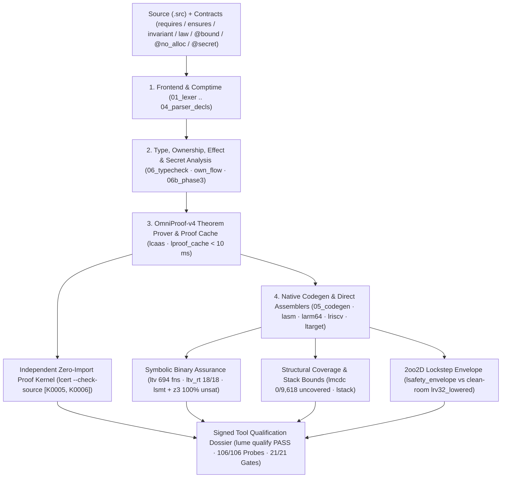

<h1>
  
  Lume v1.1.0 — Official Language Manual &amp; Architecture Encyclopedia
</h1>
<br clear="left"/>

<div align="center">

**Compile-Time Mathematical Verification (`OmniProof-v4`) · 100% Self-Hosted Zero-C Compiler (`stage2 == stage3`) · `118` `[C0011]` Constant-Time Crypto Kernels · `2oo2D` Clean-Room Safety Envelope · 9-Ecosystem Chameleon FFI · 27 Target Architectures**

[-10b981?style=for-the-badge&logo=github)](https://github.com/OmegaSoftDLL/lume/releases/tag/v1.1.0)
[-38bdf8?style=for-the-badge)](https://github.com/OmegaSoftDLL/lume/actions/workflows/ci.yml)
[](Formal-Verification-and-Prover)
[-16a34a?style=for-the-badge)](Binary-Assurance-Crypto-and-Qualification)
[-f59e0b?style=for-the-badge)](Universal-Chameleon-Polyglot-Engine)

<br />


<br />


</div>

---

## Overview — What Lume Is &amp; How It Is Engineered

**Lume (`v1.1.0`, Edition 2026)** is a statically typed, formally verified **systems, artificial intelligence, cyber-physical, and quantum programming language** created by **Ricardo Bueno ([`@OmegaSoftDLL`](https://github.com/OmegaSoftDLL))**. Lume is engineered from first principles so both human systems engineers and autonomous AI agents can write expressive high-level code whose mathematical contracts, memory discipline, constant-time cryptography, and emitted native machine code are verified end to end.

**Lume's entire production toolchain is written 100% in Lume itself (`compiler/stage1/`)**:

1. **Auditable Seed &amp; Diverse Double-Compilation (`bootstrap/lume0/`):** Bootstrap starts from a frozen ~4.8k-LoC C11 interpreter and ELF64 emitter locked by `bootstrap/lume0/SEED_FREEZE.sha256`. Under **David A. Wheeler's Diverse Double-Compilation (DDC)**, building the self-hosted compiler via independent C compilers (`cc` and `clang`) converges to the exact same SHA-256 native compiler binary (`0` byte difference).
2. **Zero-C Self-Hosted Steady State (`lumec1 == lumec2 == lumec3`):** Lume compiles, assembles, links, formats, tests, proves, and packages itself in **`~3.8 s`** with `cc`, `clang`, `as`, and `ld` completely blocked (`lume zero-c`), verified across **`134` SHA-256-locked manifest files** (`MANIFEST.sha256`) and **`114` table-driven CLI commands (`226` command &amp; alias names, `0` parity drift)**.
3. **Clean-Room Mutual Assurance:** Compiler obligations (`lcaas.src`) are independently checked by a zero-compiler-import proof kernel (`lcert.src --check-source`); emitted x86-64, AArch64, and RISC-V assembly is symbolically validated against AST semantics (`ltv.src`, `ltv_rt.src`, `ltv_multiarch.src`) and exported to `.smt2` certificates checked `unsat` by both Lume's clean-room solver (`lsmt.src`) and external `z3`; structural binary coverage reaches **`0/9,618` uncovered Masking MC/DC conditions** (`lmcdc.src`); critical functions execute in **`2oo2D` dual-channel lockstep** (`lsafety_envelope.src`) against a clean-room RV32IM compiler (`lrv32_lowered.src`) sharing **`0/3,169` functions** with `lumec`; and the entire chain is attested by an Ed25519 + X.509v3-signed **Tool Qualification Dossier (`lume qualify` — `PASS`)**.

<div align="center">
  
</div>

---

## Official Lumi Mascot, Brand Identity &amp; App Icon Gallery

<div align="center">

| Lumi — Bioluminescent Chameleon Mascot | 9-Ecosystem Chameleon Lambda Emblem | Official 3D App &amp; Desktop GUI Icon | Harmonized Vector Crest |
| :---: | :---: | :---: | :---: |
|  |  |  |  |
| `docs/assets/lume-mascot.jpg` | `docs/assets/lume-chameleon-emblem.jpg` | `docs/assets/lume-icon.jpg` (`lume.ico`) | `docs/assets/lume-mascot-badge.svg` |

</div>

---

## Complete Wiki Directory (10 Institutional Chapters)

| Wiki Page | Focus Area | Key Verified Capabilities |
| :--- | :--- | :--- |
| **[Installation &amp; Setup](Installation-and-Setup)** | Cross-platform setup, containers, AI skills &amp; source bootstrap | `install.sh`, `install.ps1`, Homebrew, GHCR OCI, `skills/lume`, `134` manifest files, `lume qualify --verify` |
| **[Language Tour &amp; Ergonomics](Language-Tour-and-Ergonomics)** | Contracts, affine ownership, effects, real-time &amp; CT types | `requires`/`ensures`/`invariant`/`law`, `own`/`&T`/`&mut T`, `/ pure` `[E0200]`, `@no_alloc` `[E0210]`, `@secret` `[C0011]`, `.intent` |
| **[Formal Verification &amp; Prover](Formal-Verification-and-Prover)** | Embedded `OmniProof-v4` multi-theory solver &amp; `lcert` kernel | `1,682` proofs, `372` tests, `122` domains; `QF_LIA` Farkas duals, `QF_NIA` Horner/Bernstein, `< 10 ms` cache, `--check-source` |
| **[Binary Assurance, Crypto &amp; Qualification](Binary-Assurance-Crypto-and-Qualification)** | Machine-code TV, clean-room SMT, MC/DC, CT crypto &amp; `2oo2D` | `694` `ltv` fns, `18/18` `ltv_rt`, `100%` `.smt2` `unsat`, `0/9,618` MC/DC, `118` `[C0011]` CT kernels, `87,224`-fault `2oo2D`, `lume qualify` `PASS` |
| **[Memory Saga &amp; Atomic Compactor](Memory-Saga-and-Atomic-Compactor)** | 4-Tier runtime, Perceus cell reuse &amp; demand-paged `LZ1` | **`31.8×` faster** `b_loop`, **`2,733×` less RAM** `b_str`, 63b unboxed int + 7B inline UTF-8, `24 B` `Cons`, 43-class GC |
| **[Universal Chameleon Engine](Universal-Chameleon-Polyglot-Engine)** | 9-ecosystem `[I0003]` FFI, `LumePuter` VM &amp; Singularity $\Omega$ | `256/256` proofs, `160/160` `ltv`, `0/2,392` MC/DC, C `--preprocess`, DLPack zero-copy, epoch guards, Bayesian SPC/CUSUM/PAVA |
| **[27 Compilation Targets](27-Universal-Compilation-Targets)** | Native OS binaries, Win64 GUI, GPU, RTL, neural &amp; quantum | ELF64, PE32+, `33,792` B Win64 GUI, Mach-O, ARM64, RV64/RV32, WASM, `.safetensors`, PTX, SPIR-V, Verilog/VHDL, QASM3, APK/IPA/ISO/UEFI |
| **[LumeLabs &amp; Community Hub](LumeLabs-and-Community-Hub)** | 7 research divisions, `v1.2.0` hardware horizon &amp; governance | Silicon `2oo2D` lockstep, HSM signing, Lean 4 metatheory, multi-node Omega-Mesh, EN/PT-BR community RFCs |
| **[Guia Completo (PT-BR)](Guia-Completo-PT-BR)** | Manual institucional completo em Português do Brasil | Instalação, sintaxe, `OmniProof-v4`, garantia binária `ltv`/`lmcdc`, `118` kernels CT, `2oo2D`, memória 4-Tier, Camaleão e 27 alvos |

---

## Compiler &amp; Mutual Assurance Pipeline



| Pillar | Core Modules (`compiler/stage1/`) | Machine-Verified Guarantee |
| :--- | :--- | :--- |
| **1. Zero-C Self-Hosted Compiler** | `lume/01_lexer.src` .. `07_driver.src`, `lasm.src`, `lmod.src`, `lcli.src` | `lumec == lumec2 == lumec3` (`0 diff`) + Wheeler DDC (`cc` vs `clang`); `lasm` byte-identical against GNU `as` across **`39,968` instructions**; **`114`-row CLI parity (`0` mismatches)** |
| **2. `OmniProof-v4` &amp; `lcert` Kernel** | `06_typecheck.src`, `06b_phase3.src`, `lcaas.src`, `lcert.src`, `lproof_cache.src` | **`1,682` obligations across `16` batteries** (`0` runtime/refuted), `372` tests, `122` domains; `QF_LIA` Farkas duals, `QF_NIA` Horner/square-completion, `< 10 ms` proof cache, `lcert --check-source` |
| **3. Binary Assurance, MC/DC &amp; `2oo2D`** | `ltv.src`, `ltv_rt.src`, `lsmt.src`, `lmcdc.src`, `lstack.src`, `lsafety_envelope.src`, `lrv32_lowered.src`, `lqualify.src` | **`694` `ltv` functions** (`687/687` branch correlation), **`18/18` runtime helpers**, **`100%` `.smt2` `unsat`**, **`0/9,618` uncovered MC/DC**, `87,224`-fault `2oo2D` RV32IM lockstep, signed **`lume qualify` `PASS`** |
| **4. 4-Tier Atomic Memory Runtime** | `own_flow.src`, `runtime_core.lume`, `arena.src`, `capsule.src` | `.rodata` singletons, 63-bit unboxed ints + 7-byte inline UTF-8 (`0 B` heap), `24 B` `Cons`, `32 B` records, Perceus reuse, 43-class GC, demand-paged `LZ1` (**`31.8×` faster**, **`2,733×` less RAM**) |
| **5. Constant-Time Crypto &amp; TLS 1.3** | `lcrypto_tls.src`, `lx509.src`, `lprotect.src`, `protect.src` | **`118` `@secret @no_alloc` `[C0011]` branch-free kernels** (`ltv` `[C0010]`, `lstack <= 536 B`, `24/24` `dudect` `\|t\| <= 2.690 < 4.5`), TLS 1.3, Ed25519 X.509v3 (`6,000/6,000` tamper rejections), SP 800-90B entropy |
| **6. Chameleon FFI, AI, OT &amp; 27 Targets** | `lchameleon.src`, `lneural_cartridge.src`, `lume_llm_core.src`, `gfx.src`, `net.src`, `lume_quantum_nexus_engine.src`, `ltarget.src` | **9-ecosystem `[I0003]` FFI** (`256/256` obligations), `.safetensors` &amp; `LumePuter` weight VMs, 7-DOF/Subsea (`77/77`), Singularity $\Omega$, IEC 62443/Omega-Mesh (`68/68`), Quantum Nexus, and **27 targets** |

<div align="center">
  
</div>

---

## Quickstart in 60 Seconds

### 1. Install Lume `v1.1.0`

**Linux, macOS &amp; WSL2:**
```sh
curl -fsSL https://github.com/OmegaSoftDLL/lume/releases/latest/download/install.sh | sh
export PATH="$HOME/.lume/bin:$PATH"
```

**Homebrew (macOS &amp; Linux):**
```sh
brew install OmegaSoftDLL/lume/lume
```

**Windows x64 (PowerShell):**
```powershell
irm https://github.com/OmegaSoftDLL/lume/releases/latest/download/install.ps1 | iex
```

### 2. Verify Toolchain Integrity &amp; Qualification Dossier

```sh
lume --version
lume self verify         # Verify SHA-256 digests of all 134 manifest files
lume self-prove          # Run OmniProof-v4 (16 batteries, 1,682 proofs, 372 tests, 122 domains)
lume qualify --verify    # Verify Ed25519 signature + X.509v3 chain of Qualification Dossier
```

### 3. Write, Prove, Certify &amp; Validate Machine Code (`kernel.src`)

```lume
@no_alloc
@bound(32)
fn clamp_dose(dose: int, lo: int, hi: int) -> int
  requires dose >= 0 and dose <= 10000 and lo >= 0 and lo <= hi and hi <= 5000
  ensures result >= lo and result <= hi
= if dose < lo then lo else if dose > hi then hi else dose

@secret
@no_alloc
fn ct_mux_u32(mask: int, a: int, b: int) -> int =
  let ma = bit_and(a, 4294967295) in
  let mb = bit_and(b, 4294967295) in
  ct_select(ct_eq(bit_and(mask, 1), 1), ma, mb)

print clamp_dose(700, 100, 500)
```

```sh
lume prove kernel.src                                    # QF_LIA, @bound [V0002], @no_alloc [E0210] & [C0011]
lume certify kernel.src > kernel.cert.json               # Emit SHA-256-bound proof certificate
lume verify-cert --check-source kernel.src kernel.cert.json # Independent lcert kernel + AST check
lume stack kernel.src --json                             # Exact worst-case stack byte bound
lume tv kernel.src --exec                                # Symbolic x86-64 equivalence + [C0010] CT check
lume mcdc kernel.src --exec                              # Native-binary Masking MC/DC witness execution
lume safety-envelope kernel.src --fn clamp_dose --args 700,100,500 # 2oo2D lockstep vs clean-room RV32IM
lume build --critical -g kernel.src -o kernel            # Standalone native binary + DWARF v4 debug info
```
