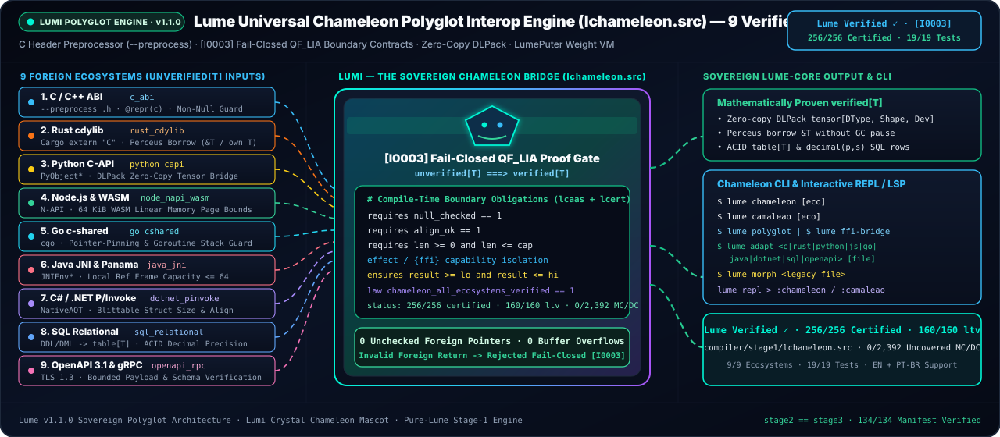
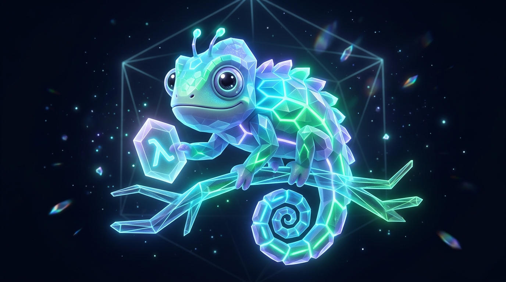
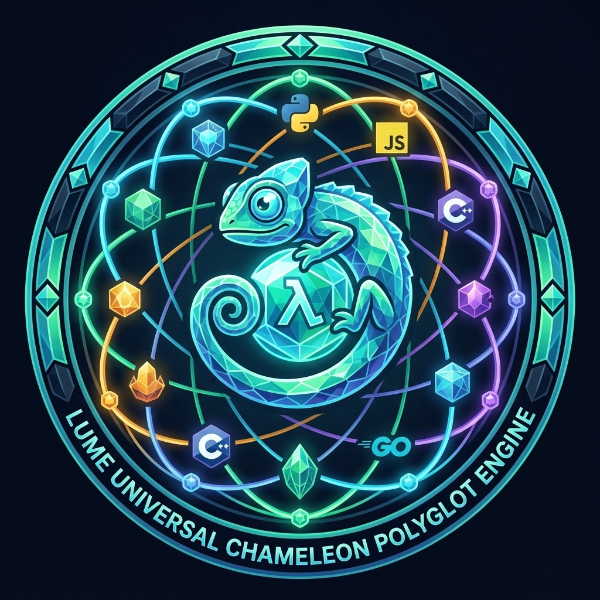
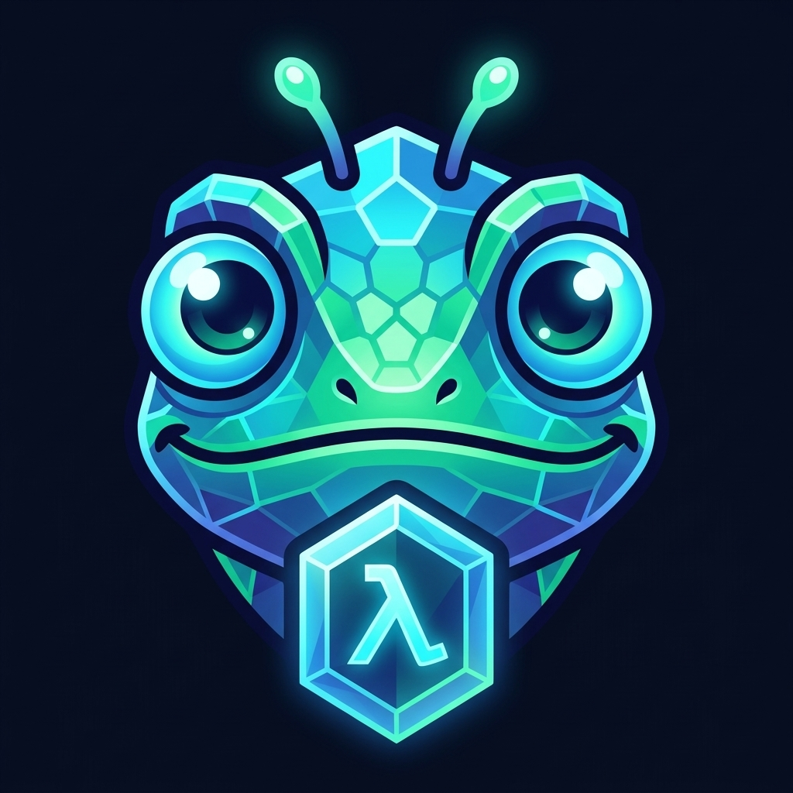
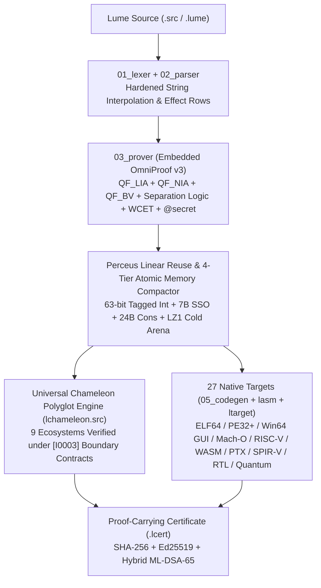
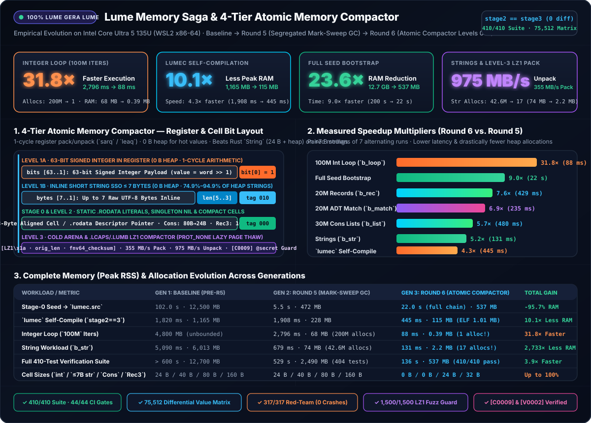

<h1>
  
  Lume v1.1.0 — Official Sovereign Wiki &amp; Architecture Encyclopedia
</h1>
<br clear="left"/>

<div align="center">

**The Self-Hosted, Formally Verified, Zero-C Systems, Polyglot, AI & Quantum Programming Language**

[-10b981?style=for-the-badge&logo=github)](https://github.com/OmegaSoftDLL/lume/releases/tag/v1.1.0)
[-38bdf8?style=for-the-badge)](https://github.com/OmegaSoftDLL/lume/actions/workflows/ci.yml)
[](https://github.com/OmegaSoftDLL/lume/blob/main/tests/harness/claude_audit_gate.src)
[](Universal-Chameleon-Polyglot-Engine)

<br />


<br />



</div>

---

## Welcome to the Official Lume Knowledge Base

**Lume** is a next-generation systems, polyglot interoperability, formal verification, autonomous AI, and post-quantum programming language engineered from first principles around a single invariant:

> **"No binary should ever be emitted unless its safety, memory discipline, worst-case execution bounds, and foreign-boundary contracts are mathematically proven by the compiler itself — with zero external C compilers, linkers, or SMT solvers."**

Meet **Lumi**, our official sovereign chameleon mascot! Just as a chameleon adapts effortlessly to any environment while maintaining acute 360-degree vision, Lume's **Universal Chameleon Polyglot Engine** (`lchameleon.src`) bridges **9 major programming ecosystems** (`C/C++`, `Rust`, `Python DLPack`, `Node.js/WASM`, `Go`, `Java/JVM`, `C#/.NET`, `SQL`, and `OpenAPI/gRPC`) under fail-closed `QF_LIA` arithmetic refinement proofs (`[I0003]: unverified[T] -> verified[T]`).

<div align="center">
  
</div>

---

## Official Lumi Mascot, Brand Identity &amp; App Icon Gallery

<div align="center">

| Lumi — 3D Bioluminescent Chameleon Mascot | 9-Ecosystem Chameleon Polyglot Emblem | Official 3D App &amp; Desktop GUI Icon | Vector Crest &amp; Favicon |
| :---: | :---: | :---: | :---: |
|  |  |  |  |
| `docs/assets/lume-mascot.jpg` | `docs/assets/lume-chameleon-emblem.jpg` | `docs/assets/lume-icon.jpg` (`lume.ico`) | `docs/assets/lume-mascot-badge.svg` |

</div>

---

## Complete Wiki Directory

| Wiki Page | Description | Key Topics |
| :--- | :--- | :--- |
| **[Installation & Setup](Installation-and-Setup)** | One-line installation across Linux, macOS, Windows & WSL2 | `install.sh`, `install.ps1`, Homebrew, GHCR Docker, `lume self-prove` |
| **[Language Tour & Ergonomics](Language-Tour-and-Ergonomics)** | Expressive ML/Rust/Zig-inspired syntax & zero-boilerplate idioms | `fn`, `\|>` pipes, `{ r with f: v }`, hardened `f"..."`, Perceus `own`/`mut` |
| **[Formal Verification & Prover](Formal-Verification-and-Prover)** | Embedded `QF_LIA` / `QF_NIA` / `QF_BV` / Separation Logic & WCET | `requires`, `ensures`, `law`, `@bound(cycles)`, `@secret` `[C0009]`, `lcert` |
| **[Universal Chameleon Engine](Universal-Chameleon-Polyglot-Engine)** | Zero-copy polyglot FFI & schema synthesis across 9 ecosystems | `lume chameleon`, `lume adapt`, `lume morph`, `[I0003]` boundary proofs |
| **[27 Compilation Targets](27-Universal-Compilation-Targets)** | Direct machine-code, GPU, FPGA, WebAssembly & Quantum emission | ELF64, PE32+, Win64 GUI (`x86_64-windows-gui`), Mach-O, PTX, SPIR-V, QASM |
| **[Memory Saga & Atomic Compactor](Memory-Saga-and-Atomic-Compactor)** | How Lume achieved a **2,733x RAM reduction** & **31.8x speedup** | `.rodata` interning, 63-bit tagged int + 7B SSO, `24B` `Cons`, `LZ1` arena |
| **[LumeLabs & Community Hub](LumeLabs-and-Community-Hub)** | Official R&D divisions, RFC governance, Projects & Discussions | 7 LumeLabs tracks, Project Roadmap, Good First Issues, Security policy |
| **[Guia Completo (PT-BR)](Guia-Completo-PT-BR)** | Documentacao oficial completa em Portugues do Brasil | Instalacao, sintaxe, provas formais `QF_LIA`, Camaleao Poliglota e Win64 GUI |

---

## Six Architectural Pillars at a Glance



1. **100% Self-Hosted Zero-C Steady State (`stage2 == stage3`):** The `lumec` compiler (`compiler/stage1/lume/01_lexer.src` .. `07_driver.src`) and `lasm` native assembler emit ELF64, PE32+, and Mach-O 64 binaries directly from Lume source without invoking `gcc`, `clang`, `as`, or `ld`.
2. **Embedded OmniProof v3 Theorem Prover (`03_prover.src`):** Decides linear integer arithmetic (`QF_LIA`), nonlinear polynomial witnesses (`QF_NIA`), bitvectors (`QF_BV`), heap separation logic, `@bound(cycles: N)` WCET budgets (`[V0002]`), and `@secret` constant-time side-channel freedom (`[C0009]`) in milliseconds.
3. **4-Tier Atomic Memory Compactor:** Combines Perceus reference counting with compile-time `.rodata` string/list interning, 63-bit tagged integers, 7-byte inline SSO strings, compact `24-byte` `Cons` cells, and an `LZ1` cold-arena compactor (`36.9 KB` peak heap across the entire self-hosted build).
4. **Universal Chameleon Polyglot, Singularity $\Omega$ &amp; Bayesian SPC Engine (`lchameleon.src`, `68/68` obligations):** Synthesizes mathematically verified bidirectional bridges across 9 ecosystems (`c_abi`, `rust_cdylib`, `python_capi`, `node_napi_wasm`, `go_cshared`, `java_jni`, `dotnet_pinvoke`, `sql_relational`, `openapi_rpc`), plus the **2nd-Order Dynamical Transition Engine (`OTE` / Singularity Boundary $\Omega$: $\tau_{\max} = T_m/4$)** and **Empirical-Bayes Beta-Binomial SPC, Page's Tabular CUSUM, CPM Float &amp; $k$-Anonymous PAVA Isotonic Regression**.
5. **27 Universal Compilation Targets (`ltarget.src`), Cyber-Physical UFE/Subsea (`77/77`) &amp; NetSentinel/Conduíte/Omega-Mesh (`68/68`):** Including the **Clean Generic Win64 Native GUI Backend** (`--target x86_64-windows-gui`, standalone `33,792`-byte PE32+ GUI with declarative `@ui-layout`), 7-Layer Unified Field &amp; Subsea/Marine Physics (`lume unified-field` / `lume subsea`: Catenary, VIV, Miner Fatigue, DNV Crane DAF, Bühlmann ZH-L16C, Well Kill, ASME B31G), and OT/HA Firewall + Sovereign Mesh/Raft/DHT (`lume iec62443` / `lume conduite` / `lume omega-mesh`).
6. **Claude Opus 5.5 + Sovereign Red-Team + Waves 1–3 Verified (`143/143`):** Every commit passes `tests/harness/claude_audit_gate.src` (`21` Claude Opus 5.5 audit issues + `64` Red-Team Round 1/2/3 checks + `58` Waves 1/2/3 Cyber-Physical/Subsea/Conduíte/Mesh checks + 4-way differential fuzzer) and `lume self-prove` (**`557` formal obligations**, **`154` unit tests**, **`99` manifest files**).

<div align="center">
  
</div>

---

## Quickstart in 30 Seconds

### 1. Install Lume `v1.1.0`

**Linux, macOS & WSL2:**
```bash
curl -fsSL https://raw.githubusercontent.com/OmegaSoftDLL/lume/main/scripts/install.sh | sh
```

**Windows (PowerShell):**
```powershell
irm https://raw.githubusercontent.com/OmegaSoftDLL/lume/main/scripts/install.ps1 | iex
```

### 2. Verify Your Sovereign Toolchain

```bash
lume --version
lume self verify
lume self-prove
lume chameleon
```

### 3. Write, Prove, and Compile Your First Verified Program

```lume
law conservation_of_funds(balance: int, amount: int) =
    ((balance - amount) + amount) == balance

@bound(cycles: 32)
pub fn safe_transfer(balance: int, amount: int) -> int / pure
    requires balance >= 0 and amount >= 0 and amount <= balance
    ensures result == balance - amount and result >= 0
=
    balance - amount

print safe_transfer(1000, 250)
```

```bash
lume prove transfer.lume     # Proves QF_LIA contracts + WCET @bound(cycles: 32)
lume build transfer.lume     # Emits native standalone binary (Zero-C)
lume certify transfer.lume   # Generates cryptographic .lcert proof bundle
```
