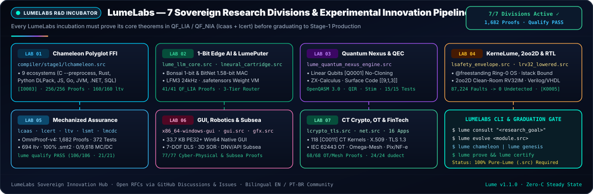
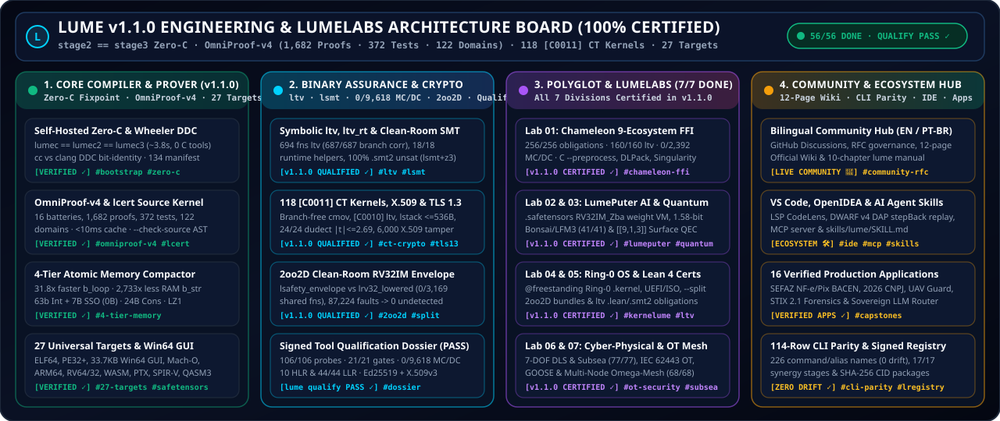

<h1>
  
  LumeLabs R&amp;D Incubator &amp; Global Community Hub
</h1>
<br clear="left"/>

<div align="center">
  
  <br />
  
</div>

---

## 1. LumeLabs Charter &amp; The 7 Research Divisions


[**LumeLabs (`LUMELABS.md`)**](https://github.com/OmegaSoftDLL/lume/blob/main/LUMELABS.md) is the applied research and systems incubation hub of the **Lume Programming Language (`v1.1.0`, Edition 2026)**, developed openly under the **Apache-2.0 License**.

Every LumeLabs module adheres to three engineering invariants:
1. **100% Native Lume (`.src`) Implementation:** Zero Python glue, zero external compiler backends, and zero C seed expansion (`stage2 == stage3` Zero-C fixpoint preserved).
2. **Machine-Checked Proofs &amp; Binary Assurance:** Every invariant is proven by `OmniProof-v4` (`lcaas.src` + `lcert.src --check-source`), with core certified modules achieving **`0 / 9,618` uncovered Masking MC/DC** (`lmcdc.src`) and symbolic machine-code validation (`ltv.src`).
3. **End-to-End Synergy &amp; CLI Parity:** Every command and engine is continuously verified by `lume synergy-gate` (`17/17` stages, `36/36` tamper checks) and `lume cli-parity` (`114` CLI rows, `0` mismatches).

<br clear="right"/>

| Division | Core Modules (`compiler/stage1/`) | Verified `v1.1.0` Production Capabilities | `v1.2.0` Research Horizon |
| :--- | :--- | :--- | :--- |
| **Lab 01 · Chameleon Polyglot &amp; Singularity $\Omega$** | `lchameleon.src` | **`256/256` certified obligations, `160/160` `ltv`, `0/2,392` uncovered MC/DC, `19/19` tests** · 9-ecosystem `[I0003]` FFI, C `--preprocess`, DLPack zero-copy, epoch guards, Singularity $\Omega$ ($\tau_{\max}=T_m/4$) &amp; Bayesian SPC/CUSUM/PAVA | Zero-copy Apache Arrow GPU IPC &amp; automated C++20 template header lifting |
| **Lab 02 · 1-Bit Edge AI, `LumePuter` &amp; Liquid Audio** | `lume_llm_core.src`, `lneural_cartridge.src`, `lume_opentpu_engine.src`, `lume_ncm_engine.src` | **`41/41` LLM core proofs** + `.safetensors` `LumePuter` (`63/63` bit-exact `RV32IM_Zba` + Gated-DeltaNet vectors), `openTPU` (`23/23`), `MS-RVQ` NCM (`19/19`), Bonsai 1-bit / 1.58-bit MAC &amp; `LFM3` 24 kHz audio budgeting | Hardware FPGA bitstream synthesis for `LumePuter` &amp; multi-cartridge MoE routing |
| **Lab 03 · Quantum Nexus &amp; Fault-Tolerant QEC** | `lume_quantum_nexus_engine.src` | **`15/15` tests** · Linear `Qubit` no-cloning (`[Q0001]`), automatic $U^\dagger$ ancilla uncomputation, ZX-calculus spider fusion, $O(n^2)$ Clifford stabilizer simulator, `[[9,1,3]]` surface-code QEC &amp; parameter-shift VQE/QAOA | Higher-distance (`d=5..17`) lattice surgery decoders &amp; hardware pulse-level QIR |
| **Lab 04 · KerneLume Ring-0 OS, `2oo2D` &amp; Silicon RTL** | `lsafety_envelope.src`, `lrv32_lowered.src`, `ltarget.src`, `examples/apps/lume_os` | **Clean-room `2oo2D` RV32IM lockstep** (`0/3,169` shared fns, `87,224` faults → `0` undetected, `--split` bundles), `@freestanding` Ring-0 OS (`[K0005]` `W^X` DMA, `[K0006]`, `lstack`), Verilog/VHDL RTL | Physical dual-board MCU/FPGA `2oo2D` UART/SPI hardware lockstep voter |
| **Lab 05 · Mechanized Soundness &amp; Qualification** | `lcaas.src`, `lcert.src`, `ltv.src`, `ltv_rt.src`, `lsmt.src`, `lmcdc.src`, `lqualify.src` | **`OmniProof-v4` (`1,682` proofs, `372` tests, `122` domains)**, `694` `ltv` fns, `18/18` `ltv_rt`, `100%` `.smt2` `unsat` (`lsmt` + `z3`), `0/9,618` MC/DC &amp; signed **`lume qualify` `PASS`** (`106/106` probes, `21/21` gates) | Mechanized Lean 4 metatheory (`formal/lean/LumeCore.lean`) &amp; PKCS#11 hardware HSM qualification signing |
| **Lab 06 · Native GUI, 7-DOF Robotics &amp; Subsea Physics** | `gui.src`, `gfx.src`, `ltarget.src` | **`77/77` proofs, `15/15` tests** · `33,792` B Win64 PE32+ GUI, conservation-proven `@ui-layout`, 7-DOF DLS kinematics, 3D Laplace SOR, Joseph EKF, IAPWS-IF97 steam, DNV/API catenary, VIV, Bühlmann ZH-L16C &amp; ASME B31G | Cross-platform native Wayland/macOS Cocoa GPU-accelerated studio panes |
| **Lab 07 · Constant-Time Crypto, IEC 62443 OT &amp; Capstones** | `lcrypto_tls.src`, `lx509.src`, `net.src`, `examples/apps/*` | **`118` `[C0011]` CT kernels** (`24/24` `dudect`), Ed25519 X.509v3 (`6,000/6,000`), TLS 1.3, **`68/68` IEC 62443 / GOOSE / Omega-Mesh proofs (`27/27` tests)** &amp; **`16` verified production apps** | Multi-node distributed Omega-Mesh Raft clusters &amp; hybrid post-quantum X.509 chains |

---

## 2. Engineering Architecture Board &amp; Roadmap (`PROJECTS.md`)

<div align="center">
  
</div>

The institutional roadmap in [**`PROJECTS.md`**](https://github.com/OmegaSoftDLL/lume/blob/main/PROJECTS.md) tracks both completed `v1.1.0` capabilities and the `v1.2.0` hardware/formalization horizon:
- **Physical Silicon Lockstep:** Running `lume safety-envelope --split` Channel A and Channel B bundles across physically independent boards connected over framed UART/SPI hardware voters.
- **Hardware-Backed Qualification Keys:** Optional PKCS#11 / hardware HSM key protection and external CA certificate chains for `lume qualify`.
- **Mechanized Metatheory:** Machine-checked Lean 4 soundness proofs for `own_flow.src`, Perceus reuse, and `lsmt.src` `QF_UFNIA` decision rules.
- **Distributed Multi-Node Sovereign Mesh:** Multi-host Omega-Mesh Kademlia/Raft replication with authenticated TLS 1.3 + X.509v3 mutual pinning.

---

## 3. Bilingual (`EN` / `PT-BR`) Community Governance &amp; Contribution Workflow

Lume maintains an inclusive, bilingual **English (`en`)** and **Brazilian Portuguese (`pt-BR`)** engineering community ([`COMMUNITY.md`](https://github.com/OmegaSoftDLL/lume/blob/main/COMMUNITY.md) &amp; [`CONTRIBUTING.md`](https://github.com/OmegaSoftDLL/lume/blob/main/CONTRIBUTING.md)):

1. **Discussions &amp; LumeLabs RFCs:** Propose language features, formal verification rules, target backends, or domain engines in [GitHub Discussions](https://github.com/OmegaSoftDLL/lume/discussions) or via the structured Issue/RFC templates.
2. **Built-In Bilingual Documentation:** Every CLI addition updates `compiler/stage1/lmanual.src` (`lume manual` &amp; `lume manual --pt`), `README.md`, `skills/lume/SKILL.md`, and this Wiki, enforced with zero drift by `./lume cli-parity` (`TOTAL MISMATCHES: 0`).
3. **Pre-Submission Verification Checklist:**

```sh
./lume fmt --check                        # Canonical formatting (pure LF \n, zero tabs)
./lume amalgamate && ./lume bootstrap     # Verify lumec1 == lumec2 == lumec3 bit-identical fixpoint
./lume zero-c                             # Verify compilation with cc/clang/as/ld blocked
./lume cli-parity                         # Confirm 0 CLI/manual/README/SKILL drift
./lume synergy-gate                       # 17/17 cross-module stages + 36/36 tamper rejections
./lume self-prove                         # 16 batteries, 1,682 proofs, 372 unit tests, 122 domains
./lume qualify --verify                   # Verify signed Qualification Dossier integrity
```
