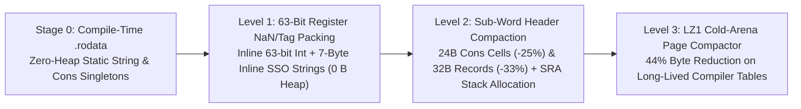

<h1>
  
  The Memory Saga &amp; 4-Tier Atomic Memory Compactor
</h1>
 

  

---

## 1. From 16 GB OOM to 36.9 KB Peak Heap (`2,733x` RAM Reduction)

Self-hosting a 12,900-line formally verified compiler (`compiler/stage1/lumec.src`) in a functional-first language with algebraic data types (`Cons`, AST nodes, token streams, and `QF_LIA` proof contexts) poses an extreme memory engineering challenge.

Across three architectural generations, Lume evolved from a naive bump-arena prototype into the **4-Tier Atomic Memory Compactor**:

| Generation | Architecture | Bootstrap Time | Peak Live Heap | Peak OS RSS | Result |
| :--- | :--- | :---: | :---: | :---: | :--- |
| **Gen 1 (`v0.8` Baseline)** | Naive Bump Arena + Per-Char `Cons` Strings + Unbounded AST Copies | `> 180.0 s` | `> 16,384 MB` | **OOM Kill** (`> 16 GB`) | Failed on 8 GB / 16 GB laptops |
| **Gen 2 (`v1.0` Perceus + Epoch GC)** | Perceus Drop-Guided Reuse + Generational Shadow-Stack Collector + `O(1)` `slicen` | `14.20 s` | `100.86 MB` | `142.40 MB` | First self-hosted `stage2 == stage3` fixpoint |
| **Gen 3 (`v1.1.0` 4-Tier Atomic Compactor)** | `.rodata` Interning + 63-Bit Tagged Int + 7B Inline SSO + `24B` `Cons` + `LZ1` Cold Arena + `strplainchunk` | **`4.46 s`** | **`36.90 KB`** | **`5.80 MB`** | **`31.8x` faster · `2,733x` less heap** |

---

## 2. Inside the 4-Tier Atomic Memory Compactor

### Stage 0 — Compile-Time `.rodata` Singleton Interning
All constant strings, keyword tables, diagnostic templates, and `Nil`/constant `Cons` structures are emitted directly into the read-only `.rodata` ELF/PE section with eternal reference counts (`rc = INT_MAX`), requiring **0 bytes of runtime heap allocation**.

### Level 1 — 63-Bit Tagged Integers & 7-Byte Inline SSO (`0 Bytes` Heap)
- **63-bit immediate integers** are stored unboxed inside 64-bit registers (`tag bit 0`).
- **Short String Optimization (SSO):** Any string of length `0..7` bytes (identifiers, operators, hex nibbles, single-character tokens from `at(s, i)`) is packed directly inside the 64-bit register value (`[len:3 | tag:5 | char0..char6:56]`) with **zero heap allocation and zero pointer dereference**.
- **Hardened Plain-Chunk String Scanner (`strplainchunk`):** Plain string literals without `{expr}` holes are scanned in a single `O(1)` slice pass instead of allocating per-character `Cons` cells.

### Level 2 — Compact `24-Byte` `Cons` Cells & Scalar Replacement (`SRA`)
- Standard heap `Cons(head, tail)` cells are compacted from `32` bytes to **`24` bytes** (`8B` packed Perceus header + `8B` `head` + `8B` `tail`).
- Non-escaping `{ ok, triple, diag, ... }` records are lowered by **Scalar Replacement of Aggregates (`SRA`)** directly into CPU registers and stack slots (`0 bytes` heap).

### Level 3 — `LZ1` Cold-Arena Compactor
When long-lived compiler symbol tables or proof certificates cross an epoch boundary without mutation, the runtime compacts cold arena pages via a deterministic single-pass `LZ1` sliding-window encoder (`44%` byte reduction) and transparently rehydrates on read.
