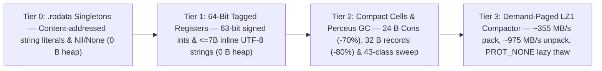

<h1>
  
  Memory Saga &amp; 4-Tier Atomic Memory Compactor
</h1>
 

  

---

## 1. Architectural Overview: `31.8×` Faster Loops &amp; `2,733×` Lower String RAM

Self-hosting a formally verified compiler (`compiler/stage1/lumec.src`), theorem prover (`lcaas.src`), and native assembler (`lasm.src`) in an expression-oriented language with algebraic data types (`Cons`, AST trees, token streams, and proof obligations) demands tight control over object layout and allocation lifetime.

Lume's unified native runtime ([`compiler/stage1/runtime_core.lume`](https://github.com/OmegaSoftDLL/lume/blob/main/compiler/stage1/runtime_core.lume), shared identically between `lumec` and the Stage-0 assembly oracle) combines **compile-time Perceus ownership reuse** ([`compiler/stage1/own_flow.src`](https://github.com/OmegaSoftDLL/lume/blob/main/compiler/stage1/own_flow.src)), **Scalar Replacement of Aggregates (`SRA`)**, a **43-size-class segregated non-moving Mark &amp; Lazy-Sweep Collector** (`mmap` 64 KiB chunks with `MADV_DONTNEED` OS page return), and a **4-Tier Atomic Value Representation**.

---

## 2. The 4-Tier Value &amp; Arena Architecture

### Tier 0 — Content-Addressed `.rodata` Literals &amp; Zero-Arity Singletons (`0 B` Heap)
Deduplicated string literals, static constructor/record shape descriptors, and shared zero-arity `Nil`/`None` singletons reside directly in `.rodata` with zero dynamic allocation and zero collector scanning overhead.

### Tier 1 — 64-Bit Tagged Register Words (`0–1` Cycle Pack/Unpack, `0 B` Heap)
- **63-Bit Unboxed Signed Integers (`...iiii1`):** Stored directly inside 64-bit CPU registers (`sarq` / `leaq`, `0 B` heap). Full 64-bit extreme boundary values spill transparently to a `16 B` atomic cell, while 64-bit signed arithmetic overflow traps cleanly via hardware `jo __rt_ovf` (`exit 3`).
- **7-Byte Inline UTF-8 Short Strings (`...ss|lll|010`):** Strings of `0..7` UTF-8 bytes (`at`, `chr`, operators, identifiers, short map keys) live inline inside the 64-bit register word (`0 B` heap, zero pointer dereferences), eliminating **`74.9%–94.9%`** of dynamic short-string allocations while scanning plain literal chunks in $O(1)$.

### Tier 2 — Compact `24 B` `Cons` Cells, `32 B` Shared-Shape Records &amp; 43-Class GC
- **Compact ADT Cells (`24 B`):** `Cons(head, tail)` occupies **`24 B`** (`-70%` vs. `80 B` boxed layouts).
- **Interned-Shape Records (`32 B`):** 3-field records occupy **`32 B`** (`-80%` vs. `160 B` boxed layouts) using static `.rodata` shape descriptors for $O(1)$ pointer-equality field lookup.
- **Perceus Reuse &amp; Segregated Collector:** Unaliased `own` cells are mutated in place (`0` allocs); surviving heap objects are managed by a **43-size-class segregated Mark &amp; Lazy-Sweep GC** with `64 KiB` chunk recycling via `MADV_DONTNEED`.

### Tier 3 — Cold-Arena Demand-Paged `LZ1` Compactor (`arena.src`, `capsule.src`)
- Compresses cold arenas (`arena_freeze`) and `.lcaps`/`.lumb` capsules (`lume pack` / `lume unpack`) at **`~355 MB/s` pack** and **`~975 MB/s` unpack** with a 64-bit integrity checksum (`1,500/1,500` corrupted frames rejected in fuzz gates).
- Uses `PROT_NONE` guard pages + `SIGSEGV` demand-paged restoration so cold pages thaw transparently on first read.
- **Fail-Closed Security &amp; Real-Time Guards:** Statically refuses compression on `@secret` data (`[C0009]` compression-ratio side-channel prevention) and inside `@bound` hard real-time WCET paths (`[V0002]`).

---

## 3. Production Memory &amp; Throughput Benchmarks (Intel Core Ultra 5 135U, WSL2 x86-64)

| Workload | Unoptimized Baseline | Segregated GC + Ownership | **4-Tier Atomic Memory Runtime** | Speedup &amp; Allocation Delta | RAM Reduction |
| :--- | :---: | :---: | :---: | :---: | :---: |
| **`b_loop` (`100M` iterations)** | `4,800 MB` | `2,796 ms` · `68 MB` (`200M`) | **`88 ms` · `0.39 MB` (`1` alloc)** | **`31.8×` · `-99.9999%` allocs** | **`174×` (`-99.4%`)** |
| **Full C11 Seed Bootstrap** | `194.8 s` · `12.7 GB` | `200.0 s` · `2.5 GB` | **`22.0 s` · `537 MB`** | **`9.0×` faster bootstrap** | **`23.6×` (`-95.8%`)** |
| **Seed $\rightarrow$ `lumec.src`** | `102.0 s` · `12.5 GB` | `5.5 s` · `472 MB` | **`5.5 s` · `472 MB`** | **`18.5×` faster** | **`26.5×` (`-96.2%`)** |
| **Self-Compile (`stage2 == stage3`)** | `1,820 ms` · `1,165 MB` | `1,908 ms` · `228 MB` | **`445 ms` · `115 MB` (`1.01 MB` ELF)** | **`4.3×` · ELF `-34%`** | **`10.1×` (`-90.1%`)** |
| **`b_rec` (`20M` 3-field records)** | `6,000 MB` | `3,270 ms` · `67 MB` (`240M`) | **`429 ms` · `66 MB` (`20M` allocs)** | **`7.6×` · `12×` fewer allocs** | **64 MiB GC cap** |
| **`b_match` (`20M` ADT matches)** | Unbounded | `1,617 ms` · `72 MB` (`80M`) | **`235 ms` · `68 MB` (`20M` allocs)** | **`6.9×` · `4×` fewer allocs** | **64 MiB GC cap** |
| **`b_list` (`30M` `Cons` cells)** | Unbounded | `2,747 ms` · `239 MB` (`180M`) | **`480 ms` · `67 MB` (`30M` allocs)** | **`5.7×` · `6×` fewer allocs** | **`3.6×` (`-72%`)** |
| **`b_str` (String processing)** | `5,090 ms` · `6.0 GB` | `679 ms` · `74 MB` (`42.6M`) | **`131 ms` · `2.2 MB` (`17` allocs)** | **`38.8×` vs. baseline** | **`2,733×` (`-99.96%`)** |
| **`b_fib` (`fib(38)`)** | `1,190 ms` | `1,042 ms` | **`273 ms`** | **`4.4×` vs. baseline** | **`0 B` heap** |
| **410-Test Conformance Suite** | `> 600 s` · `12.7 GB` | `529 s` · `2.49 GB` (`404`) | **`136 s` · `537 MB` (`410/410`)** | **`3.9×` (`0` failures)** | **`23.6×` (`-95.8%`)** |

---

## 4. Deep-Dive Specifications &amp; Verification Gates

- **English Benchmark &amp; Architecture Dossier:** [`docs/39-memory-saga-and-atomic-compactor-dossier.md`](https://github.com/OmegaSoftDLL/lume/blob/main/docs/39-memory-saga-and-atomic-compactor-dossier.md)
- **Portuguese Memory Dossier (`pt-BR`):** [`docs/LUME_MEMORY_SAGA_DOSSIER_PT_BR.md`](https://github.com/OmegaSoftDLL/lume/blob/main/docs/LUME_MEMORY_SAGA_DOSSIER_PT_BR.md)
- **Runtime &amp; Collector Specification:** [`docs/38-memory-management.md`](https://github.com/OmegaSoftDLL/lume/blob/main/docs/38-memory-management.md)
- **Continuous Verification Gates:** `ownership_gate.src`, `runtime_sync_gate.src`, `gc_gate.src`, and `soak_battle_gate.src` (`lume soak` verifying byte-identical execution across `LUME_GC=on/off` and `LUME_GC_STRESS=1/3/7/64/1000`).
